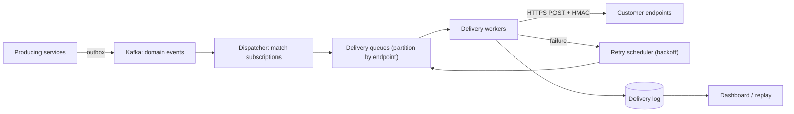
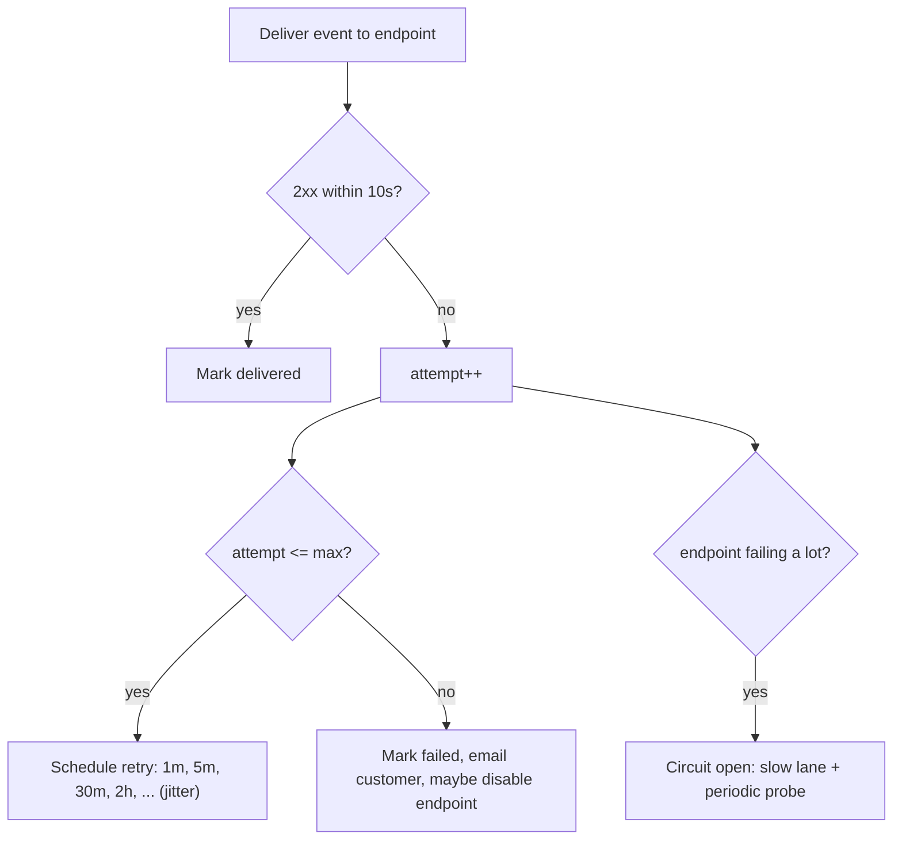

# 47 · Design Webhook Delivery Service

| Category | Difficulty | Key ideas |
|---|---|---|
| Job / delivery | Medium | per-endpoint isolation, retries over days, circuit breakers, HMAC signatures, SSRF defences |

Deliver events to thousands of customer-owned HTTP endpoints reliably - while those endpoints are slow, flaky, or down.
Related: [Notification System (Push, SMS, Email)](07-notification-system.md), [Distributed Job Scheduler](32-distributed-job-scheduler.md), Fundamentals -> Message Queues, Reliability, Security.

---

## Architecture at a glance



### Key flow



---

## Requirements
- **Functional:** customers register endpoint URLs & choose event types; when an event occurs (payment succeeded), POST a JSON payload to each subscribed endpoint; retries with backoff for failures; delivery logs & manual replay; signing secret per endpoint.
- **Non-functional:** **at-least-once** delivery; events should arrive within seconds normally; one slow/broken customer must not delay others; scale to 100K events/s fan-out; secure.

---

## Design
```
Producers (payment service, etc.) ─outbox─► Kafka: domain events
     ▼
Dispatcher: for each event, look up subscriptions (cached) → create delivery tasks
     ▼
Delivery queue (partitioned by endpoint_id)  ─► Delivery workers ─HTTPS POST─► Customer endpoints
     │                                              │
     │                     failure → Retry scheduler (delayed queue / sorted set by next_attempt_at)
     ▼                                              ▼
Deliveries DB (event_id, endpoint_id, attempts, status, response code, latency) ─► Dashboard / replay API
```

---

## Deep dives

### Isolation between customers Easy
- Partition tasks by `endpoint_id` and apply **per-endpoint concurrency limits & rate limits**.
- If an endpoint keeps failing/timing out, mark it **degraded** -> move its traffic to a separate slow lane; **circuit breaker** pauses deliveries and probes periodically.
- Short HTTP timeouts (e.g., 5-10 s) so workers aren't tied up.

### Retries
Exponential backoff with jitter over a long window (e.g., up to 3 days: 1m, 5m, 30m, 2h, ...). After the final attempt -> mark failed, notify the customer (email), auto-disable endpoint after repeated failures. Manual "resend" from dashboard.

### Ordering & duplicates
- At-least-once -> duplicates possible; include a unique `event_id` so receivers dedupe (documented contract).
- Strict ordering is usually **not** guaranteed (retries reorder); include `created_at`/sequence so consumers can reconcile, or offer optional per-endpoint ordered delivery (one in-flight at a time - slower).

### Security
- **HMAC signature** header: `Signature: t=timestamp, v1=HMAC_SHA256(secret, timestamp + "." + body)` -> receiver verifies authenticity & rejects old timestamps (replay protection).
- **SSRF protection**: endpoints are user-supplied URLs -> block private IP ranges/metadata IPs, resolve DNS and validate before connecting, use egress proxies with fixed IPs (customers can allowlist them).
- HTTPS only; secrets rotatable.

### Payload strategy
Thin events (`{type, id}` -> receiver fetches latest via API) vs fat events (full object). Fat is convenient; thin avoids stale/out-of-order data issues and limits sensitive data exposure.

### Observability
Per-endpoint success rate, latency, queue backlog; customer-facing delivery logs with request/response bodies (truncated, retained N days).

---

## Points to mention in an interview
- Outbox -> Kafka -> dispatcher -> per-endpoint partitioned delivery queues.
- Backoff retries over days, circuit breakers & slow lanes so bad endpoints don't hurt others.
- At-least-once with event ids for dedupe; HMAC signatures; SSRF defences.

---

## Interview Q&A

**Q: Why partition by endpoint?**
A: Isolation - a slow customer can't consume all workers.

**Q: How do receivers trust the webhook?**
A: HMAC-SHA256 signature over timestamp + body with a per-endpoint secret; reject old timestamps.
