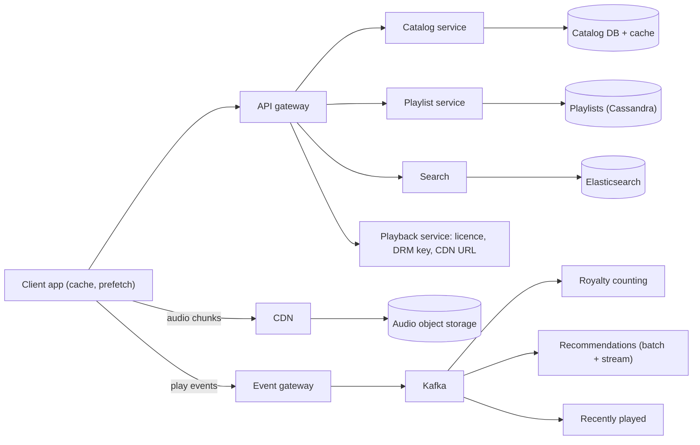
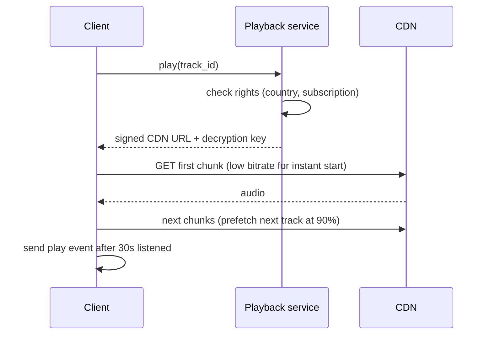

# 48 · Design Spotify (Music Streaming)

> **Category:** Media delivery · **Difficulty:** ⭐⭐⭐ · **Patterns:** CDN for audio, small-file streaming, offline downloads with DRM, playlist service, play-event pipeline

---

## 1. TL;DR
Audio files (~3–10 MB per song in several bitrates) live in **object storage** behind a **CDN**; the client streams/prefetches them in chunks. Catalog, playlists and user libraries are served by stateless services over sharded databases with heavy caching. **Play events** flow through Kafka for royalties, recommendations ("Discover Weekly") and analytics.

---

## 2. Requirements
| Functional | Non-functional |
|---|---|
| Search & play songs, albums, podcasts | Playback start < 200 ms, no gaps |
| Playlists (create/share/collaborate) | 500M MAU, 100M songs |
| Offline downloads (premium) | Highly available, global |
| Recommendations, recently played | Accurate play counts (royalties!) |

### Estimates
100M songs × 3 bitrates × ~5 MB ≈ **1.5 PB** audio (small vs. video). Streams: 200M DAU × 2 h ≈ 50M concurrent at peak × 160 kbps ≈ **8 Tbps** → CDN.

---

## 3. Architecture

## 4. Playback flow

---

## 5. Deep dives
- **Instant start & gapless:** start with a small low-bitrate chunk, upgrade quality; prefetch the next song before the current ends; local disk cache of recently played tracks.
- **Offline:** encrypted files on device; keys tied to device & subscription; must re-verify online every 30 days.
- **Royalties:** a "stream" counts after 30 s; events deduped by (user, track, timestamp), aggregated per track/country/day with exactly-once pipeline and reconciliation (see [Ad click aggregation](18-ad-click-aggregation.md)).
- **Playlists:** small, read-heavy; collaborative playlists need ordering → per-playlist version numbers, last-writer-wins per item.
- **Search:** Elasticsearch with typo tolerance, popularity boosts.
- **Recommendations:** collaborative filtering + audio embeddings, weekly batch playlists, real-time session signals.
- **Licensing:** per-country availability rules checked at play time and filtered in search.

---

## 6. Interview Q&A
**Q: How does music differ from video streaming?** Files are much smaller (no ABR ladder of segments needed in the same way), so whole-file or few-chunk downloads, aggressive prefetch and client caching work well.

**Q: How do you count plays accurately for payouts?** Client events → Kafka → dedupe + 30 s rule → exactly-once aggregation → nightly reconciliation.

**Q: Where's most of the cost?** CDN egress and licensing; caching on device and at ISP edges reduces egress.

---

**Related:** [YouTube](11-youtube.md) · [Netflix](46-netflix.md) · [Recommendation system](43-recommendation-system.md) · [CDN](52-cdn.md)
