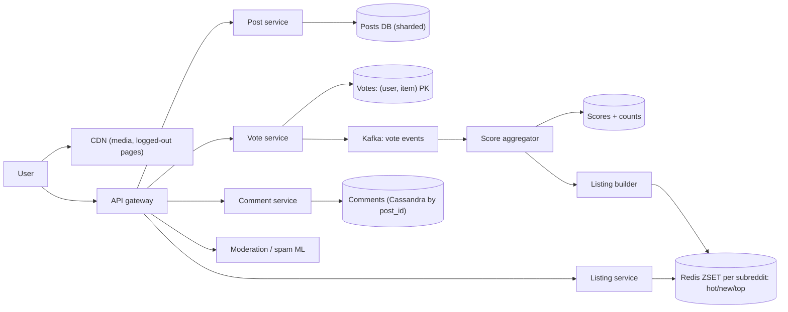
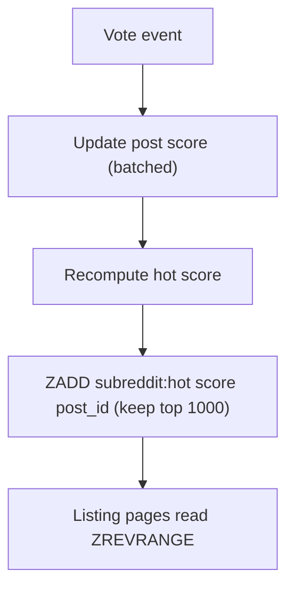

# 49 · Design Reddit (Communities, Voting, Nested Comments)

| Category | Difficulty | Key ideas |
|---|---|---|
| Social / ranking | Medium | vote counters, time-decay ranking (hot score), precomputed listings, nested comment trees, caching |

---

## Summary
Posts belong to **subreddits**; users **vote**, and listings (hot, new, top) are **precomputed** per subreddit using a time-decayed score and cached (Redis sorted sets). Votes are idempotent per user and aggregated asynchronously. Comments form a **tree**, stored with parent pointers (or materialized paths) and rendered by loading the top of the tree, sorted by score, with "load more" for deep branches.

---

## Requirements
| Functional | Non-functional |
|---|---|
| Create subreddits, posts (text/link/media) | Read-heavy, fast listing pages |
| Upvote/downvote posts & comments | 50M DAU, popular threads with 50K+ comments |
| Hot / New / Top listings, home feed of joined subs | Vote counts eventually consistent |
| Nested comments | Moderation tools |

---

## Architecture



---

## Ranking: the "hot" score
```
score = upvotes - downvotes
order = log10(max(|score|, 1))
sign  = 1 if score > 0, -1 if < 0, else 0
hot   = sign * order + (post_epoch_seconds - 1134028003) / 45000
```
Every 12.5 hours of age is worth 10× votes -> new posts can outrank old ones. Hot scores only change when votes arrive, so they're recomputed on vote events and stored in a **sorted set per subreddit** (top 1,000 posts).



**Home feed:** merge top posts of the user's joined subreddits (k-way merge of sorted sets), cached briefly per user.

---

## Votes
- `votes(user_id, item_id, value ∈ {-1, 0, +1})` primary key -> changing a vote is an upsert; delta (e.g., -1 -> +1 = +2) is emitted as an event.
- Counters aggregated asynchronously (see [Distributed counter](42-distributed-counter.md)); display counts are approximate ("vote fuzzing" also deters bots).
- Anti-manipulation: rate limits, account age/karma thresholds, bot detection.

---

## Comment trees
| Storage approach | How | Good for |
|---|---|---|
| Adjacency list | `parent_id` column | Simple writes; build tree in app |
| Materialized path | `path = "001.004.017"` sortable | Load subtree with prefix range scan |
| Closure table | Ancestor/descendant pairs | Complex queries, heavy writes |

Typical approach: comments stored per `post_id` (one partition), fetch top-level comments sorted by "best" score + first few replies, lazily load deeper branches ("continue this thread"). Cache rendered comment trees for hot posts; invalidate/patch on new comments.

---

## Interview Q&A
**Q: Why precompute listings?**
A: Sorting all posts on every page view is too expensive; scores change only on votes.

**Q: How do you handle a viral thread with 100K comments?**
A: Paginate the tree, cache the top portion, sort by best (Wilson score), load more on demand.

**Q: Why are vote counts not exact?**
A: Async aggregation + intentional fuzzing; exactness isn't needed and protects against manipulation.

---

**Related:** [News feed](08-news-feed-system.md) · [Distributed counter](42-distributed-counter.md) · [Top-K](34-top-k-heavy-hitters.md)
