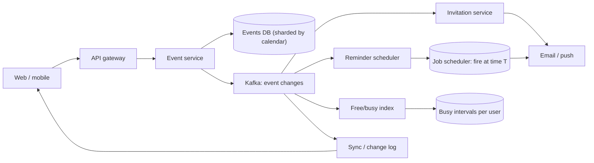
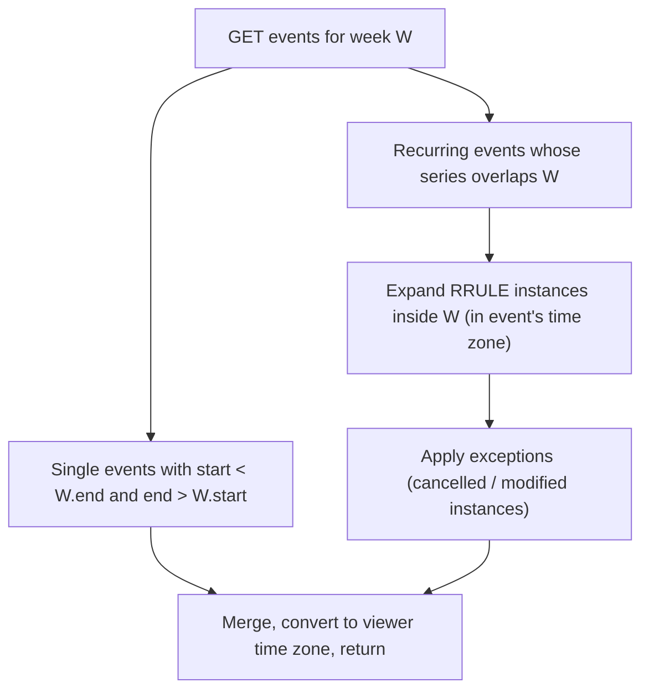

# 50 · Design Google Calendar (Events, Invites, Reminders)

> **Category:** Scheduling / CRUD at scale · **Difficulty:** ⭐⭐⭐ · **Patterns:** recurring events (RRULE), time-range queries, free/busy, reminder scheduling, sync via change tokens

---

## 1. TL;DR
Store events per calendar with **start/end in UTC + the original time zone**; recurring events store a **recurrence rule (RRULE)** plus **exceptions**, and are **expanded at read time** for the requested window. Invites create attendee entries and notify via email/push. **Reminders** are scheduled in a distributed job scheduler. Clients sync incrementally with **sync tokens**.

---

## 2. Requirements
| Functional | Non-functional |
|---|---|
| Create/update/delete events, recurring events | Low-latency calendar views (week/month) |
| Invite attendees, RSVP | Strong consistency for a user's own edits |
| Free/busy lookup, find a meeting time | 500M users, reminders on time (±1 min) |
| Reminders (email/push) | Multi-device sync |

---

## 3. Data model
```
calendar(calendar_id, owner_id, timezone, acl)
event(event_id, calendar_id, start_utc, end_utc, tz, title, location,
      rrule, recurrence_end_utc, organizer_id, version)
event_exception(event_id, original_start_utc, status [cancelled|modified], override_fields)
attendee(event_id, user_id, rsvp [needs_action|yes|no|maybe])
reminder(event_id, user_id, minutes_before, method)
```
Partition by `calendar_id`; index `(calendar_id, start_utc)` plus `recurrence_end_utc` for recurring events.

---

## 4. Architecture



---

## 5. Reading a week view

Why expand at read time? "Every Monday forever" can't be materialized infinitely; editing the series updates one row.

**Time zones & DST:** store the event's tz; "9:00 every Monday in New York" must stay 9:00 local after DST changes, so expand in local time, then convert to UTC.

---

## 6. Deep dives
- **Edit "this and following" events:** split the series: end the old RRULE before the date, create a new series from that date.
- **Invites:** attendees get a copy/reference of the event in their calendar; organizer's version is the source of truth; RSVP updates sent back.
- **Free/busy & find-a-time:** maintain busy intervals per user (materialized for the next N weeks); intersect attendees' free slots; respect privacy (busy only, no details).
- **Reminders:** on create/update, (re)schedule jobs for upcoming instances (rolling window, e.g., next 30 days); idempotent fire with `(event_id, instance_start, user)` key. See [Job scheduler](32-distributed-job-scheduler.md).
- **Sync:** per-calendar change log; clients call `list?syncToken=…` to fetch only changes (CalDAV/ICS for interoperability).
- **Conflicts:** optimistic concurrency with `version` (ETag) on update.

---

## 7. Interview Q&A
**Q: How do you store recurring events?** RRULE + exceptions, expanded for the requested range.

**Q: Reminder for an event 2 years away?** Don't schedule it now; a rolling-window job schedules reminders for instances in the next 30 days.

**Q: How do you make "find a time" fast for 10 attendees?** Precomputed busy intervals per user + interval intersection (merge sorted intervals).

---

**Related:** [Job scheduler](32-distributed-job-scheduler.md) · [Notification system](07-notification-system.md) · [Time & clocks](../01-fundamentals/20-time-clocks-and-ordering.md)
