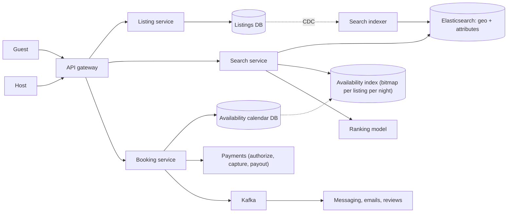
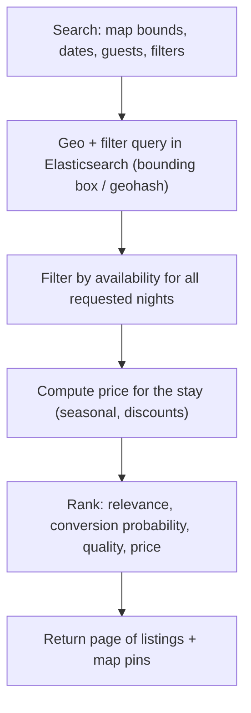
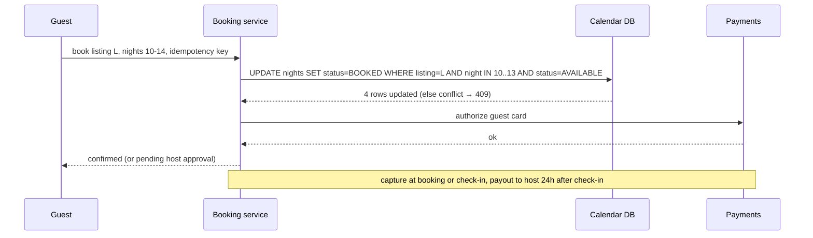

# 51 · Design Airbnb (Listings Search & Booking)

| Category | Difficulty | Key ideas |
|---|---|---|
| Geo search + booking | Hard | geo + date-availability search, availability calendar per listing, booking with holds, two-sided payments, search ranking |

---

## Summary
Hosts create **listings**; guests **search** by location + dates + guests + filters. Search uses an **Elasticsearch** geo index combined with an **availability index** (which listings are free on the requested nights). Booking reserves the nights in a **per-listing availability calendar** with an atomic conditional update, takes payment (authorize then capture), and pays out the host after check-in.

---

## Requirements
| Functional | Non-functional |
|---|---|
| Host: create listing, set calendar & price | Search < 300 ms |
| Guest: search by map area/city, dates, filters | No double booking |
| Book (instant or request-to-book), pay, cancel | 7M listings, 100M searches/day, ~2M bookings/day |
| Reviews, messaging hostvsguest | Highly available search; consistent booking |

---

## Architecture

---

## Search flow

Availability per listing as a **bitset of the next 365 nights** (46 bytes) -> "free for nights d1..dn" is a fast bitmask check; kept in Redis or inside the search document (updated via events).

---

## Booking flow

Request-to-book: hold the nights with a TTL until the host accepts (24 h), release on decline/expiry.

---

## Deep dives
- **Calendar table:** `(listing_id, night) -> status, price, booking_id` - shard by listing_id so a booking is a single-shard transaction.
- **Calendar sync with other platforms** (iCal) - periodic import; conflicts resolved by blocking nights.
- **Search ranking:** ML model predicting booking probability; diversity; new-listing boost.
- **Pricing:** base + seasonal + length-of-stay discounts + fees + taxes; quote locked for checkout.
- **Payments:** multi-currency, split payouts, refunds by cancellation policy - ledger as in [Payment system](23-payment-system.md).
- **Trust & safety:** identity verification, fraud scoring, review integrity.

---

## Interview Q&A
**Q: How do you combine "near here" and "free on these dates"?**
A: Geo/filters in the search index, then availability bitmask filter (or availability stored as nested field) before ranking.

**Q: How do you prevent double booking?**
A: Atomic conditional update of all nights in one transaction on the listing's shard + idempotency keys.

**Q: Hotel reservation vs Airbnb?**
A: Hotels sell many identical rooms per type (counter); Airbnb listings are unique units (per-night status).

---

**Related:** [Hotel reservation](19-hotel-reservation.md) · [Proximity service](13-proximity-service.md) · [Search systems](../01-fundamentals/19-search-systems-and-inverted-index.md)
