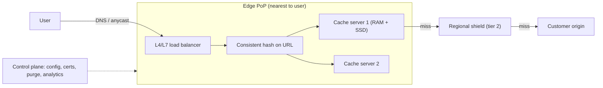
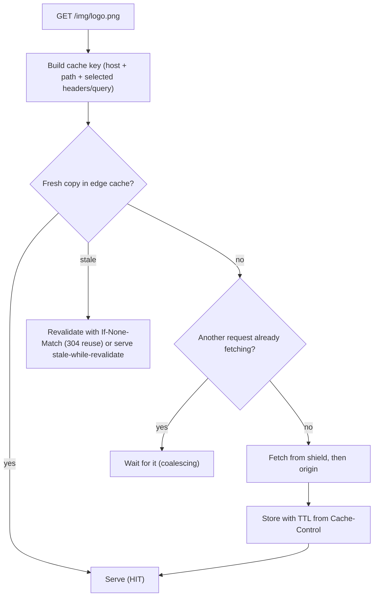

# 52 · Design a Content Delivery Network (CDN)

| Category | Difficulty | Key ideas |
|---|---|---|
| Edge infrastructure | Hard | anycast / GeoDNS routing, tiered caching, consistent hashing inside a PoP, request coalescing, purge propagation |

---

## Summary
Deploy **Points of Presence (PoPs)** worldwide. Route users to the nearest healthy PoP with **anycast** or **GeoDNS**. Inside a PoP, a load balancer spreads requests and **consistent hashing** maps each URL to the cache server that owns it. Misses go up a **tiered cache** (edge -> regional shield -> origin) with **request coalescing** so the origin sees one request per object. Support TTLs, cache keys, **purges** propagated globally, TLS at the edge, and DDoS absorption.

---

## Requirements
| Functional | Non-functional |
|---|---|
| Cache & serve static content (images, JS, video segments) | Low latency (< 50 ms to edge) |
| Respect cache headers; custom rules | 99.99%+ availability |
| Purge/invalidate content | Tbps of egress, millions of RPS |
| TLS termination with customer certificates | Protect origins from overload/DDoS |

---

## Architecture

---

## Request flow

---

## Deep dives
- **Routing:** anycast (same IP everywhere, BGP picks nearest; fast failover) vs GeoDNS (DNS answers per resolver location; TTL-bound failover).
- **Cache storage:** hot objects in RAM, warm on SSD; eviction LRU/LFU-variants; large files cached in ranges (video segments).
- **Tiered caching / origin shield:** fewer origin requests, higher hit ratio for long-tail content.
- **Cache key design:** include only what changes content (strip tracking params; `Vary` on encoding/language).
- **Invalidation:** versioned URLs (best), or purge API -> control plane fans out to all PoPs within seconds (pub/sub), soft purge marks stale.
- **Dynamic content:** edge compute, short TTLs, `stale-while-revalidate`, connection reuse to origin (TCP/TLS kept warm).
- **Security:** TLS termination with SNI certs, WAF rules, rate limiting, DDoS absorption across anycast network.
- **Observability:** hit ratio, origin offload, p95 latency per PoP, error rates; logs streamed to customers.

---

## Interview Q&A
**Q: How does a CDN pick the server for a URL inside a PoP?**
A: Consistent hashing on the cache key so each object is stored once per PoP and adding servers moves few objects.

**Q: How do you protect the origin when a popular object expires?**
A: Request coalescing + stale-while-revalidate + origin shield.

**Q: Push vs pull CDN?**
A: Pull fetches on first miss (simple); push pre-loads content (large files, predictable launches).

---

**Related:** [Networking](../01-fundamentals/01-networking-basics.md) · [Caching](../01-fundamentals/07-caching-deep-dive.md) · [Consistent hashing](02-consistent-hashing.md) · [Netflix](46-netflix.md)
