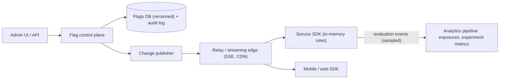
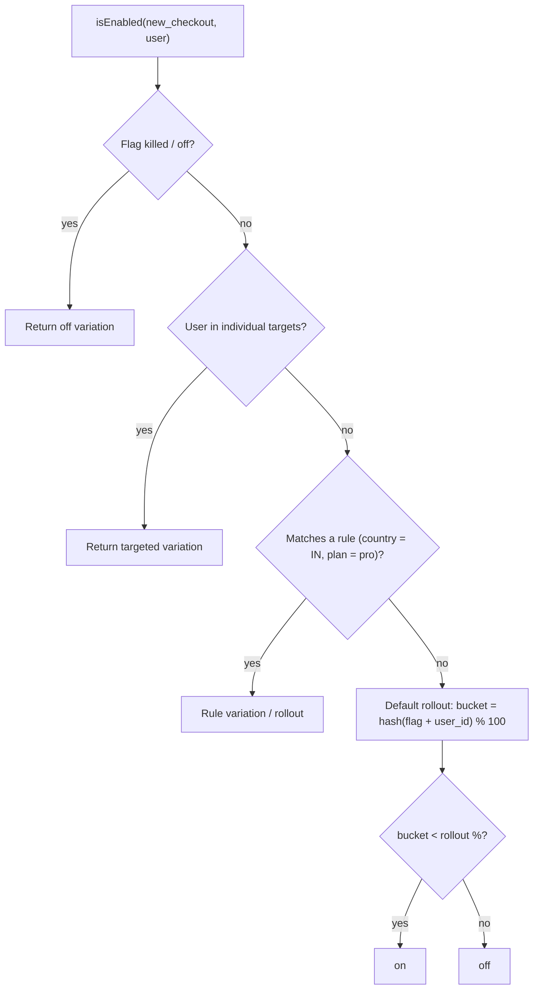

# 53 · Design a Feature Flag / Remote Config Service (LaunchDarkly-like)

> **Category:** Platform infrastructure · **Difficulty:** ⭐⭐⭐ · **Patterns:** local evaluation in SDKs, streaming config updates, consistent percentage rollouts via hashing, audit log, fail-safe defaults

---

## 1. TL;DR
Flags and targeting rules are edited in a **control plane** (versioned, audited) and **pushed** to SDKs in every service/app via streaming (SSE) through a CDN/relay layer. SDKs keep the whole ruleset **in memory** and evaluate flags **locally** in microseconds — no network call per check. Percentage rollouts use `hash(flag_key + user_id) % 100` so users get **sticky** assignments. If the flag service is down, SDKs use the last known config or safe defaults.

---

## 2. Requirements
| Functional | Non-functional |
|---|---|
| Boolean / multivariate flags | Evaluation < 1 ms, never blocks the app |
| Targeting: users, segments, %, attributes | Config changes propagate in seconds |
| Gradual rollout, kill switch, experiments | Survives service outage (fail static) |
| Audit history, approvals | Millions of evaluations/s across fleets |

---

## 3. Architecture

## 4. Evaluation

Hash-based bucketing is deterministic → a user stays in the same bucket as the percentage grows 1% → 10% → 50%.

---

## 5. Deep dives
- **Propagation:** SDK connects to streaming endpoint; on change, receives the new flag version (or a "changed" ping then fetches). Polling fallback every 30–60 s.
- **Client-side (mobile/web) SDKs:** can't hold all rules (privacy, size) → server evaluates for that user and returns only their flag values.
- **Consistency:** versions per flag; SDK ignores older versions arriving late.
- **Safety:** approvals for production changes, scheduled changes, automatic rollback on metric regressions, stale-flag cleanup reminders.
- **Experiments:** log exposure events (user saw variation B) → join with business metrics → statistical analysis.

---

## 6. Interview Q&A
**Q: Why evaluate locally instead of calling an API per check?** A network call per `if` would add latency and make every service depend on the flag service's availability.

**Q: How are percentage rollouts sticky?** Deterministic hash of (flag key, user ID) into 0–99 buckets.

**Q: What happens if the flag service is down at startup?** SDK uses a bundled/bootstrapped config or code defaults; updates resume when connectivity returns.

---

**Related:** [Reliability: deployment safety](../01-fundamentals/13-reliability-and-resilience-patterns.md) · [Distributed lock / config service](44-distributed-lock-service.md)
