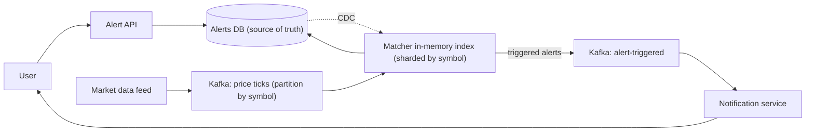
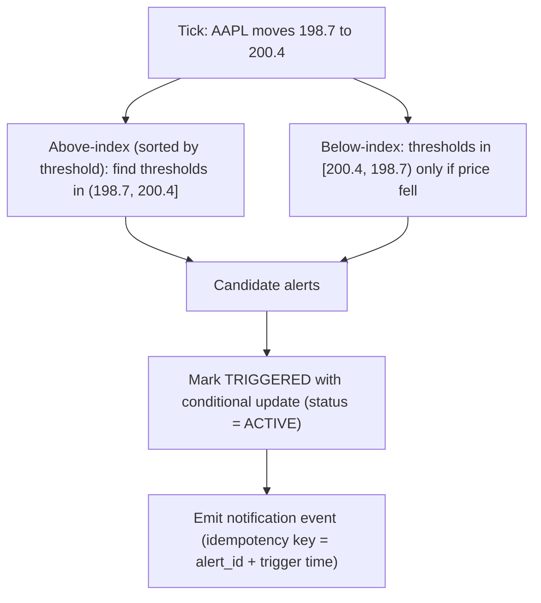

# 54 · Design a Price Alert System (stock / crypto / flight price alerts)

> **Category:** Event matching + notifications · **Difficulty:** ⭐⭐⭐ · **Patterns:** inverted matching (price → alerts), sorted thresholds per symbol, stream processing, dedupe & idempotent notifications

---

## 1. TL;DR
Users create alerts like "notify me when AAPL ≥ $200". Instead of checking every alert on every tick, **index alerts by symbol** in two **sorted structures** (above-thresholds and below-thresholds). When a price update arrives, a range query finds exactly the alerts crossed since the last price, marks them triggered (idempotently), and sends notifications through the notification pipeline.

---

## 2. Requirements
| Functional | Non-functional |
|---|---|
| Create/delete alerts: symbol, condition (≥, ≤, % change), one-time or recurring | Alert fires within seconds of the price crossing |
| Notifications via push/email/SMS | 100M alerts, 10K symbols, 100K price ticks/s |
| | No duplicate notifications for one-time alerts |

---

## 3. Architecture

## 4. Matching per symbol

Range query on a sorted map/skip list → O(log n + k). Each matcher shard owns a set of symbols (Kafka partition by symbol) → ordered ticks per symbol.

---

## 5. Deep dives
- **Recovery:** matcher state rebuilt from Alerts DB + last processed offset; ticks replayed from Kafka.
- **Price jitter:** hysteresis / cooldown for recurring alerts (don't fire 50 times while price oscillates around the threshold).
- **Percent-change alerts:** maintain rolling window baselines per symbol (stream processing).
- **Hot symbols:** many alerts on one symbol live on one shard — fine since lookup is a range query; split symbol's alert list across sub-shards if needed.
- **Notification storms:** big market move triggers millions of alerts → queue + rate-limited senders, priority for paid users.

---

## 6. Interview Q&A
**Q: Why not scan all alerts on every tick?** 100M alerts × 100K ticks/s is impossible; index by symbol and threshold so each tick touches only crossed alerts.

**Q: How do you avoid duplicate notifications?** Conditional status transition ACTIVE → TRIGGERED and idempotency keys in the notification pipeline.

---

**Related:** [Stock exchange](25-stock-exchange.md) · [Notification system](07-notification-system.md) · [Message queues](../01-fundamentals/11-message-queues-pub-sub-and-event-streaming.md)
