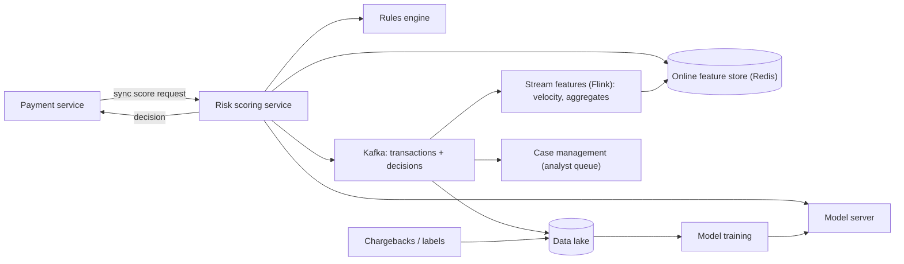
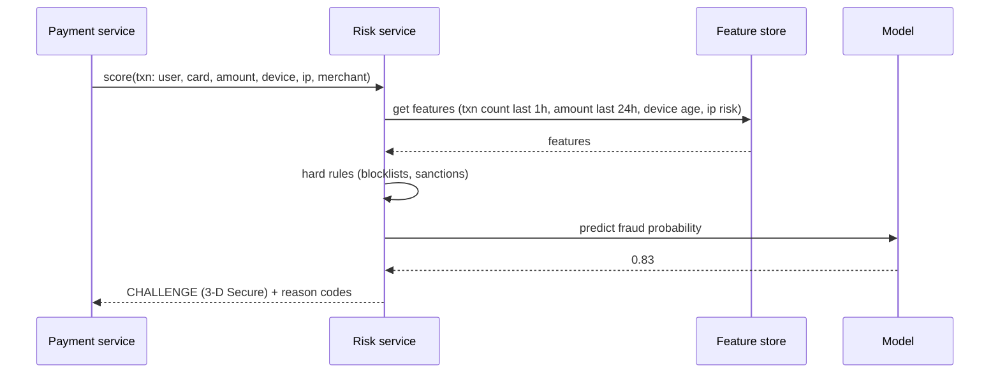

# 55 · Design a Real-Time Fraud Detection System (payments)

| Category | Difficulty | Key ideas |
|---|---|---|
| ML + streaming | Hard | synchronous risk scoring with tight latency budget, real-time features from streams, rules + ML, feedback loops, case management |

---

## Summary
Every payment calls a **risk service** synchronously (budget ~50-100 ms). It fetches **real-time features** (velocity counters, device/IP reputation, user history) from an online **feature store**, runs **rules** plus an **ML model**, and returns **approve / challenge (3-D Secure, OTP) / decline**. All decisions and later outcomes (chargebacks) flow into Kafka for **feature computation**, **model retraining**, and **analyst case review**.

---

## Requirements
| Functional | Non-functional |
|---|---|
| Score each transaction (approve / review / decline / step-up auth) | p99 < 100 ms (on the payment critical path) |
| Rules editable by analysts without deploys | 10K-50K TPS |
| Case management for manual review | High availability - fail to a safe default |
| Learn from chargebacks/feedback | Explainable decisions (compliance) |

---

## Architecture

## Scoring flow

---

## Deep dives
- **Real-time features:** counters per card/user/device/IP over sliding windows (1 min, 1 h, 24 h), distinct cards per device, geo-velocity ("two countries in 10 min"); computed by streaming jobs, stored in Redis with TTL.
- **Graph signals:** shared devices/addresses linking accounts into fraud rings (batch graph analysis feeding features).
- **Rules + ML:** rules for known patterns and compliance; ML for unknown patterns; thresholds tuned to business cost of false positives vs fraud losses.
- **Latency budget:** parallel feature fetches, model served in-process or via low-latency server, timeouts with fallback (rules only).
- **Feedback loop:** labels arrive weeks later (chargebacks) -> careful training windows; monitor drift.
- **Shadow mode:** new models score in parallel without affecting decisions before rollout.

---

## Interview Q&A
**Q: What if the risk service is down?**
A: Fail to a default policy: approve low-amount, low-risk segments; decline/queue others - decided by business.

**Q: Why synchronous scoring if it's on the critical path?**
A: Fraud must be stopped before money moves; async analysis is used for post-transaction review and account-level actions.

---

**Related:** [Payment system](23-payment-system.md) · [Batch & stream processing](../01-fundamentals/17-batch-and-stream-processing.md) · [Recommendation system (feature store)](43-recommendation-system.md)
