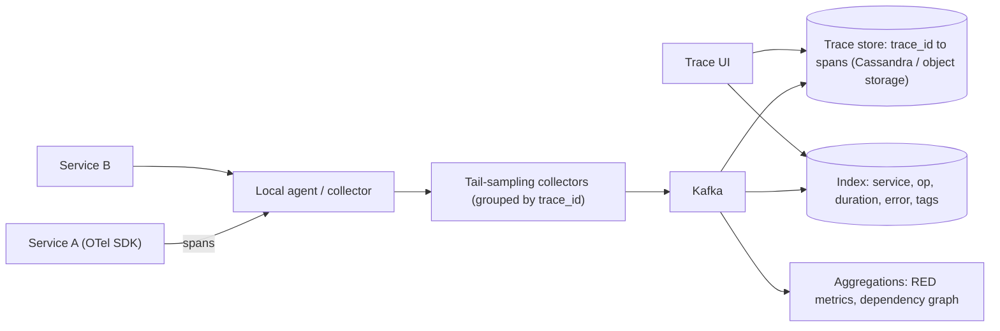
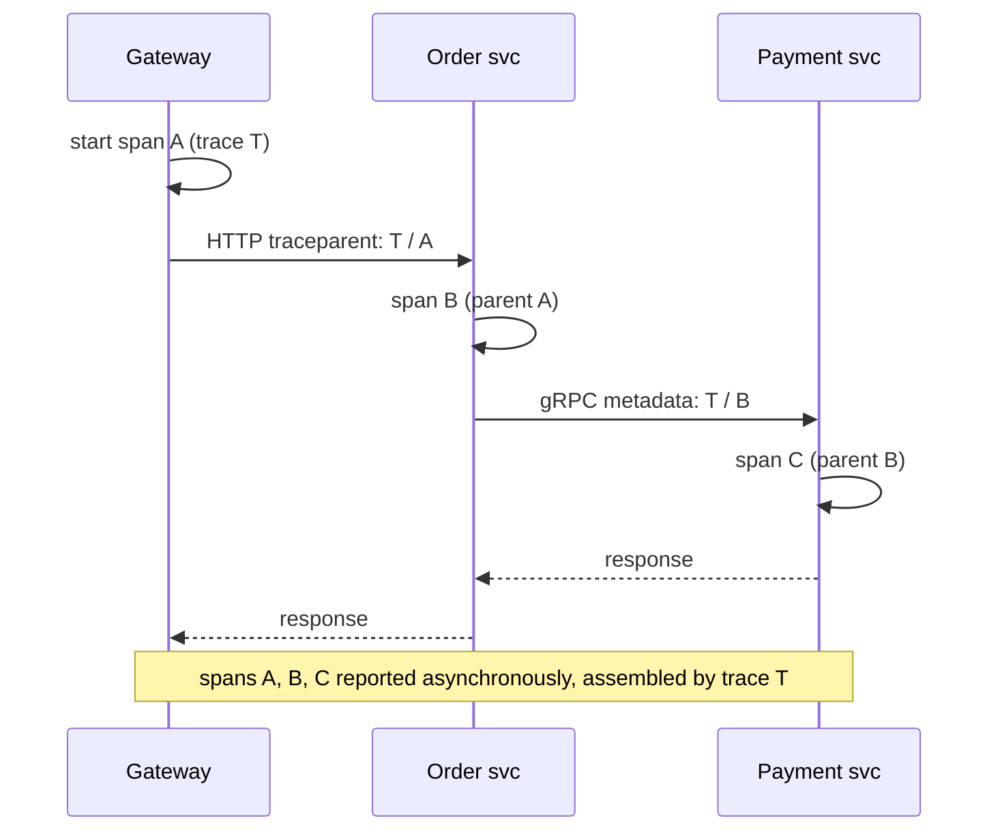

# 56 · Design a Distributed Tracing System (Jaeger / Zipkin / Dapper)

> **Category:** Observability infrastructure · **Difficulty:** ⭐⭐⭐⭐ · **Patterns:** context propagation, spans, head vs tail sampling, collectors + Kafka, trace storage by trace ID

---

## 1. TL;DR
Every request gets a **trace ID**; each unit of work creates a **span** (trace ID, span ID, parent span ID, timings, tags). Context is **propagated** via headers (W3C `traceparent`) across services and queues. SDKs (OpenTelemetry) send spans to local **agents/collectors**, which **sample**, batch and push to **Kafka** → storage keyed by **trace ID** (plus indexes on service, operation, duration, errors). A UI assembles the span tree into a waterfall.

---

## 2. Requirements
| Functional | Non-functional |
|---|---|
| Trace a request across 100s of services | < 1% overhead on services |
| Search traces by service, latency, error, tags | Millions of spans/s |
| Service dependency graph | Keep error/slow traces; sample the rest |

---

## 3. Architecture

## 4. Context propagation

---

## 5. Sampling
| Strategy | How | ✅ | ❌ |
|---|---|---|---|
| Head-based | Decide at trace start (e.g., 1%) and propagate the decision | Cheap, simple | Misses rare errors/slow traces |
| **Tail-based** | Buffer all spans of a trace briefly, decide after it completes (keep errors, slow, 1% of normal) | Keeps interesting traces | Needs routing all spans of a trace to the same collector (hash on trace_id), memory |
| Adaptive | Per-service rates to cap volume | Fair across services | More complex |

---

## 6. Deep dives
- **Low overhead:** async, batched export; in-memory ring buffers; drop spans rather than block.
- **Async boundaries:** propagate context in message headers (Kafka) — spans link via "follows-from".
- **Storage:** write-heavy, read by trace ID → wide-column or object storage with trace-ID partitioning; TTL 7–30 days.
- **Correlate:** include trace_id in logs and exemplars in metrics.

---

## 7. Interview Q&A
**Q: How do you find the slow service in a request?** Waterfall view of spans: longest self-time span on the critical path.

**Q: Why tail sampling?** Most traces are boring; tail sampling keeps all errors and slow outliers while dropping 99% of normal traffic.

---

**Related:** [Observability](../01-fundamentals/14-observability-logs-metrics-tracing.md) · [Metrics & alerting](17-metrics-monitoring-alerting.md) · [Logging](41-distributed-logging.md)
