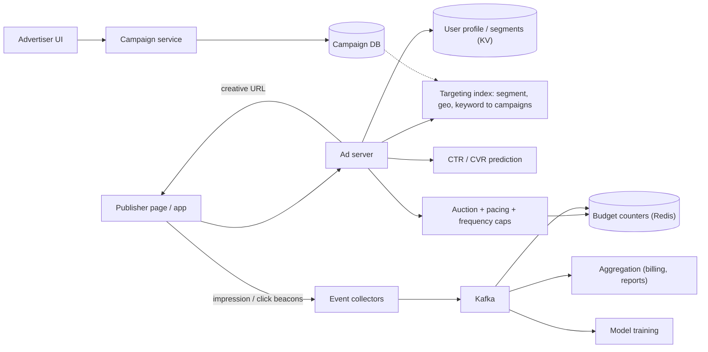
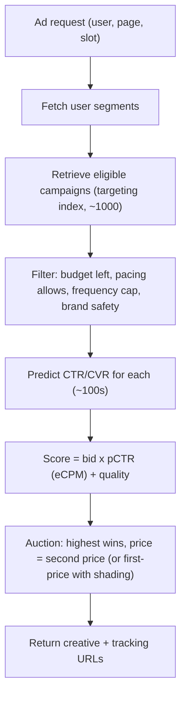

# 57 · Design an Ad Serving / Real-Time Bidding System

> **Category:** Low-latency ranking + auctions · **Difficulty:** ⭐⭐⭐⭐⭐ · **Patterns:** strict latency budgets, candidate retrieval + ranking, second-price/first-price auction, budget pacing, event aggregation

---

## 1. TL;DR
When a page loads, the **ad server** must pick an ad in ~**100 ms**. It retrieves **eligible campaigns** (targeting index), predicts **CTR/CVR** with ML, computes **bid × predicted value** for each candidate, runs an **auction**, applies **budget pacing** and frequency caps, and returns the winning creative. Impressions and clicks are logged to Kafka and aggregated for billing and model training (see [Ad click aggregation](18-ad-click-aggregation.md)).

---

## 2. Requirements
| Functional | Non-functional |
|---|---|
| Advertisers create campaigns: targeting, budget, bid | p99 < 100 ms end-to-end |
| Select best ad per request | 1M+ ad requests/s |
| Budget & frequency caps | Accurate billing |
| Reporting | Highly available (no ad = lost revenue) |

---

## 3. Architecture

## 4. Serving one request

Latency budget example: profile 5 ms, retrieval 10 ms, prediction 20 ms, auction 2 ms, network rest.

---

## 5. Deep dives
- **RTB (exchange model):** the exchange sends bid requests to many DSPs in parallel with a ~80 ms timeout; responses after the deadline are dropped.
- **Budget pacing:** spread spend through the day — throttle participation probability based on spend vs plan; budgets as Redis counters updated from event stream; small overspend tolerated.
- **Frequency caps:** per (user, campaign) counters with TTL in a KV store.
- **Click fraud:** dedupe, bot filtering, anomaly detection before billing.
- **Targeting index:** inverted index from targeting attributes to campaigns, refreshed incrementally as campaigns change.

---

## 6. Interview Q&A
**Q: Why rank by bid × pCTR, not just bid?** Revenue for CPC ads depends on clicks; expected value per impression (eCPM) is what matters, and it also rewards relevant ads.

**Q: How do you avoid overspending a budget across 1,000 ad servers?** Central counters with async decrements + pacing that stops bidding before the limit; reconcile from billing events.

---

**Related:** [Ad click aggregation](18-ad-click-aggregation.md) · [Recommendation system](43-recommendation-system.md) · [Distributed counter](42-distributed-counter.md)
