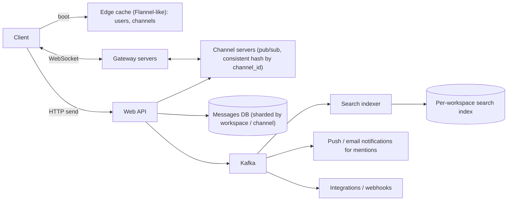
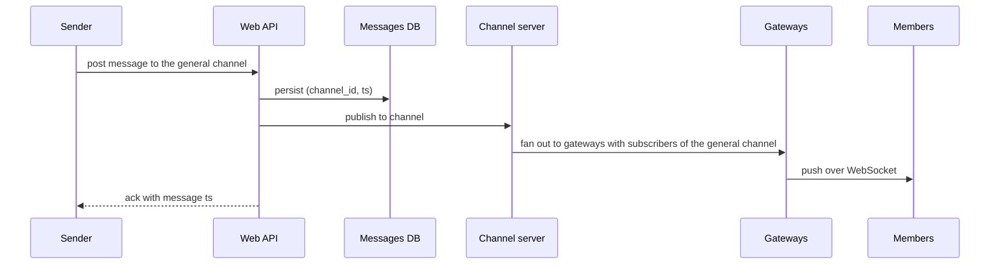

# 58 · Design Slack (Workspace Messaging)

| Category | Difficulty | Key ideas |
|---|---|---|
| Real-time messaging, multi-tenant | Hard | channel-based pub/sub, gateway servers, edge cache for boot data, per-workspace sharding, search per tenant |

---

## Summary
Differs from WhatsApp-style chat: messages go to **channels** with up to tens of thousands of members, organized by **workspace** (tenant), with full **history search**, threads, and integrations. Clients load a **boot snapshot** (channels, users, unread counts) from an **edge cache**, then keep a WebSocket to a **gateway server** subscribed to the user's channels via a **channel pub/sub** layer. Messages are persisted (sharded by workspace/channel), fanned out to online members, and indexed for search.

---

## Requirements
| Functional | Non-functional |
|---|---|
| Workspaces, public/private channels, DMs, threads | Message delivery < 500 ms |
| Unread counts, mentions, notifications | Large channels (50K members) |
| Search all history (per workspace) | Tenant isolation, compliance exports |
| Bots / integrations / webhooks | Fast app startup |

---

## Architecture

## Send flow

---

## Deep dives
- **Large channels:** fan-out only to **online** members via gateways that subscribed; offline members see it on next load (unread pointer). Rate-limit @channel mentions.
- **Unread counts:** store last-read timestamp per (user, channel); unread = messages after it (cached counts).
- **Boot time:** edge cache near users serves lazy-loaded workspace data instead of sending the whole workspace at connect.
- **Sharding:** by workspace (tenant isolation, easy export/compliance) with very large workspaces split by channel.
- **Threads:** replies linked by `thread_ts`; thread subscribers notified.
- **Search:** per-workspace indexes respecting channel permissions (filter by channels the user can access).
- **Enterprise:** data residency, retention policies, legal hold, EKM (customer-managed keys).

---

## Interview Q&A
**Q: Slack vs WhatsApp design differences?**
A: Slack is channel-centric with huge groups, searchable server-side history and tenants; WhatsApp is device-centric, mostly small groups, E2E encrypted, messages deleted from servers after delivery.

**Q: How do gateways know which messages to deliver?**
A: Each gateway subscribes to channel servers for the channels of its connected users.

---

**Related:** [Chat system](09-chat-system.md) · [Search systems](../01-fundamentals/19-search-systems-and-inverted-index.md) · [Webhook delivery](47-webhook-delivery-service.md)
