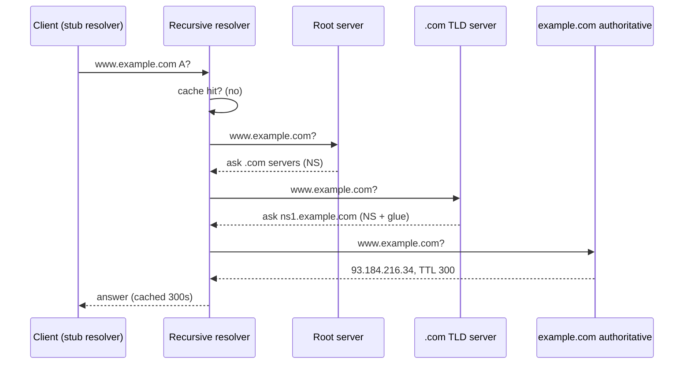
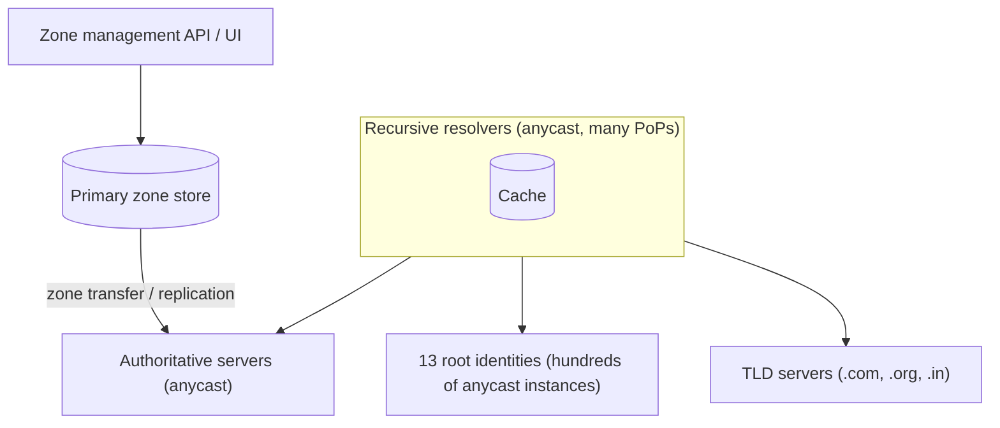

# 59 · Design the Domain Name System (DNS)

| Category | Difficulty | Key ideas |
|---|---|---|
| Internet infrastructure | Medium | hierarchical delegation, caching with TTL, anycast, replication of authoritative zones, eventual consistency |

---

## Summary
DNS is a **hierarchical, distributed, heavily cached** key-value system mapping names to records. **Recursive resolvers** (ISP, 8.8.8.8) walk the hierarchy - **root -> TLD -> authoritative** - and cache each answer for its **TTL**. Authoritative servers are replicated and served via **anycast**, and zone updates propagate to secondaries. The design trades instant consistency for massive scale and availability.

---

## Requirements
| Functional | Non-functional |
|---|---|
| Resolve names to A/AAAA/CNAME/MX/TXT records | Trillions of queries/day |
| Owners update records | Low latency (cache hits in ms) |
| Delegation of subdomains | Extremely high availability, DDoS resilience |

---

## Resolution flow

## Architecture

---

## Deep dives
- **Caching at every layer:** browser, OS, resolver; TTL controls freshness vs load (low TTL = faster changes, more queries). Negative caching for NXDOMAIN.
- **Updates propagate eventually:** after a change, old answers live until cached TTLs expire -> lower TTL before planned migrations.
- **Anycast:** same IP from many locations -> nearest instance answers, absorbs DDoS, automatic failover via BGP.
- **Managed DNS features:** GeoDNS / latency-based answers, weighted records (canary), health-checked failover.
- **Security:** DNSSEC signs records (integrity), DoH/DoT encrypt queries, rate limiting & response-rate limiting against amplification attacks.
- **Storage at authoritative servers:** zones held in memory (small), replicated to all anycast nodes.

---

## Interview Q&A
**Q: Why is DNS so scalable?**
A: Hierarchical delegation splits ownership, and aggressive TTL-based caching means most queries never reach authoritative servers.

**Q: Why might users still hit an old IP after you changed a record?**
A: Resolvers cache until TTL expires (some ignore TTLs).

---

**Related:** [Networking basics](../01-fundamentals/01-networking-basics.md) · [CDN](52-cdn.md) · [Load balancing](../01-fundamentals/03-load-balancing.md)
