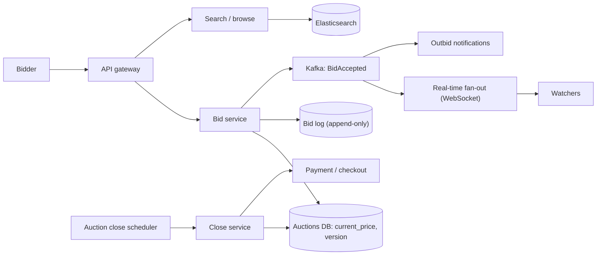
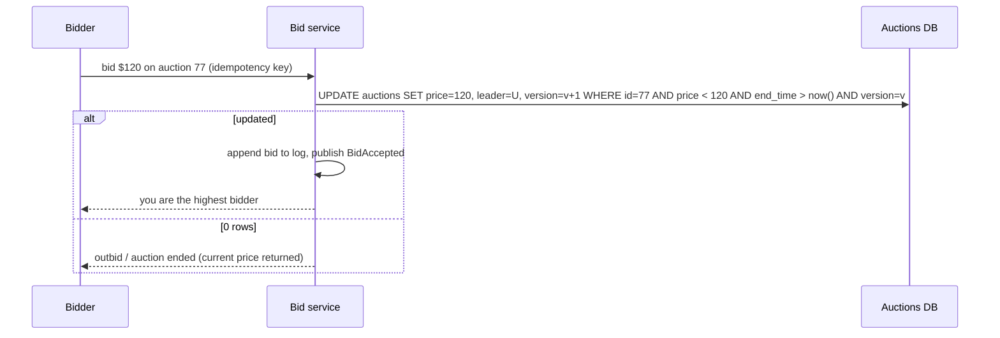

# 60 · Design an Online Auction System (eBay)

| Category | Difficulty | Key ideas |
|---|---|---|
| Contention + real-time | Hard | serialized bids per auction, conditional updates, real-time bid updates via WebSocket, scheduled auction close, anti-sniping |

---

## Summary
Bids on one auction must be **ordered and validated** against the current highest bid. Route all bids for an auction to one place (single-row **conditional update** in the DB, or a per-auction partition/actor), append each accepted bid to a **bid log**, and **broadcast** the new price to watchers via WebSocket. A scheduler **closes** auctions at end time (with optional anti-sniping extension), determines the winner, and triggers payment.

---

## Requirements
| Functional | Non-functional |
|---|---|
| List items with start price, reserve, end time | Correct winner: no lost/overlapping bids |
| Place bids (manual & proxy/max bids) | Bid latency < 200 ms |
| Real-time current price to watchers | Hot auctions: thousands of bids/min near close |
| Close auction, notify winner, payment | Fairness & auditability |

---

## Architecture

## Placing a bid

---

## Deep dives
- **Proxy bidding:** user sets a max; system bids the minimum increment above the competitor up to that max - computed inside the same atomic update logic (compare both proxies).
- **Hot auctions:** serialize bids per auction via Kafka partition by auction_id or an in-memory actor per auction (with the DB/bid log as durable record) to avoid DB row contention.
- **Closing:** scheduler fires at end time; anti-sniping extends end time by N minutes if a bid arrives in the last minute; close transitions state ACTIVE -> ENDED with a conditional update so late bids fail.
- **Clock fairness:** server time decides; bids timestamped on arrival at the bid service.
- **Fraud:** shill bidding detection, bid retraction rules, account verification.

---

## Interview Q&A
**Q: How do you guarantee two equal bids don't both win?**
A: Conditional update with `price < new_bid` (and version) - the first committed wins; the second sees 0 rows.

**Q: How do watchers see updates instantly?**
A: WebSocket subscriptions per auction fed by BidAccepted events.

---

**Related:** [Ticketmaster](29-ticketmaster.md) · [E-commerce flash sale](38-ecommerce-flash-sale.md) · [Job scheduler](32-distributed-job-scheduler.md)
