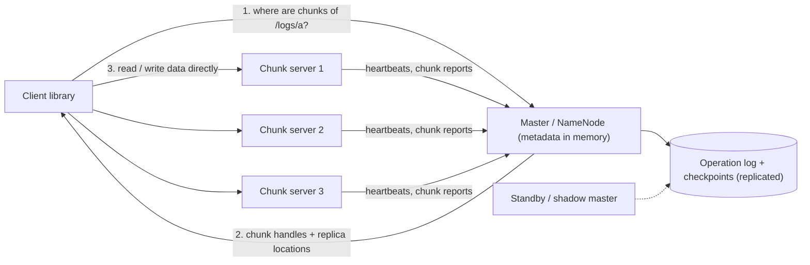
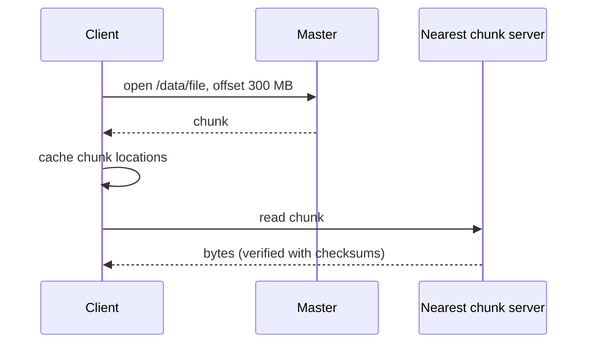
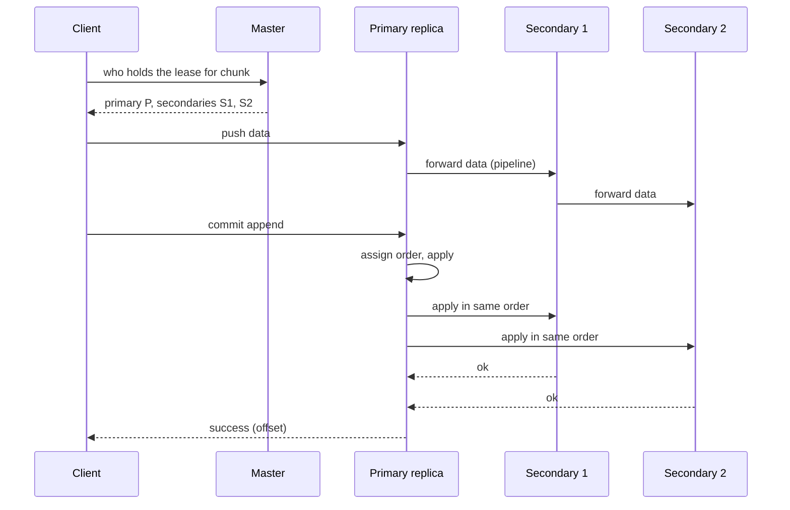

# 61 · Design a Distributed File System (GFS / HDFS)

| Category | Difficulty | Key ideas |
|---|---|---|
| Storage infrastructure | Hard | single metadata master, large chunks, chunk replication, leases, pipelined writes, rack awareness |

---

## Summary
Files are split into large **chunks** (64-128 MB), each replicated (default 3) across data servers. A **master** (NameNode) holds only metadata in memory: the namespace, file-to-chunk mapping, and chunk locations. Clients ask the master where chunks are, then read and write **directly** with data servers, so the master never carries file bytes. Writes are pipelined through replicas; the master grants a **lease** to one primary replica per chunk to order mutations.

---

## Requirements
| Functional | Non-functional |
|---|---|
| Create, read, append, delete large files | Petabytes of data, files of GBs-TBs |
| Directory namespace | High throughput for large sequential reads and appends (batch analytics) |
| | Tolerate frequent disk and machine failures |
| | Low latency is not a goal |

---

## Architecture

---

## Read flow

## Write (append) flow

Pushing data along a chain uses each machine's full outbound bandwidth instead of the client sending three copies.

---

## Deep dives
- **Why large chunks?** Fewer chunks means less metadata (the master keeps everything in RAM), fewer master requests, and long sequential I/O. The downside is wasted space and hot spots for small files.
- **Metadata durability:** every namespace change goes to an operation log replicated to other machines before acknowledging; periodic checkpoints speed up recovery. HDFS adds an active/standby NameNode with shared edit logs (journal nodes) and ZooKeeper failover.
- **Replica placement:** spread across racks (one local, two on another rack) to survive rack failures while limiting cross-rack write traffic.
- **Failure handling:** missing heartbeats mark a server dead; the master re-replicates its chunks from surviving copies, prioritizing chunks with only one replica left.
- **Integrity:** checksums per block on each server; corrupted replicas are discarded and re-copied.
- **Garbage collection:** deleted files are renamed to hidden and lazily reclaimed.
- **Master bottleneck:** clients cache locations; metadata is small per chunk (~64 bytes). Very large systems shard metadata (Colossus, HDFS federation).
- **Erasure coding** for cold data reduces storage overhead from 200% to about 50%.

---

## Trade-offs
| Decision | Benefit | Cost |
|---|---|---|
| Single master | Simple global decisions (placement, leases) | Metadata limited by one machine's memory; needs HA |
| Relaxed consistency for concurrent appends | High append throughput | Clients must handle duplicates or padding (record IDs, checksums) |
| Large chunks | Throughput, small metadata | Poor fit for many small files |

---

## Interview Q&A

**Q: Why doesn't file data go through the master?**
A: The master would become a bandwidth bottleneck; it only hands out locations and leases.

**Q: What happens if a chunk server dies mid-write?**
A: The write fails for that attempt; the client retries, the master excludes the dead server, and re-replication restores the replica count.

**Q: How is this different from S3?**
A: A DFS offers a file namespace with appends and is tuned for batch compute next to the data; object storage offers immutable objects over HTTP at larger scale. See [Object storage](21-object-storage-s3.md).

---

**Related:** [Object storage](21-object-storage-s3.md) · [Storage systems](../01-fundamentals/16-storage-systems-block-file-object-oltp-vs-olap.md) · [Batch processing](../01-fundamentals/17-batch-and-stream-processing.md)
