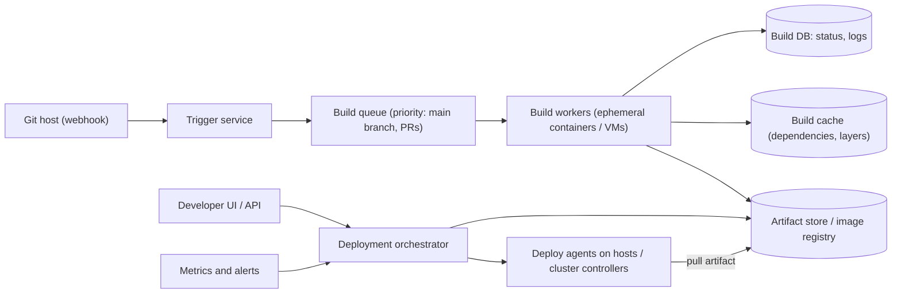
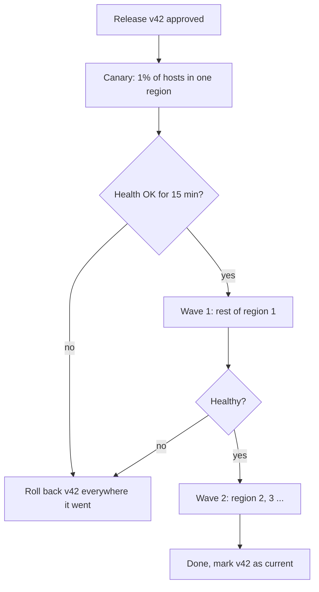

# 62 · Design a CI/CD and Code Deployment System

| Category | Difficulty | Key ideas |
|---|---|---|
| Developer infrastructure | Medium-Hard | build queue + workers, artifact store, deployment orchestrator, progressive rollout, automatic rollback |

---

## Summary
Commits trigger **build jobs** placed on a queue and executed by an autoscaled pool of isolated **build workers**. Outputs (binaries, container images) go to an **artifact store** with immutable versions. A **deployment orchestrator** rolls a release out in waves (canary, then region by region) to thousands of hosts or clusters, watches health metrics, and **rolls back automatically** if error rates rise.

---

## Requirements
| Functional | Non-functional |
|---|---|
| Build and test on every commit / PR | Thousands of builds per day, fast feedback (minutes) |
| Store versioned artifacts | Deploy to 100K hosts across regions within ~30 minutes |
| Deploy a version to environments (staging, prod) | Safe: never take down everything at once |
| Rollback, deployment history, approvals | Reliable: a deploy either completes or is reverted |

---

## Architecture

---

## Deployment flow

---

## Deep dives
- **Build isolation:** each job in a fresh container or micro-VM; secrets injected per job with least privilege; no state leaks between builds.
- **Speed:** dependency and layer caches, remote build caching (Bazel-style content hashing so unchanged targets are not rebuilt), test sharding across workers, only run tests affected by the change.
- **Artifact store:** immutable, content-addressed versions; replicated to every region; hosts pull from a nearby mirror or via peer-to-peer distribution (BitTorrent-style) to avoid a stampede when 100K hosts pull a 1 GB artifact.
- **Orchestrator state:** a deployment is a state machine per wave and per host (`PENDING, DOWNLOADING, SWITCHING, HEALTHY, FAILED`) stored durably, so the orchestrator can crash and resume.
- **Health gating:** compare canary error rate and latency to the baseline; automatic rollback on regression; manual pause button.
- **Rollback:** keep the previous version on hosts so switching back is a symlink or image tag change, not a full download.
- **Database migrations:** expand/contract pattern so old and new code both work during rollout.
- **Concurrency control:** one active deployment per service and environment (lock), deploy freezes during incidents or holidays.

---

## Interview Q&A

**Q: How do you deploy a large artifact to 100K machines quickly?**
A: Regional mirrors plus peer-to-peer distribution so machines fetch pieces from each other; the origin only serves a small fraction.

**Q: How do you make deployments safe?**
A: Small canary, waves across failure domains, automated health checks against a baseline, automatic rollback, and feature flags to separate deploy from release.

**Q: The orchestrator crashes in the middle of a rollout. What happens?**
A: Its state is persisted per wave and host; a new instance takes the lock and resumes from the recorded state.

---

**Related:** [Containers and deployment](../01-fundamentals/24-containers-kubernetes-and-deployment.md) · [Job scheduler](32-distributed-job-scheduler.md) · [Feature flags](53-feature-flags.md)
