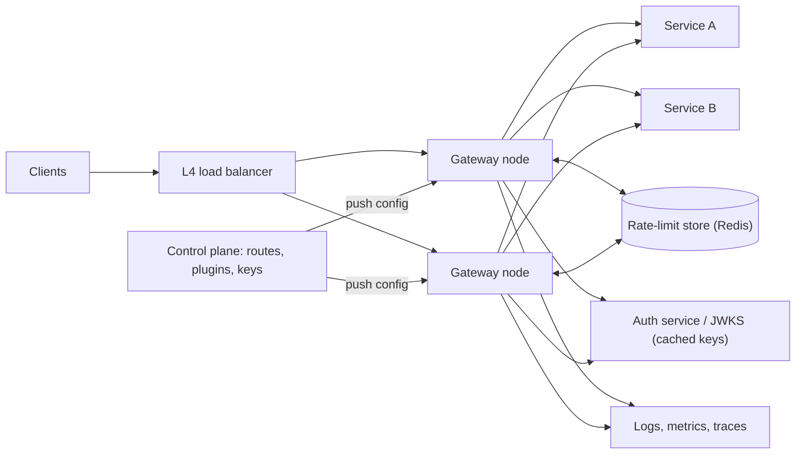
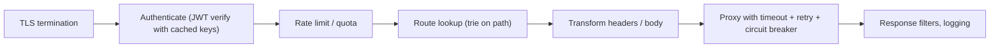

# 63 · Design an API Gateway

| Category | Difficulty | Key ideas |
|---|---|---|
| Edge infrastructure | Medium | request pipeline of filters, route table, auth offload, rate limiting, config push, stateless data plane |

---

## Summary
The gateway is a horizontally scaled, **stateless proxy** in front of backend services. Each request passes through a **pipeline of filters**: TLS termination, authentication, rate limiting, routing, request transformation, retries and timeouts, then logging. Routes and policies live in a **control plane** and are pushed to every gateway node, which keeps them in memory so the hot path never calls a database.

---

## Requirements
| Functional | Non-functional |
|---|---|
| Route requests by host/path/method to services | Adds only a few ms of latency |
| AuthN (API keys, JWT, OAuth) and AuthZ hooks | 1M+ requests/s across the fleet |
| Rate limits and quotas per key/tenant | Highly available, no single point of failure |
| Request/response transformation, versioning | Config changes live within seconds |
| Observability: logs, metrics, tracing | |

---

## Architecture

## Request pipeline

---

## Deep dives
- **Route matching:** compile routes into a prefix trie or radix tree per host; longest-prefix match in microseconds.
- **Authentication offload:** verify JWT signatures locally using cached public keys (JWKS); API keys validated against an in-memory copy synced from the control plane.
- **Rate limiting:** local token buckets for speed plus a shared Redis counter for global limits (see [Rate limiter](01-rate-limiter.md)).
- **Resilience:** per-route timeouts, retries only for idempotent methods, circuit breakers per upstream, connection pools to services.
- **Config distribution:** versioned config snapshots pushed (or long-polled) from the control plane; nodes apply atomically; bad config is rolled back by version.
- **Plugins:** filters as a chain so features can be added per route (CORS, caching, request validation, WAF rules).
- **Aggregation / BFF:** optional composition endpoints that call several services in parallel and merge results.
- **Deployment:** stateless nodes in every AZ behind L4 load balancers; drain connections on deploy.

---

## Interview Q&A

**Q: Why not call the auth service on every request?**
A: It adds latency and a hard dependency. Verify signed tokens locally and cache key material; call out only for revocation checks or complex authorization.

**Q: Gateway vs service mesh?**
A: The gateway handles north-south traffic (outside to inside) and API concerns like keys and quotas; a mesh handles east-west traffic between services (mTLS, retries) via sidecars.

**Q: How do you avoid the gateway becoming a single point of failure?**
A: Many stateless replicas across zones, no database on the hot path, config cached locally so nodes keep serving if the control plane is down.

---

**Related:** [API design](../01-fundamentals/02-api-design.md) · [Load balancing](../01-fundamentals/03-load-balancing.md) · [Rate limiter](01-rate-limiter.md) · [Security](../01-fundamentals/15-security-authn-authz-encryption.md)
