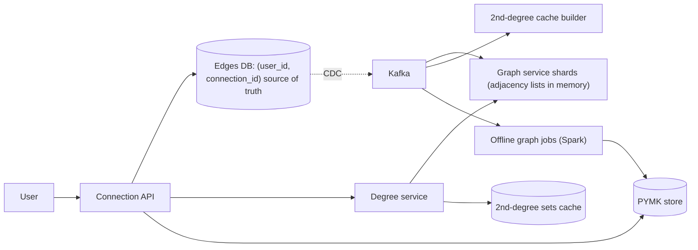
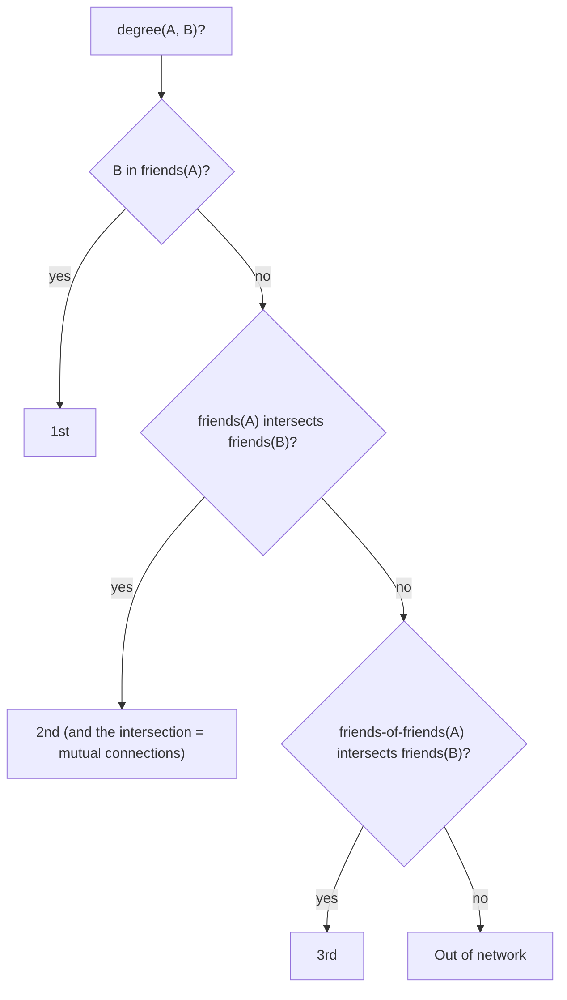

# 64 · Design LinkedIn Connections (Social Graph, Degrees, People You May Know)

| Category | Difficulty | Key ideas |
|---|---|---|
| Graph systems | Hard | sharded adjacency lists, bidirectional BFS, precomputed 2nd-degree networks, batch graph jobs for recommendations |

---

## Summary
Store the graph as **adjacency lists** (user -> list of connection IDs) sharded by user ID, cached in memory. "Is X a 1st/2nd/3rd-degree connection?" uses **bidirectional BFS** limited to depth 3, helped by caching each user's 2nd-degree set. **People You May Know** is computed offline by batch graph jobs (common connections, same company/school) and served from a precomputed store.

---

## Requirements
| Functional | Non-functional |
|---|---|
| Send/accept connection requests | 1B members, avg 500 connections (some 30K) |
| Show degree badge (1st, 2nd, 3rd) on any profile | Degree lookup < 50 ms (shown on every profile view and search result) |
| Mutual connections | Connection changes visible quickly |
| People You May Know (PYMK) | Highly available reads |

### Estimates
1B users × 500 edges × 8 bytes = **4 TB** of adjacency data (×2 for both directions), so it must be sharded across many in-memory graph servers.

---

## Architecture

---

## Degree computation

Bidirectional search keeps the frontier small: two sets of ~500 instead of expanding 500 × 500 × 500 nodes from one side. Sorted ID lists or bitmaps make intersections fast.

For users with huge networks, precompute and cache the 2nd-degree set (could be 100K+ IDs, stored compressed as a Roaring bitmap), so a 3rd-degree check becomes one set intersection.

---

## Deep dives
- **Sharding the graph:** by user ID; a friends-of-friends query fans out to the shards owning each friend. Graph servers batch requests per shard to limit fan-out.
- **Consistency:** edges written to the source DB first, then streamed to graph shards and caches; degree badges may lag by seconds.
- **Supernodes:** influencers with huge follower counts are treated differently (followers vs connections, limits, separate storage).
- **PYMK:** offline jobs score candidates by number of mutual connections, shared employers/schools, profile views; results stored per user and refreshed daily, plus a near-real-time boost after a new connection.
- **Privacy:** respect hidden connection lists and blocking when showing mutual connections.

---

## Interview Q&A

**Q: Why not use a graph database for everything?**
A: Generic graph DBs struggle at billions of edges with millisecond SLAs. A purpose-built sharded in-memory adjacency store plus caches is the common choice; a graph DB can still serve offline analytics.

**Q: How do you find mutual connections quickly?**
A: Intersect the two sorted adjacency lists (or bitmaps) - O(n) for n around 500.

**Q: How is PYMK different from degree lookup?**
A: Degree lookup must be real time for one pair; PYMK is a ranking over many candidates and is precomputed in batch.

---

**Related:** [Data modeling](../01-fundamentals/27-multi-tenancy-and-data-modeling.md) · [Recommendation system](43-recommendation-system.md) · [Partitioning](../01-fundamentals/06-partitioning-and-sharding.md)
