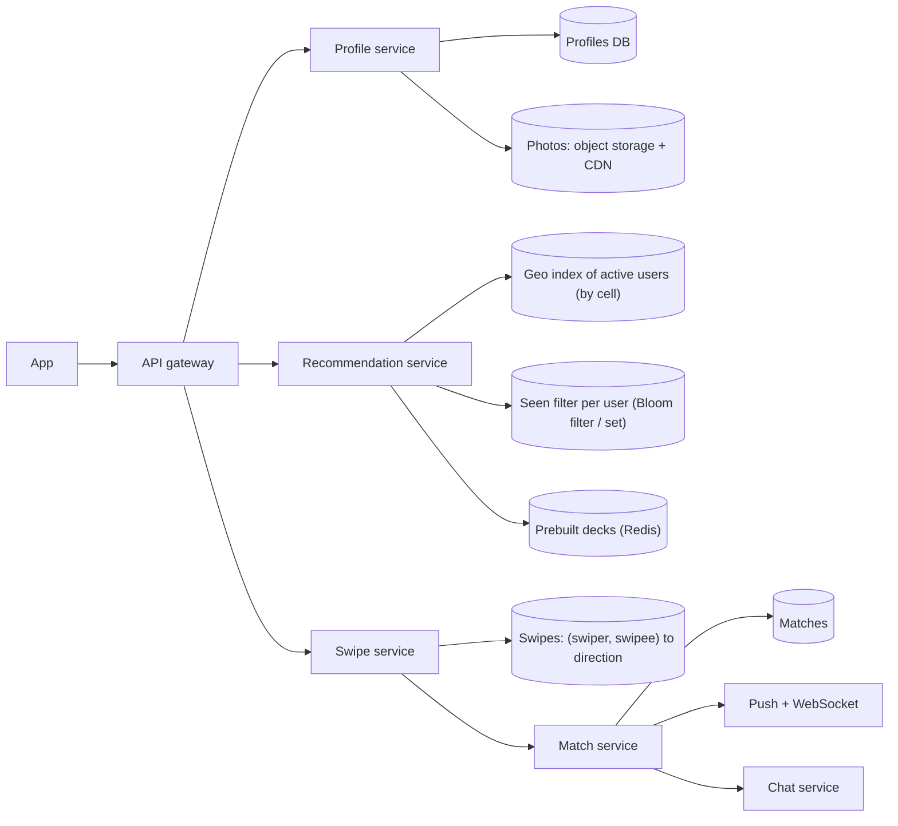
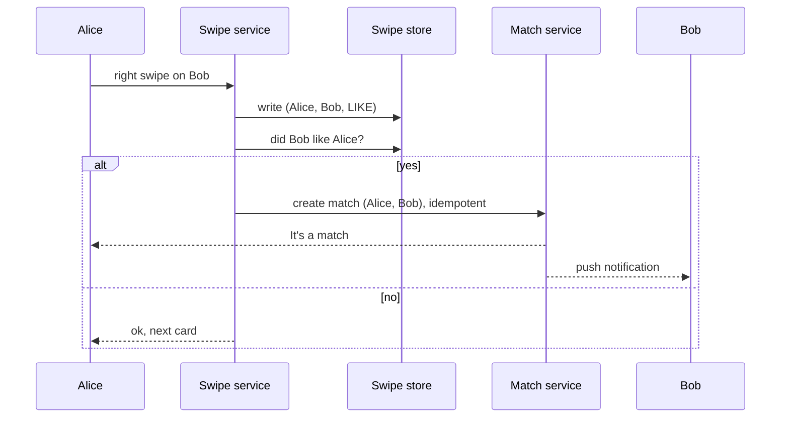

# 65 · Design Tinder (Geo Matching and Swipes)

| Category | Difficulty | Key ideas |
|---|---|---|
| Geo + social | Medium-Hard | geo-sharded candidate search, precomputed recommendation decks, swipe storage, mutual-like detection, real-time match notification |

---

## Summary
For each user, a **recommendation service** builds a **deck** of nearby candidates matching preferences (distance, age, gender), excluding people already swiped, ranked by a model. Swipes are written to a **swipe store**; on a right swipe the service checks whether the other person already liked this user. If so, it creates a **match** and notifies both in real time, after which they can chat.

---

## Requirements
| Functional | Non-functional |
|---|---|
| Profile with photos, location, preferences | 50M DAU, ~1B swipes/day (~12K/s, peaks 3x) |
| Show nearby candidates one card at a time | Deck loads instantly (prefetched) |
| Swipe left / right / super like | Never show the same person twice |
| Match when both like, then chat | Match notification within seconds |

---

## Architecture

---

## Swipe and match flow

Storing likes keyed by `(swipee, swiper)` makes "did Bob like Alice?" a single point lookup. To avoid a race when both swipe at the same moment, create the match with a unique key on the ordered pair.

---

## Deep dives
- **Candidate search:** active users indexed by geo cell (geohash/S2) and coarse attributes; query the user's cell and neighbours within their distance setting, then filter by mutual preferences.
- **Deck prebuilding:** compute a deck of ~100-200 candidates ahead of time, store in Redis, and refill in the background when it runs low. The app prefetches the next cards and photos.
- **Never show twice:** per-user seen set (Bloom filter for the large history, exact set for recent swipes) applied when building decks.
- **Ranking:** model predicting mutual-like probability, recency of activity, profile completeness; balance so popular profiles are not shown to everyone.
- **Location updates:** only when the user opens the app or moves significantly; stored coarsened for privacy.
- **Scale of swipes:** write-heavy, simple key access, so a wide-column store partitioned by swiper; TTL old left swipes after some months.

---

## Interview Q&A

**Q: How do you detect a match without scanning?**
A: Look up the reverse key `(other_user, me)` in the swipe store on every right swipe.

**Q: How do you keep the deck fast?**
A: Precompute decks per user, keep them in Redis, prefetch on the client, and refill asynchronously.

**Q: How do you handle users in very dense cities?**
A: Smaller geo cells, ranking to limit candidates, and capping how often a single profile is shown.

---

**Related:** [Proximity service](13-proximity-service.md) · [Nearby friends](14-nearby-friends.md) · [Chat system](09-chat-system.md) · [Recommendation system](43-recommendation-system.md)
