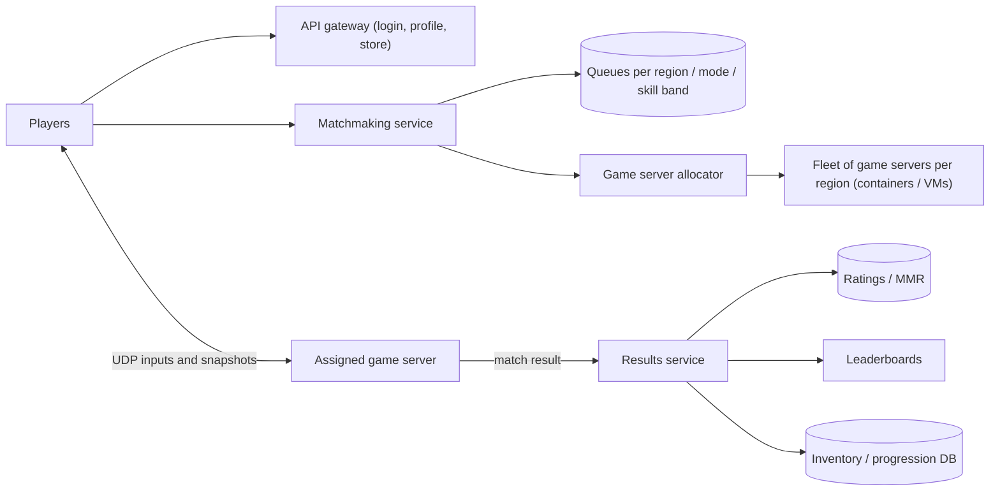
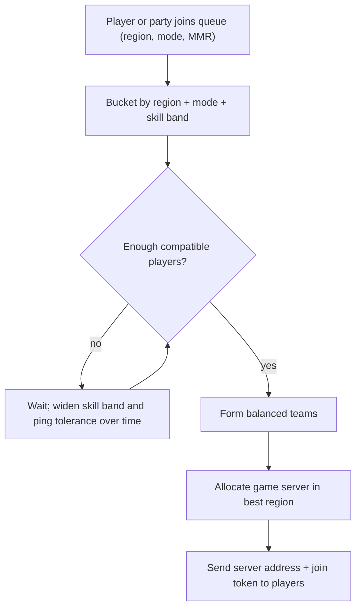

# 66 · Design a Multiplayer Game Backend (Matchmaking and Game Servers)

| Category | Difficulty | Key ideas |
|---|---|---|
| Real-time systems | Hard | matchmaking queues by skill and region, dedicated authoritative game servers, UDP tick updates, fleet allocation, persistence of results |

---

## Summary
Players enter a **matchmaking** queue grouped by region, mode, and skill rating. When a balanced group is found, an **allocator** reserves an idle **dedicated game server** near the players and sends them its address. The game server is **authoritative**: clients send inputs over **UDP**, the server simulates the world at a fixed tick rate (20-60 Hz) and broadcasts state snapshots. When the match ends, results update ratings, leaderboards, and rewards through normal backend services.

---

## Requirements
| Functional | Non-functional |
|---|---|
| Matchmaking with fair teams | Match found within ~30-60 s |
| Real-time gameplay for 10-100 players per match | In-game latency < 50-100 ms |
| Persist results, ranks, inventory | Cheat resistance |
| Friends, parties, lobbies | Scale to millions of concurrent players, spiky launches |

---

## Architecture

---

## Matchmaking flow

---

## Deep dives
- **Authoritative server:** clients never decide outcomes; the server validates inputs (speed, cooldowns) to block most cheats. Clients use prediction and interpolation to hide latency; the server does lag compensation for hit detection.
- **Network protocol:** UDP with custom reliability for important events; state deltas instead of full snapshots; tick rate trades bandwidth and CPU for responsiveness.
- **Fleet management:** pre-warmed idle servers per region; autoscale on queue size and time of day; one process can host several matches. Allocation must be atomic so two matches don't get the same server.
- **Matchmaking quality vs wait time:** start with a narrow skill and ping range and widen it as players wait.
- **Rating systems:** Elo, Glicko, TrueSkill update after each match.
- **Persistence:** match results written once at the end (idempotent by match ID); in-game state lives only in the game server's memory.
- **Failures:** if a game server crashes, the match is lost or restarted; players can rejoin via the same token if the server is alive.

---

## Interview Q&A

**Q: Why dedicated servers instead of peer-to-peer?**
A: Fairness and cheat prevention (one authority), better connectivity behind NATs, and consistent performance regardless of one player's connection.

**Q: Why UDP?**
A: Old state is useless; retransmitting a lost packet from 100 ms ago only adds delay. The next snapshot replaces it.

**Q: How do you handle a launch-day spike?**
A: Pre-scale fleets, queue players with an estimated wait, and degrade gracefully (fewer modes, wider skill bands).

---

**Related:** [Gaming leaderboard](22-gaming-leaderboard.md) · [Video conferencing](39-video-conferencing.md) · [Concurrency](../01-fundamentals/26-concurrency-and-connection-handling.md)
