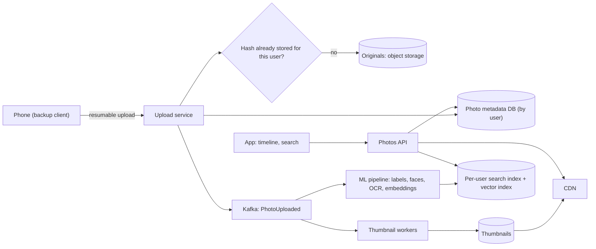
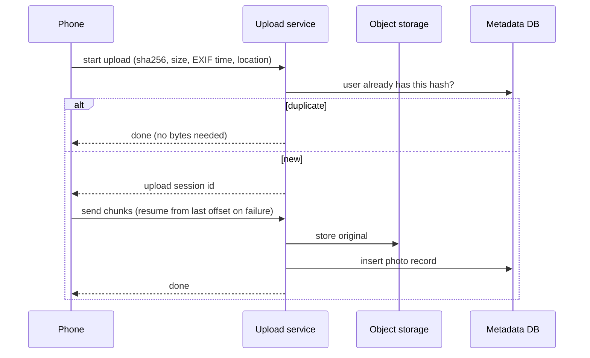

# 67 · Design Google Photos (Backup, Search by Content, Sharing)

| Category | Difficulty | Key ideas |
|---|---|---|
| Media + ML | Hard | resumable uploads, content-hash dedupe, thumbnail pipeline, ML labeling and embeddings, per-user search index, tiered storage |

---

## Summary
Phones upload photos in the background with **resumable uploads**; the server deduplicates by **content hash**, stores originals in object storage, and an async pipeline creates **thumbnails** and runs **ML models** (labels, faces, text, embeddings). Metadata and ML results go into a **per-user index**, so searches like "beach 2019" or "dog" run only over that user's library. Older originals move to cheaper storage tiers.

---

## Requirements
| Functional | Non-functional |
|---|---|
| Automatic backup from devices | 1B users, ~4B photos uploaded per day |
| Browse timeline, albums | Never lose a photo (high durability) |
| Search by content, place, people, date | Thumbnails load instantly while scrolling |
| Share albums / links | Uploads resilient on mobile networks, low battery use |

### Estimates
4B photos/day × 3 MB ≈ **12 PB/day** of originals before dedupe; thumbnails ~50 KB each ≈ 200 TB/day. Storage cost dominates, so dedupe, compression and tiering matter.

---

## Architecture

---

## Upload flow

---

## Deep dives
- **Client behaviour:** upload on Wi-Fi/charging by default, batch small photos, compress on device if the user chose "storage saver".
- **Thumbnails:** several sizes generated immediately so the timeline works before ML finishes; served from CDN with immutable keys.
- **Search:** labels and OCR text in an inverted index per user; image embeddings in a vector index for "photos like this"; face clusters per user (privacy: face models stay per account).
- **Timeline:** metadata partitioned by user, sorted by capture time; month/day aggregates precomputed for fast scrolling.
- **Sharing:** albums with ACLs; share links with random tokens; shared photos are references, not copies.
- **Storage tiering:** recent photos in hot storage, older originals in cold or erasure-coded tiers; thumbnails stay hot.
- **Deletion:** soft delete into trash for 60 days, then hard delete of originals and derived data.

---

## Interview Q&A

**Q: Why per-user search indexes instead of one global index?**
A: Queries are always scoped to one user's library; per-user (or user-partitioned) indexes keep queries small and privacy boundaries simple.

**Q: How do you avoid storing the same photo twice?**
A: Content hash per user (and optionally across users for identical files), checked before upload.

**Q: How does "search for dog" work?**
A: ML labels each photo at upload time; the label "dog" is indexed, so the search is a normal inverted-index lookup.

---

**Related:** [Instagram](27-instagram.md) · [Google Drive](12-google-drive.md) · [Object storage](21-object-storage-s3.md) · [Search systems](../01-fundamentals/19-search-systems-and-inverted-index.md)
