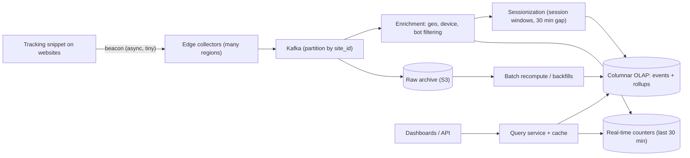
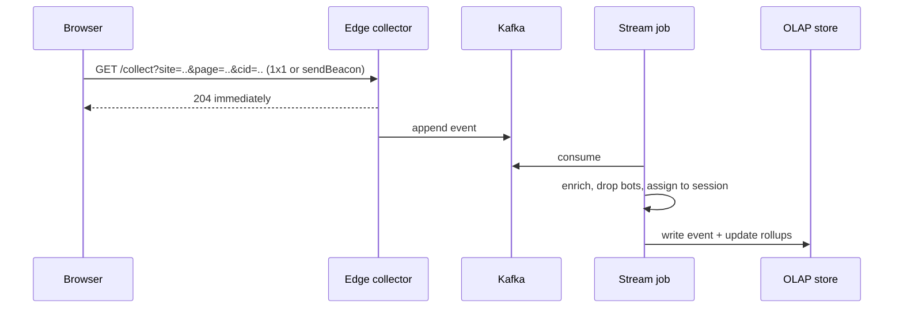

# 68 · Design a Web Analytics Platform (Google Analytics)

| Category | Difficulty | Key ideas |
|---|---|---|
| Data pipeline | Medium-Hard | lightweight tracking beacons, edge collectors, Kafka, sessionization with session windows, columnar OLAP store, HyperLogLog for uniques |

---

## Summary
A JavaScript snippet on customer websites sends small **beacons** (page views, events) to **edge collectors**, which validate and push them into **Kafka**. Stream jobs **enrich** (geo from IP, device from user agent), **sessionize** visits, and write to a **columnar OLAP store** (ClickHouse/Druid) partitioned by site and time. Dashboards query pre-aggregated rollups for speed; unique visitors use **HyperLogLog**.

---

## Requirements
| Functional | Non-functional |
|---|---|
| Track page views, custom events, conversions | Millions of sites, 1M+ events/s at peak |
| Dashboards: visitors, sessions, top pages, sources, devices | Tracking must never slow down customer sites |
| Real-time view (last 30 min) | Reports in seconds over months of data |
| Filters and segments | Privacy: IP anonymization, consent, data retention |

---

## Architecture

---

## Event flow

---

## Deep dives
- **Collection:** `navigator.sendBeacon` so page unloads don't block; collectors respond instantly and buffer; anycast edge for low latency.
- **Identity:** first-party cookie client ID for visitors; respect consent mode (no cookies without consent, modelled data instead).
- **Sessionization:** session windows keyed by client ID with a 30-minute inactivity gap; late events handled with watermarks.
- **Storage layout:** columnar table partitioned by `(site_id, date)`, sorted by time; queries scan only needed columns.
- **Rollups:** precompute hourly/daily aggregates per site and common dimensions (page, country, source); dashboards hit rollups, ad-hoc queries hit raw events.
- **Unique visitors:** HyperLogLog sketches per site per day, mergeable for any date range.
- **Multi-tenancy:** per-site quotas, sampling for huge sites on ad-hoc queries.
- **Privacy:** truncate IPs, retention limits, deletion requests per client ID.

---

## Interview Q&A

**Q: How do you make sure tracking never slows the customer's site?**
A: Async snippet, tiny beacons, fire-and-forget responses from edge collectors, no dependency on downstream processing.

**Q: How do you count unique visitors over an arbitrary date range quickly?**
A: Store one HyperLogLog per site per day and merge the sketches for the range.

**Q: Why a columnar store?**
A: Reports aggregate a few columns over billions of rows; columnar storage plus compression makes those scans fast and cheap.

---

**Related:** [Ad click aggregation](18-ad-click-aggregation.md) · [Batch and stream processing](../01-fundamentals/17-batch-and-stream-processing.md) · [Probabilistic data structures](../01-fundamentals/18-probabilistic-data-structures-and-useful-algorithms.md)
