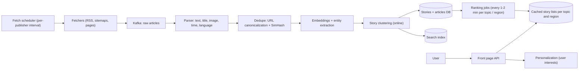
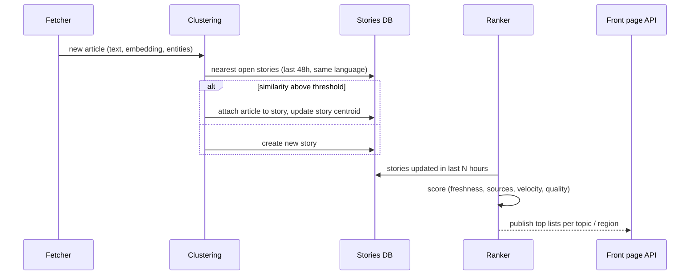

# 69 · Design a News Aggregator (Google News)

| Category | Difficulty | Key ideas |
|---|---|---|
| Content pipeline + ranking | Medium | feed polling with per-publisher schedules, near-duplicate clustering into stories, freshness-weighted ranking, cached personalized front pages |

---

## Summary
A **fetcher** polls thousands of publisher feeds (RSS/Atom, sitemaps) on schedules tuned to how often each publisher posts. New articles are parsed, deduplicated, embedded and **clustered into stories** (many outlets covering one event). A ranking service scores stories by freshness, source quality, coverage and the user's interests, and the front page is assembled from cached per-topic story lists plus a small personalized layer.

---

## Requirements
| Functional | Non-functional |
|---|---|
| Ingest articles from ~50K publishers | New articles visible within minutes |
| Group articles about the same event into one story | 100M DAU, front page < 200 ms |
| Front page: top stories, topics, local news, "for you" | Avoid duplicates and stale stories |
| Click-through to the publisher | Respect publishers' robots.txt and rate limits |

### Estimates
~2M new articles/day ≈ 25/s. Reads dominate: 100M DAU x 5 page views = 500M/day ≈ 6K/s, peaks 3x. Writes are tiny; the work is clustering and ranking.

---

## Architecture

---

## Key flow: from article to front page

---

## Deep dives
- **Polling schedule:** adapt per publisher: poll busy outlets every minute, quiet blogs hourly; back off on errors; honour publisher push (WebSub) when offered.
- **Dedupe:** canonical URL (strip tracking params), exact content hash, then SimHash for near-identical syndicated copies (wire stories republished everywhere).
- **Clustering:** compare a new article's embedding and entities against recent story centroids (approximate nearest neighbour); attach or start a new story. Periodically re-cluster to merge split stories.
- **Ranking a story:** recency decay, number and authority of sources covering it, coverage velocity (how fast new articles join), diversity of viewpoints, local relevance.
- **Personalization:** blend a non-personalized top list (cached, shared by millions) with user-specific topics from reading history. Keep the shared part cache-friendly.
- **Freshness:** the front page is rebuilt every minute or two; clients poll or get a "new stories" hint.
- **Quality:** source reputation scores, spam and misinformation filters, manual curation for breaking events.

---

## Trade-offs
| Choice | Benefit | Cost |
|---|---|---|
| Precomputed lists per topic/region | Cheap reads, CDN cacheable | Personalization limited to re-ranking |
| Online clustering | Stories appear fast | Mistakes need periodic re-clustering |
| Polling | Works with any publisher | Wasted requests on quiet feeds |

---

## Interview Q&A

**Q: How do you know two articles are about the same event?**
A: Similar embeddings and overlapping named entities within a time window; near-identical text (SimHash) for syndicated copies.

**Q: How do you keep the front page fast for 100M users?**
A: Most of it is the same for everyone in a region and topic, so precompute and cache it; apply a light personal re-rank on top.

**Q: A publisher posts breaking news. How fast does it show up?**
A: As fast as its polling interval (or instantly with push), plus a minute for clustering and the next ranking cycle.

**Related:** [Web crawler](06-web-crawler.md) · [Recommendation system](43-recommendation-system.md) · [Probabilistic data structures](../01-fundamentals/18-probabilistic-data-structures-and-useful-algorithms.md)
