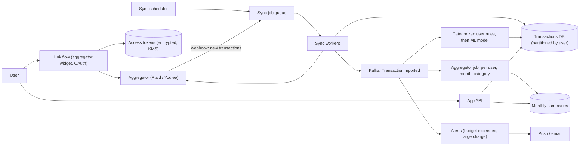
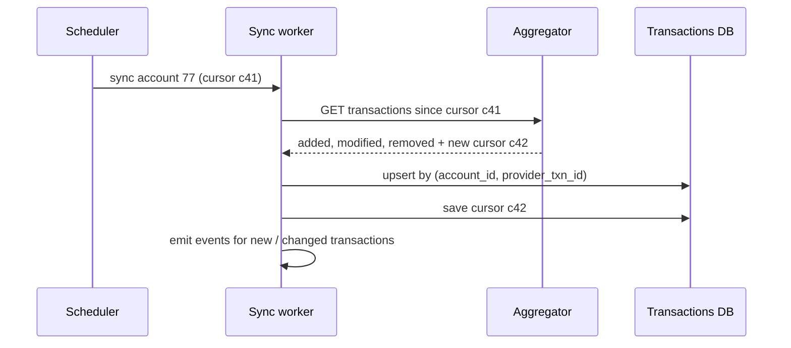

# 70 · Design a Personal Finance App (Mint)

| Category | Difficulty | Key ideas |
|---|---|---|
| Data aggregation | Medium | bank connections via aggregators, scheduled incremental sync, idempotent transaction import, categorization (rules + ML), budgets as materialized aggregates, strong security |

---

## Summary
Users link bank and card accounts through an **aggregator** (Plaid, Yodlee) using OAuth or tokens, never storing bank passwords. A **sync scheduler** pulls new transactions incrementally (plus webhooks when the aggregator pushes). Imported transactions are **deduplicated**, **categorized** by user rules then an ML model, and rolled up into **monthly aggregates** that power budgets, trends and alerts.

---

## Requirements
| Functional | Non-functional |
|---|---|
| Link accounts at many banks | 20M users, ~5 accounts each |
| Import and categorize transactions | Data fresh within hours (minutes with webhooks) |
| Budgets per category, alerts when over | No duplicated or lost transactions |
| Net worth, spending trends | Bank-grade security, encryption, audit |

### Estimates
100M accounts x 2 transactions/day = 200M transactions/day ≈ 2.3K/s writes; small rows (~500 B) -> ~100 GB/day before indexes.

---

## Architecture

---

## Sync flow

---

## Deep dives
- **Idempotent import:** unique key `(account_id, provider_txn_id)`; pending transactions often change ID or amount when they post, so handle "modified" and "removed" from the aggregator's diff.
- **Scheduling:** spread syncs through the day with jitter; prioritize users active in the app; respect aggregator rate limits; retry with backoff and mark accounts needing re-authentication.
- **Categorization:** merchant name normalization ("AMZN MKTP US*2K4" -> Amazon), user overrides as rules that always win, ML model for the rest, learn from user corrections.
- **Budgets:** keep running totals per (user, month, category) updated by events, so dashboards don't scan every transaction; recompute on re-categorization.
- **Security:** tokens encrypted with KMS, per-user data isolation, MFA, audit logs, read-only bank scopes, data deletion on request.
- **Money handling:** integer minor units with currency; multi-currency accounts converted with dated rates for reports.

---

## Interview Q&A

**Q: How do you avoid duplicate transactions after a retry or a pending-to-posted change?**
A: Upsert on the provider's transaction ID and process the aggregator's modified/removed lists; match pending and posted versions by the provider's pending-ID link.

**Q: Why precompute monthly summaries?**
A: Budget screens are read often; summing a year of transactions on every open is wasteful. Aggregates update incrementally on each import.

**Q: Where do bank credentials live?**
A: Nowhere in our system ideally: the aggregator handles login; we store only an encrypted access token.

**Related:** [Payment system](23-payment-system.md) · [Job scheduler](32-distributed-job-scheduler.md) · [Security](../01-fundamentals/15-security-authn-authz-encryption.md)
