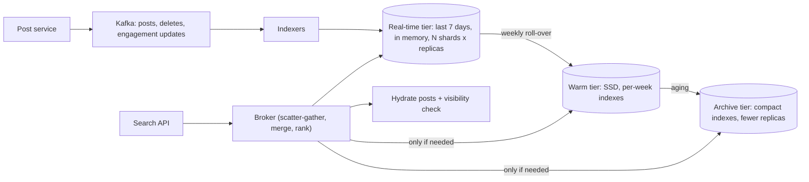
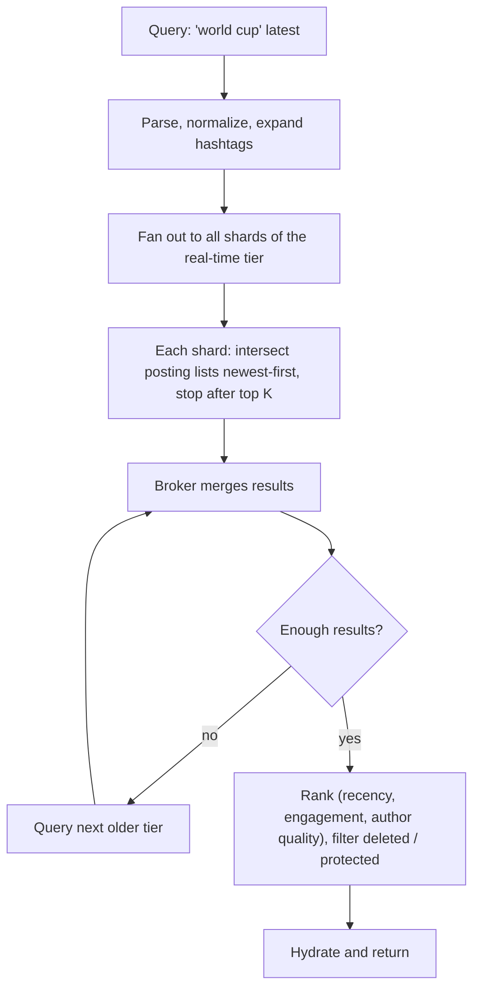

# 71 · Design Post Search (Twitter Search)

| Category | Difficulty | Key ideas |
|---|---|---|
| Search at scale | Hard | real-time inverted index, time-partitioned tiers, in-memory recent index, scatter-gather with early termination, ranking by recency + engagement |

---

## Summary
New posts flow through Kafka into **indexers** that add them to an **in-memory real-time index**, searchable within seconds. The index is **partitioned by time** (recent week in memory, older weeks on SSD, archive on cheaper storage) and **sharded** within each tier. A query goes to the recent tier first, fans out to its shards, each returns its best hits, and a broker merges and ranks them. Most queries are satisfied by the last week, so older tiers are queried only when needed.

---

## Requirements
| Functional | Non-functional |
|---|---|
| Keyword search over posts, with filters (user, date, has media) | New posts searchable within ~10 s |
| Sort by top or latest | 500B posts total, 500M new per day |
| Hashtags, mentions | p99 < 200 ms for last-week queries |
| Deleted/protected posts never shown | 50K queries/s |

### Estimates
500M posts/day ≈ 6K/s indexing. Last 7 days ≈ 3.5B posts; with ~100 bytes of index per post ≈ 350 GB -> fits in RAM across ~20-40 machines per replica.

---

## Architecture

---

## Query flow

---

## Deep dives
- **Real-time index:** posting lists stored newest-first (append to the head), so "latest" queries read the beginning and stop early. Doc IDs are time-ordered.
- **Sharding inside a tier:** by post ID (document-partitioned) so load is even and every query fans out; replicas for throughput.
- **Tiers by time:** the newest data gets the most RAM and replicas; older data is cheaper and queried rarely.
- **Deletes and privacy:** deletes flow through Kafka as tombstones; results are re-checked against current visibility at hydration.
- **Engagement signals for "top":** like/retweet counts updated asynchronously in a separate fast store, joined at ranking time rather than reindexing posts.
- **Hot queries:** cache results for trending searches for a few seconds.

---

## Interview Q&A

**Q: Why not just use one big Elasticsearch cluster?**
A: Ingest rate and freshness needs at this scale favor a custom append-only in-memory index for recent data; general-purpose clusters can work for smaller scales or older tiers.

**Q: How do you get sub-second freshness?**
A: Index directly from the post stream into memory; no batch rebuild on the hot path.

**Q: How do you search 500B posts quickly?**
A: You rarely search all of them: answer from the last week first and only touch older tiers when results are insufficient or the user asks for a date range.

**Related:** [Search systems](../01-fundamentals/19-search-systems-and-inverted-index.md) · [Web search engine](36-web-search-engine.md) · [Twitter](26-twitter.md)
