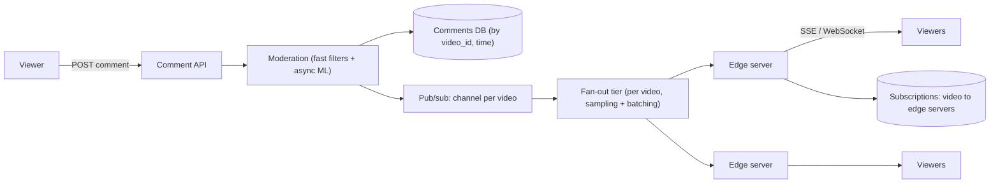
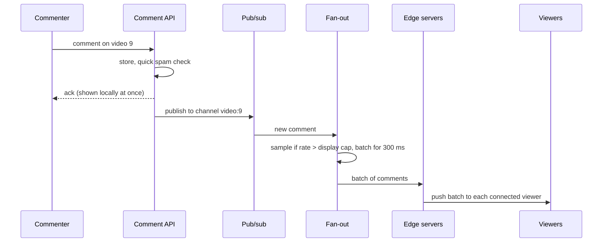

# 72 · Design Live Comments (Facebook Live / YouTube Live chat)

| Category | Difficulty | Key ideas |
|---|---|---|
| Real-time fan-out | Medium | write path to a durable store, pub/sub per video, fan-out tree of edge servers, sampling and rate capping for huge streams, batching pushes |

---

## Summary
Viewers keep a connection (SSE or WebSocket) to an **edge server**. A posted comment is moderated, stored, and published on the video's **pub/sub channel**. Edge servers subscribed to that channel push it to their viewers in **batches** every few hundred milliseconds. When a live video has more comments than anyone could read, the system **samples**: it keeps showing a readable rate (for example 20 comments per second), favoring friends, verified accounts and highly-liked comments.

---

## Requirements
| Functional | Non-functional |
|---|---|
| Post comments on a live video | Delivery to viewers within ~2 s |
| See new comments live, plus reactions | Popular streams: 5M concurrent viewers, 50K comments/s |
| Load recent comments when joining | Comments are not lost after acknowledgement |
| Moderation (spam, abuse) | Most videos small, a few enormous (hot keys) |

---

## Architecture

---

## Delivery flow

---

## Deep dives
- **Why a fan-out tier?** One pub/sub channel feeding 5M connections directly would overload it. Edge servers each hold ~100K connections and subscribe once per video they serve; the channel only fans out to a few hundred edges.
- **Sampling:** humans can't read 50K comments/s. Keep a per-video display budget; choose by priority (the viewer's friends, the streamer, verified users, high-reaction comments), then random sample the rest. The full set still goes to storage.
- **Personal views:** the commenter always sees their own comment immediately (client-side echo), even if it's sampled out for others.
- **Joining late:** fetch the last N comments from the DB/cache, then switch to the live stream.
- **Hot videos:** the comment write path for one video can be hot; buffer writes through a queue partitioned by video and write in batches.
- **Reactions (likes, hearts):** aggregate counts per second at the edge and send totals, not individual events.

---

## Interview Q&A

**Q: How is this different from a chat app?**
A: Chat must deliver every message to every member; live comments are one-to-millions and can be sampled, so the problem is fan-out and readable rate, not per-message guarantees.

**Q: How do you keep latency under 2 s with batching?**
A: Batch windows of 200-500 ms at the fan-out tier, persistent connections, and edges close to viewers.

**Related:** [Live streaming](40-live-streaming.md) · [Chat system](09-chat-system.md) · [Pub/sub](../01-fundamentals/11-message-queues-pub-sub-and-event-streaming.md)
