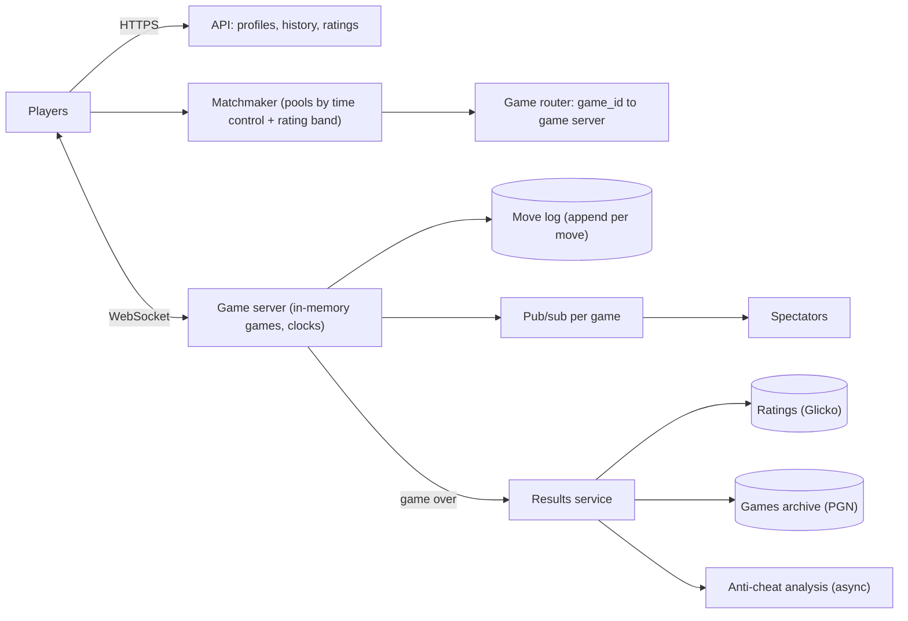
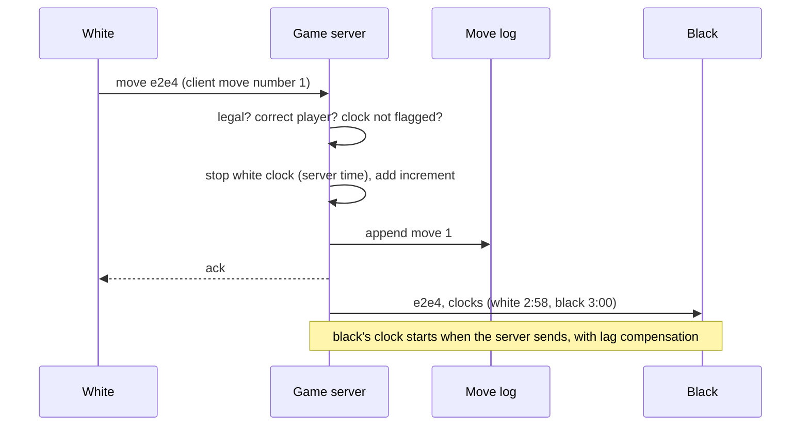

# 73 · Design an Online Chess Platform (chess.com / lichess)

| Category | Difficulty | Key ideas |
|---|---|---|
| Real-time games | Medium | rating-based matchmaking, game server owns state and clocks, WebSocket move relay, server-side move validation, durable move log |

---

## Summary
Players join a **matchmaking** pool by time control and rating. A match is assigned to a **game server** that holds the game state in memory: board, move list and both **clocks**. Clients send moves over a **WebSocket**; the server validates each move, updates the clock using its own time, appends the move to a durable **move log**, and pushes it to the opponent and spectators. Finished games are stored in PGN form for history and analysis.

---

## Requirements
| Functional | Non-functional |
|---|---|
| Matchmaking by rating and time control (bullet to classical) | 10M games/day, ~500K concurrent games at peak |
| Play with clocks, resign, draw offers, rematch | Move delivered in < 100 ms |
| Spectate live games, chat | Fair clocks (no client cheating) |
| Game history, ratings | A crashed server must not lose a game |

---

## Architecture

---

## Move flow

---

## Deep dives
- **Clocks:** the server is the time authority. Measure each player's network lag and credit a small compensation so a slow connection isn't punished unfairly; flag a player when the server clock hits zero.
- **Matchmaking:** pool per time control; widen the rating window the longer someone waits; avoid instantly re-pairing the same opponents.
- **Durability:** every move is appended to a replicated log before acknowledging. If a game server dies, another loads the move log, rebuilds the position and clocks, and players reconnect.
- **Routing:** a game lives on one server (consistent hashing on game_id or a lookup table) so both players and spectators reach the same place.
- **Spectators:** fan out via pub/sub; big events (championship games) go through a broadcast tier with slight delay.
- **Anti-cheat:** compare moves to engine suggestions after the game, timing patterns, browser signals; ban and refund ratings.
- **Ratings:** Glicko-2 updates after each game, idempotent by game ID.

---

## Interview Q&A

**Q: Why does the server validate moves if the client already does?**
A: Clients can be modified; the server is the only source of truth for the position and the clocks.

**Q: What happens if a player disconnects?**
A: Their clock keeps running; they can reconnect and resync from the move log. After a timeout the game is claimed by the opponent.

**Related:** [Multiplayer game backend](66-multiplayer-game-backend.md) · [Gaming leaderboard](22-gaming-leaderboard.md) · [Chess (object-oriented)](../05-low-level-design/08-chess-game.md)
