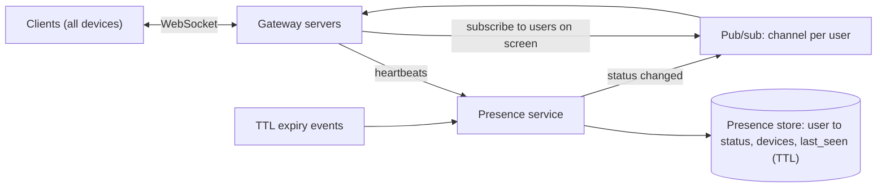
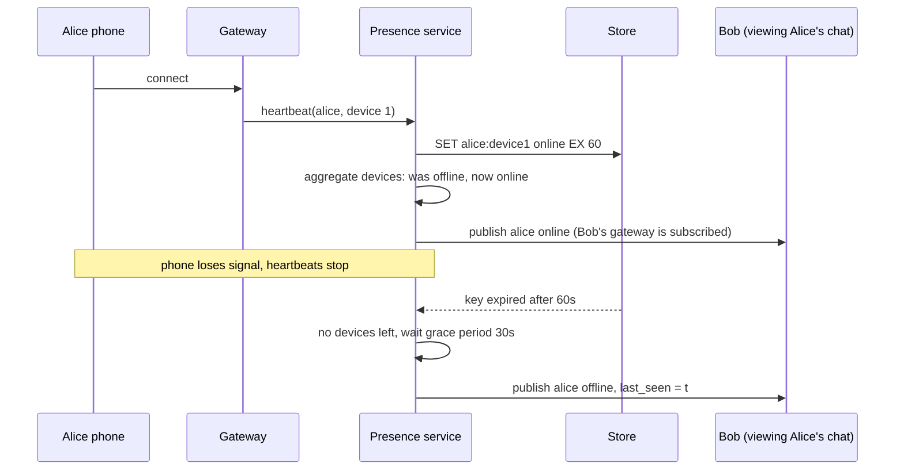

# 74 · Design an Online Presence Service (green dots)

| Category | Difficulty | Key ideas |
|---|---|---|
| Real-time state | Medium | heartbeats with TTL, presence store sharded by user, publish only status changes, subscribe-on-view instead of broadcasting to all contacts, debouncing flaps |

---

## Summary
Each connected client sends a **heartbeat** every ~30 s through its WebSocket gateway. The **presence service** stores `user -> status, last_seen` in an in-memory store with a **TTL** slightly longer than the heartbeat interval, so a missing heartbeat expires the user to offline automatically. Only **changes** (online -> away -> offline) are published. Clients **subscribe to the users currently visible on screen** (an open chat, a channel member list), not their entire contact list, which keeps fan-out manageable for 100M online users.

---

## Requirements
| Functional | Non-functional |
|---|---|
| Show online / away / offline / last seen for contacts | 100M users online at once |
| Update dots within a few seconds | Heartbeat writes: ~3M/s |
| Multiple devices per user | Avoid flicker when a phone briefly loses signal |
| Privacy settings (hide last seen) | Eventual consistency is fine |

---

## Architecture

---

## Status change flow

---

## Deep dives
- **Heartbeat interval vs accuracy:** shorter means faster offline detection but more writes. 30 s heartbeat with 60-90 s TTL is a common compromise.
- **Debounce:** wait a short grace period before announcing offline; many disconnects are reconnects a few seconds later.
- **Multiple devices:** online if any device is online; "away" if all devices are idle.
- **Fan-out control:** broadcasting every change to all contacts is O(contacts) per change. Instead, clients subscribe only to visible users; for large channels show counts ("1,234 online") computed periodically, not individual dots.
- **Store sizing:** 100M users x ~100 bytes ≈ 10 GB -> a sharded in-memory store (Redis cluster) partitioned by user ID.
- **Graceful disconnect:** on explicit logout or app close, mark offline immediately instead of waiting for TTL.
- **Privacy:** filter status by the viewer's permission before sending.

---

## Interview Q&A

**Q: Why not write "offline" when the socket closes?**
A: Sockets drop silently on mobile networks, and close events are not always delivered. TTL-based expiry is the reliable signal; socket close is an optimization.

**Q: How do you avoid sending 500 updates each time a popular user changes status?**
A: Only push to viewers currently looking at that user (subscribe-on-view), and coalesce rapid changes.

**Related:** [Chat system](09-chat-system.md) · [Slack](58-slack.md) · [Nearby friends](14-nearby-friends.md)
