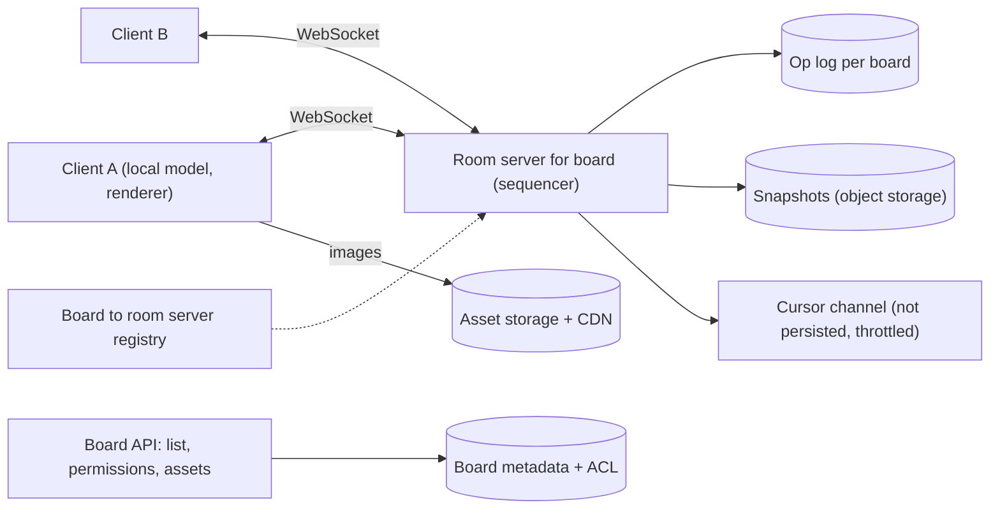
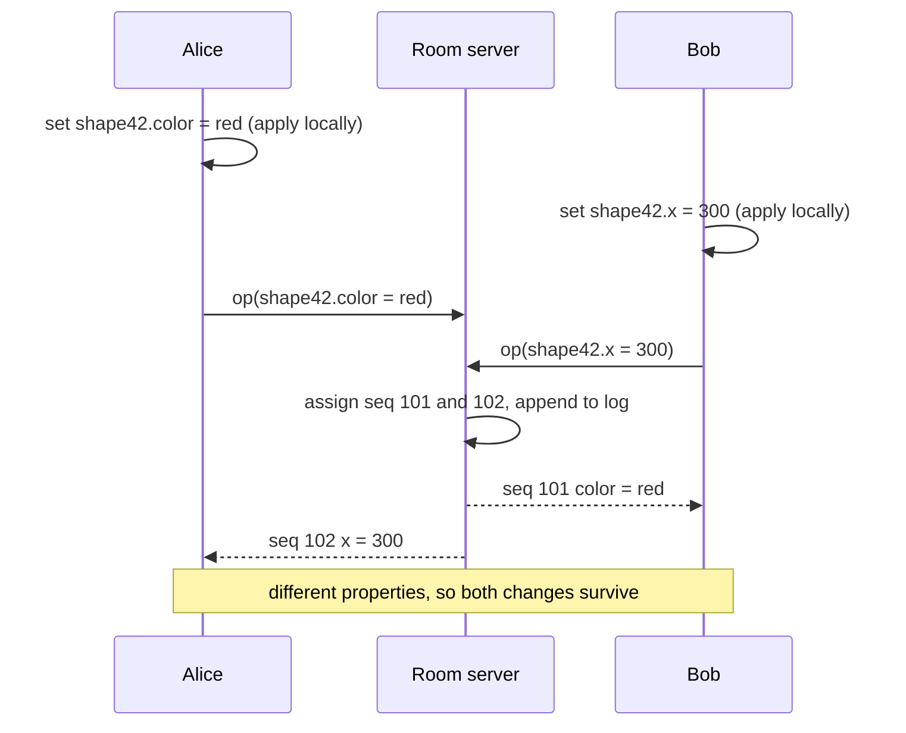

# 75 · Design a Collaborative Whiteboard (Miro / FigJam)

| Category | Difficulty | Key ideas |
|---|---|---|
| Real-time collaboration | Hard | shapes as objects with per-property last-writer-wins, room server per board, op log + snapshots, ephemeral cursor channel, viewport-based loading for infinite canvas |

---

## Summary
A board is a set of **objects** (sticky notes, shapes, lines, images), each with properties (x, y, color, text). Edits are small operations like "set shape 42.x = 300". Concurrent edits are resolved **per property with last-writer-wins** using a server-assigned order (or a CRDT map), so two people moving the same shape converge, while one changing color and another moving it both keep their changes. Each active board has a **room server** that orders and broadcasts operations, appends them to an **op log**, and periodically saves snapshots. Cursors travel on a separate lossy channel.

---

## Requirements
| Functional | Non-functional |
|---|---|
| Create, move, resize, style and delete shapes on an infinite canvas | Edits visible to others in < 200 ms |
| Many users editing at once, live cursors | Boards with 100K objects, up to ~100 editors |
| Undo/redo per user, version history | Offline edits merge on reconnect |
| Comments, images, templates | No lost edits |

---

## Architecture

---

## Concurrent edit resolution

If both change the **same** property, the higher sequence number wins on every client, so they converge. Deleting vs editing: delete wins (tombstone), unless undone.

---

## Deep dives
- **Data model:** `objects: id -> {type, props, z-index (fractional index), parent frame}`; fractional indexes allow reordering without renumbering.
- **Why not OT like Google Docs?** Whiteboard edits are mostly independent property sets on separate objects; per-property LWW (a simple CRDT) is enough and much simpler. Text inside a sticky note can use a text CRDT if collaborative typing matters.
- **Cursors and selections:** sent 10-20 times a second, dropped if late, never stored.
- **Large boards:** clients load objects in the viewport plus a margin (spatial index by tile), streaming more as the user pans.
- **Undo:** per-user stack of inverse operations, applied as new ops (so they don't undo someone else's work).
- **Offline:** queue ops locally with a client clock; on reconnect, the server orders them; LWW resolves conflicts.
- **Durability:** ops acknowledged after appending to the log; snapshots every N ops for fast loading and history.

---

## Interview Q&A

**Q: Two people drag the same sticky note at once. What happens?**
A: Both see their own drag locally; the server orders the position updates and the last one wins everywhere.

**Q: How do you open a board with 100K objects quickly?**
A: Load the latest snapshot plus recent ops, and only the objects in the current viewport first.

**Related:** [Google Docs](35-google-docs.md) · [CAP and consistency (CRDTs)](../01-fundamentals/08-cap-pacelc-and-consistency-models.md) · [Presence service](74-presence-service.md)
