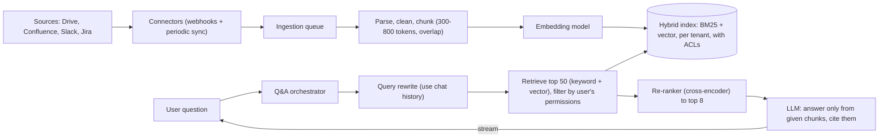
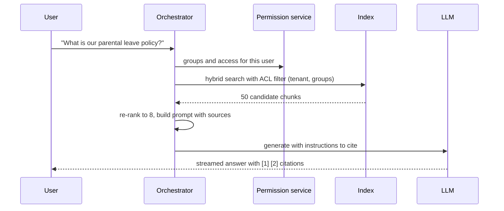

# 76 · Design Document Q&A with RAG (Glean / ChatGPT over company docs)

| Category | Difficulty | Key ideas |
|---|---|---|
| LLM + search | Medium | connectors and incremental ingestion, chunking and embeddings, hybrid retrieval (BM25 + vectors), permission filtering at query time, re-ranking, grounded answers with citations |

---

## Summary
Connectors pull documents from Google Drive, Confluence, Slack and so on, **chunk** them, compute **embeddings**, and store chunks in a **hybrid index** (keyword + vector) together with each document's **access control list**. At question time the system retrieves candidate chunks the user is **allowed to see**, **re-ranks** them, and asks an LLM to answer using only those chunks, returning **citations**. Answers stream back to the user.

---

## Requirements
| Functional | Non-functional |
|---|---|
| Ask questions in natural language over company documents | Millions of documents, thousands of companies |
| Answers cite sources | Never leak a document a user can't open |
| Index new and changed docs | Freshness: edits searchable within minutes |
| Follow-up questions | First tokens in < 2 s |

---

## Architecture

---

## Answer flow

---

## Deep dives
- **Permissions:** store each chunk's allowed users/groups (synced from the source), filter **inside** the search query, and re-check at the source for sensitive results. Never filter after the LLM sees the text.
- **Freshness:** webhooks for changes where the source supports them, otherwise incremental sync by modified time; deletes and permission changes must propagate fast.
- **Chunking:** split on headings and paragraphs, keep the document title and section in each chunk, small overlap so answers aren't cut mid-thought.
- **Hybrid retrieval:** keywords catch exact names and codes ("PTO-2024"); vectors catch meaning ("time off after a baby"); merge with reciprocal rank fusion.
- **Grounding:** instruct the model to answer only from context and say "not found" otherwise; check that cited chunks support the claims.
- **Tenancy:** separate index (or strict tenant filter) per company; per-tenant encryption keys.
- **Cost and latency:** cache embeddings, cache answers for repeated questions in a team, use a smaller model for query rewriting.
- **Evaluation:** a set of real questions with known answers to measure retrieval recall and answer accuracy before each change.

---

## Interview Q&A

**Q: How do you stop the assistant from revealing a document the user can't access?**
A: Apply ACL filters in retrieval so forbidden chunks never reach the prompt, keep ACLs in sync with the sources, and audit queries.

**Q: Why not fine-tune the model on company documents instead?**
A: Retrieval keeps answers current, supports citations and per-user permissions; fine-tuning bakes data into weights that everyone can query.

**Related:** [LLM chat service](45-llm-chat-service.md) · [Permissions service](80-permissions-service.md) · [Search systems](../01-fundamentals/19-search-systems-and-inverted-index.md)
