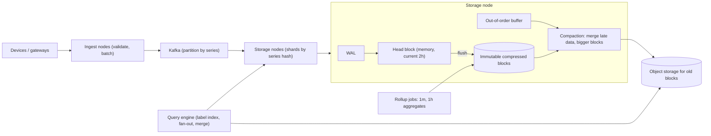
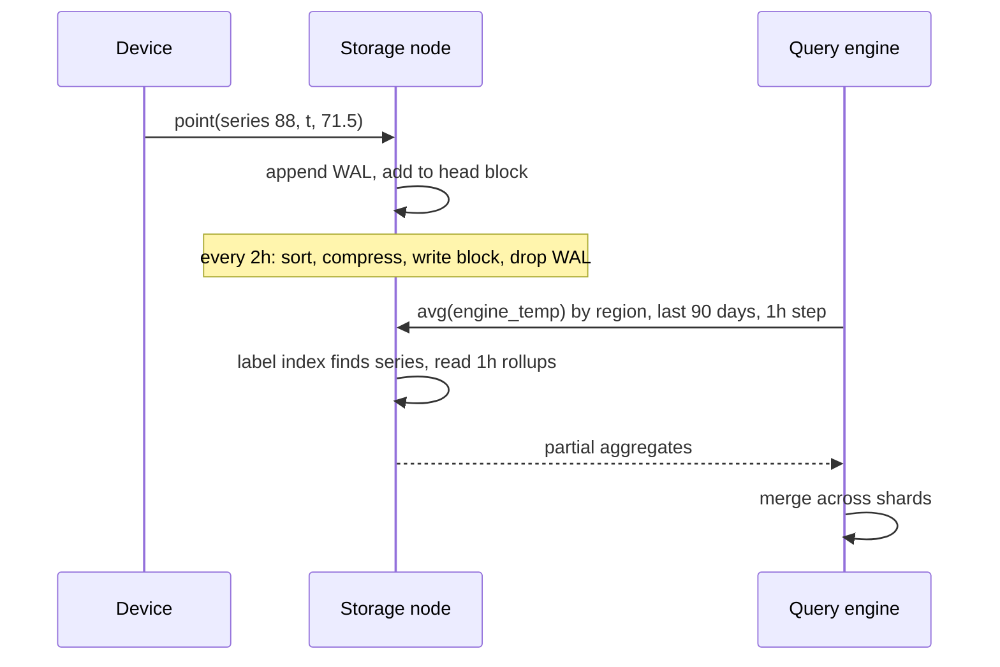

# 77 · Design a Time-Series Database (device telemetry)

| Category | Difficulty | Key ideas |
|---|---|---|
| Storage engine | Hard | series ID + time partitioning, in-memory head block with WAL, columnar compressed blocks (delta-of-delta, XOR), out-of-order and late data, downsampling, label index |

---

## Summary
Each **series** (metric + tags, for example `engine_temp{vehicle=123}`) gets an ID. Incoming points are appended to a **write-ahead log** and an **in-memory head block** per time window. When a window closes (for example 2 hours), points are sorted, **compressed** (delta-of-delta timestamps, XOR-encoded values) and flushed as immutable **blocks** partitioned by time. A **label index** finds series for a query; **rollups** (1 min, 1 h) make 90-day fleet reports fast. Late points go to a separate out-of-order buffer and are merged during compaction.

---

## Requirements
| Functional | Non-functional |
|---|---|
| Write points (series, timestamp, value) | 1M devices x 10 metrics every 10 s = 1M points/s |
| Query ranges and aggregates by tags (avg temp by region over 90 days) | Accept points up to 24 h late |
| Retention and downsampling policies | Fleet reports in seconds |
| | Store years cheaply |

---

## Architecture

---

## Write and query flow

---

## Deep dives
- **Compression:** timestamps at regular intervals become near-zero delta-of-deltas; values that change little XOR to mostly zeros. Typical result is ~1.5 bytes per point instead of 16.
- **Late data:** points older than the head window go to an out-of-order block; compaction merges them in. Rollups for affected windows are recomputed.
- **Label index:** inverted index from label value to series IDs (`region=eu` -> {series}). Watch cardinality: per-request IDs as labels create millions of series.
- **Partitioning:** shard by series so a series' points stay together; time partitioning inside a shard makes retention a matter of deleting old blocks.
- **Downsampling:** keep raw for 7-30 days, 1-minute rollups for months, 1-hour rollups for years; store min, max, sum and count so averages remain correct.
- **Queries over 90 days:** read rollups, not raw points; push aggregation down to storage nodes and merge partial results.

---

## Interview Q&A

**Q: Why not store points in a regular relational table?**
A: A row per point costs far more space, B-tree inserts at 1M/s are expensive, and range aggregates over billions of rows are slow. Columnar compressed blocks per series fix all three.

**Q: How do you handle a device that uploads yesterday's data after being offline?**
A: Accept it into an out-of-order buffer, merge it into the right blocks during compaction, and refresh the affected rollups.

**Related:** [Metrics monitoring](17-metrics-monitoring-alerting.md) · [Storage systems](../01-fundamentals/16-storage-systems-block-file-object-oltp-vs-olap.md) · [Key-value store (LSM)](03-key-value-store.md)
