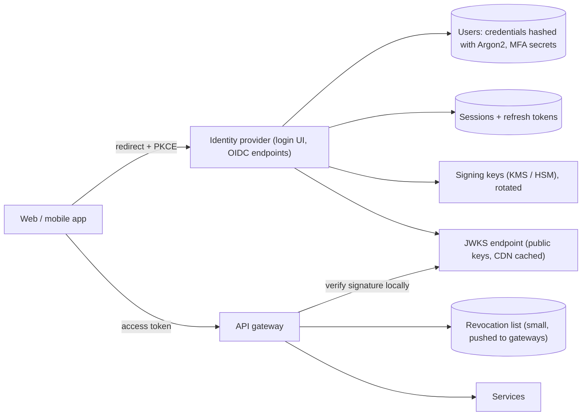
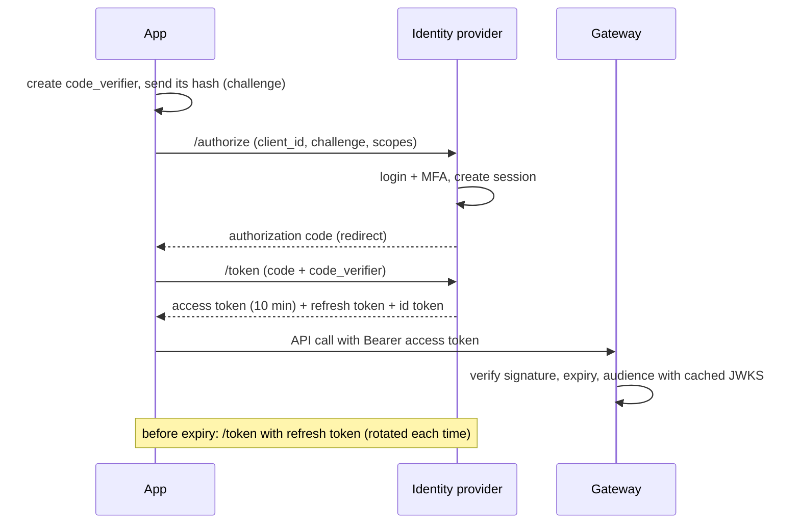

# 78 · Design an Authentication Service (SSO across web and mobile)

| Category | Difficulty | Key ideas |
|---|---|---|
| Security infrastructure | Medium | OIDC authorization code + PKCE, short-lived signed access tokens, rotating refresh tokens, JWKS for local verification, session revocation within minutes, MFA |

---

## Summary
Users sign in once at a central **identity provider** (IdP). Apps use **OIDC authorization code flow with PKCE** to get a short-lived **access token** (JWT, ~10 min) and a **refresh token**. Gateways and services verify access tokens **locally** with the IdP's public keys (JWKS), so no lookup per request. Revocation works by keeping access tokens short and checking refresh tokens (and a small revocation list) on every refresh, so a logout or compromised session is cut off within minutes.

---

## Requirements
| Functional | Non-functional |
|---|---|
| Sign up, sign in (password, social login, passkeys), MFA | 100M users, sign-in peaks of 10K/s |
| Single sign-on across many apps | Token check at the gateway with no network call |
| Sign out everywhere, revoke sessions | Revocation effective within ~5 min |
| Password reset, account recovery | Very high availability (if auth is down, everything is down) |

---

## Architecture

---

## Sign-in flow (authorization code + PKCE)

---

## Deep dives
- **Why short access tokens:** they can't be revoked individually without a lookup, so their lifetime is the revocation delay. 5-15 minutes is the usual balance.
- **Refresh token rotation:** each refresh returns a new refresh token and invalidates the old one; reuse of an old one signals theft, so revoke the whole session family.
- **Revoke now:** for urgent cases (account takeover), push session IDs to a small revocation list on gateways until their tokens expire.
- **Key rotation:** publish new keys in JWKS before using them; keep old keys until all tokens signed with them expire.
- **Password storage:** Argon2/bcrypt with per-user salt; breached-password checks; rate limiting and lockouts against credential stuffing.
- **MFA and passkeys:** TOTP, push approval, WebAuthn passkeys (phishing resistant).
- **Availability:** the IdP is replicated across regions; token verification works even if the IdP is briefly down because it's local.

---

## Interview Q&A

**Q: Why PKCE?**
A: Mobile and single-page apps can't keep a client secret; PKCE proves the app redeeming the code is the one that started the login, which blocks intercepted codes.

**Q: How does "sign out of all devices" work?**
A: Delete all refresh tokens for the user and add active sessions to the revocation list; access tokens die within minutes.

**Related:** [Security](../01-fundamentals/15-security-authn-authz-encryption.md) · [API gateway](63-api-gateway.md) · [Permissions service](80-permissions-service.md)
