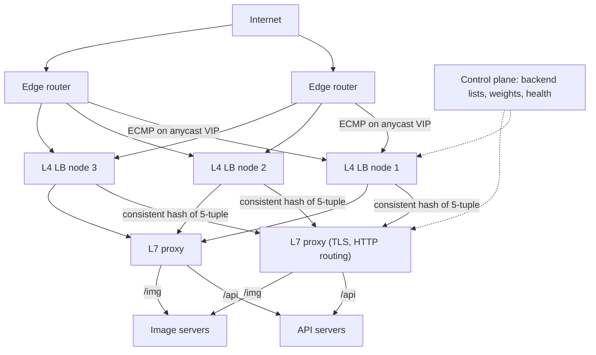
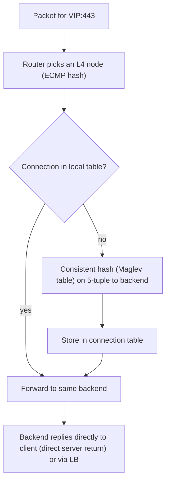

# 79 · Design a Load Balancer (L4 and L7)

| Category | Difficulty | Key ideas |
|---|---|---|
| Network infrastructure | Hard | ECMP + anycast in front of an L4 tier, consistent hashing for connection affinity, L7 proxies for HTTP routing, health checks, connection draining, no single point of failure |

---

## Summary
Build it in layers. Routers spread packets across a fleet of **L4 load balancers** using **ECMP** (equal-cost multi-path) on a shared **anycast/virtual IP**. Each L4 node picks a backend with **consistent hashing** on the connection's 5-tuple, so every packet of a connection lands on the same backend even if a different L4 node receives it. Behind that, **L7 proxies** terminate TLS and route HTTP by host and path. Health checks remove bad backends; draining lets deploys finish in-flight requests.

---

## Requirements
| Functional | Non-functional |
|---|---|
| Spread TCP/UDP connections and HTTP requests across thousands of servers | Millions of new connections per second, Tbps of traffic |
| Health checks, weighted routing, draining | No single point of failure |
| TLS termination, path routing (L7) | Adding or removing an LB node must not break existing connections |

---

## Architecture

---

## Packet path at L4

---

## Deep dives
- **Why consistent hashing at L4:** when an L4 node is added or removed, ECMP may send a connection's packets to a different node. Because every node computes the same hash, the new node picks the same backend and the connection survives.
- **Maglev-style lookup table:** fast O(1) lookup with near-even spread and minimal disruption when backends change.
- **Direct server return:** responses (usually much larger than requests) skip the LB, so the LB handles only inbound traffic.
- **L7 features:** TLS termination, HTTP/2, routing by host/path/header, retries, timeouts, rate limits, sticky sessions by cookie, request buffering.
- **Algorithms:** round robin, least connections, least latency, power of two random choices, weighted (for canaries).
- **Health checks:** active probes plus passive outlier detection; remove a backend after N failures, add back after M successes; avoid draining the whole pool if a shared dependency fails.
- **Draining:** on deploy, stop sending new connections, let existing ones finish (or time out).
- **Control plane:** distributes backend lists and weights; data plane keeps working with the last known config if the control plane is down.

---

## Interview Q&A

**Q: How do you avoid the load balancer being a single point of failure?**
A: Many L4 nodes behind ECMP on an anycast IP; any node can fail and routers stop sending to it; consistent hashing keeps connections stable.

**Q: When would you use only L4?**
A: For non-HTTP protocols or maximum throughput; add L7 when you need content-based routing, TLS termination or HTTP features.

**Related:** [Load balancing basics](../01-fundamentals/03-load-balancing.md) · [Consistent hashing](02-consistent-hashing.md) · [API gateway](63-api-gateway.md)
