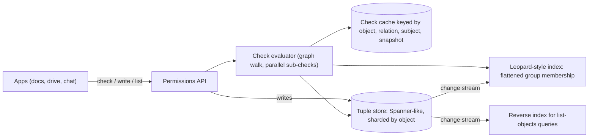
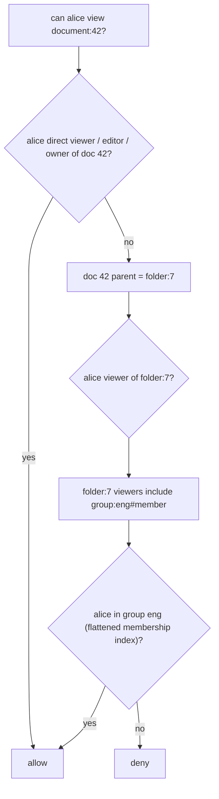

# 80 · Design a Permissions Service (Google Zanzibar style)

| Category | Difficulty | Key ideas |
|---|---|---|
| Authorization infrastructure | Hard | relationship tuples, namespace configs with inheritance rules, graph evaluation with caching, consistency tokens to avoid stale checks, reverse index for "list what I can see" |

---

## Summary
Store permissions as **relationship tuples**: `document:42#viewer@user:alice`, `folder:7#editor@group:eng#member`, `document:42#parent@folder:7`. A **namespace config** says how relations combine, for example "editors are also viewers" and "viewers of a folder are viewers of its documents". A **check** request walks this graph (with heavy caching) to answer "can Alice view document 42?" in milliseconds. **Consistency tokens** make sure a check is at least as fresh as the change that granted or removed access.

---

## Requirements
| Functional | Non-functional |
|---|---|
| Check: can user U do action A on object O? | p99 < 10 ms, millions of checks/s |
| Grant/revoke roles to users and groups | Inherited sharing: workspace -> folder -> document |
| Nested groups | No "new enemy" problem: after removing access, new content isn't visible |
| List objects a user can access; list users with access | Highly available |

---

## Data model
```
object#relation@subject
document:42#owner@user:bob
document:42#parent@folder:7
folder:7#viewer@group:eng#member
group:eng#member@user:alice
```
Namespace config (simplified):
```
document:
  owner
  editor  = owner + direct editors
  viewer  = editor + direct viewers + parent.viewer
folder:
  viewer  = direct viewers + parent.viewer
```

---

## Architecture



---

## Check evaluation


---

## Deep dives
- **Consistency tokens (zookies):** each write returns a token tied to a commit timestamp. Apps store it with the content; checks pass the token so evaluation uses a snapshot at least that new. Prevents showing new content to someone whose access was just removed.
- **Caching:** most checks repeat; cache sub-results per snapshot and share them across requests; request hedging for slow shards.
- **Deep group nesting:** precompute flattened group memberships (user -> all groups) and update incrementally from the change stream.
- **Hot objects:** a widely shared document gets many checks; cache aggressively and replicate.
- **List objects ("what can I see?"):** needs a reverse index from subjects to objects, or the app queries search and filters results with batched checks.
- **Availability:** checks are read-only and served from replicas at a recent snapshot; writes need the primary.

---

## Interview Q&A

**Q: Why tuples instead of an ACL list on each document?**
A: Tuples express inheritance and groups once (a folder share covers every document inside it), so sharing changes are one write instead of thousands.

**Q: What is the "new enemy" problem?**
A: Removing Bob from a document, then adding secret content, but a stale check still lets Bob see it. Consistency tokens make checks respect the order of those two writes.

**Related:** [Security](../01-fundamentals/15-security-authn-authz-encryption.md) · [Authentication service](78-authentication-service.md) · [Google Docs](35-google-docs.md)
