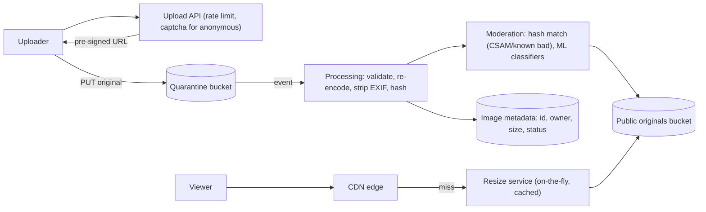
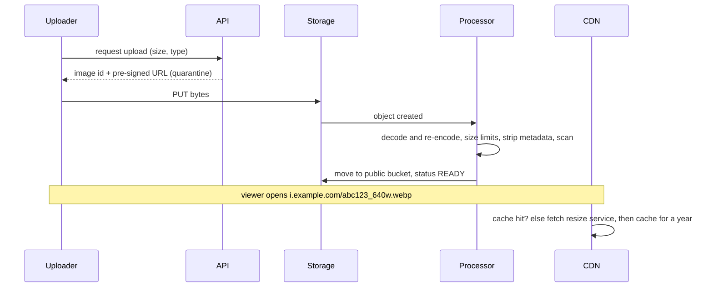

# 81 · Design an Image Hosting Service (Imgur)

| Category | Difficulty | Key ideas |
|---|---|---|
| Media serving | Easy | direct uploads, safe processing of untrusted files, on-the-fly resizing at the edge, CDN with immutable URLs, abuse and moderation pipeline, cost control |

---

## Summary
Anyone can upload an image; the service returns a short link and serves the image to anyone who opens it. Uploads go **straight to object storage** with a pre-signed URL. A processing step **validates** the file (real image, size limits), strips metadata, scans for abuse, and records the image. Viewing is almost entirely served by a **CDN**, with sizes and formats generated **on demand at the edge** and cached, so you don't pre-render every variant.

---

## Requirements
| Functional | Non-functional |
|---|---|
| Upload images (anonymous or signed in) | 2B image views/day, 2M uploads/day |
| Get a shareable link, embed in other sites | Serve cheaply (bandwidth is the main cost) |
| Thumbnails and resized versions | Safe against malicious files |
| Delete, report abuse | Remove illegal content quickly |

### Estimates
Views: 2B/day ≈ 23K/s average, peaks ~70K/s; at 300 KB average that's ~20 GB/s at peak, which only a CDN can serve economically. Storage: 2M/day x 1 MB ≈ 2 TB/day of originals.

---

## Architecture

---

## Upload and view flow

---

## Deep dives
- **Untrusted files:** never trust extensions or MIME types; decode with a hardened library in a sandbox and re-encode, which removes hidden payloads and metadata (GPS location in EXIF).
- **On-the-fly resizing:** URLs encode size and format; the edge or a resize service creates variants on first request and caches them. Limit allowed sizes to prevent cache-busting attacks.
- **Immutable URLs:** an image never changes under its URL, so cache forever; deletion purges the CDN.
- **Dedupe:** content hash to avoid storing identical uploads twice.
- **Abuse:** perceptual hash matching against known illegal content, ML classifiers, user reports, fast takedown with CDN purge, rate limits on anonymous uploads.
- **Cost:** storage tiers for old images with few views, modern formats (WebP/AVIF) to cut bandwidth, hotlink protection or limits.

---

## Interview Q&A

**Q: Why re-encode images instead of serving the upload as-is?**
A: It removes malicious payloads and private metadata, normalizes formats, and controls size.

**Q: Pre-generate thumbnails or resize on demand?**
A: Pre-generate a couple of common sizes; produce the rest on demand at the edge and cache them, since most images are viewed in only a few sizes.

**Related:** [Instagram](27-instagram.md) · [CDN](52-cdn.md) · [Object storage](21-object-storage-s3.md)
