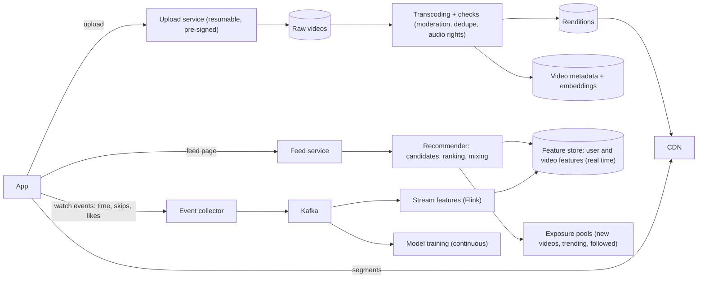
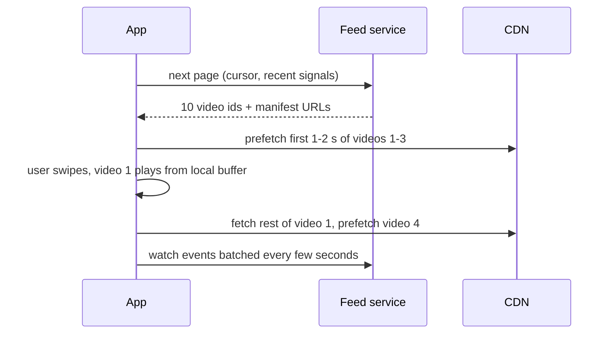

# 82 · Design a Short Video App (TikTok)

| Category | Difficulty | Key ideas |
|---|---|---|
| Media + recommendations | Hard | upload and transcode pipeline, For You feed from a recommendation engine, aggressive prefetch for instant start, real-time interest signals, cold-start exposure for new videos |

---

## Summary
Unlike a follow-based feed, the **For You** feed is driven by a **recommendation engine** that learns from watch time, replays, skips and likes in near real time. Uploaded videos are transcoded into a few renditions and pushed to the **CDN**. The app fetches the feed in pages of ~10 video IDs and **prefetches** the first seconds of the next few videos, so each swipe starts playing instantly. Every new video gets a small **test audience**; if it performs, it's shown more widely.

---

## Requirements
| Functional | Non-functional |
|---|---|
| Upload 15-60 s videos with music/effects | 1B MAU, 50M uploads/day |
| Endless personalized For You feed | Swipe-to-play under ~200 ms |
| Like, comment, share, follow | Feed reacts to interests within minutes |
| Creator analytics | Huge egress, cost-sensitive |

### Estimates
50M uploads/day x 30 MB (all renditions) ≈ 1.5 PB/day of new storage. Viewing: 1B views/hour at peak x 5 MB ≈ 1.4 TB/s -> only possible with CDNs and edge caching.

---

## Architecture

---

## Watching flow

---

## Deep dives
- **Recommendation:** candidates from interest clusters, similar users, trending and followed creators; a ranking model predicts watch-through, replay, like, share; re-rank for diversity. Session signals (skips in the last minutes) update features quickly.
- **New video exposure:** every upload is shown to a small, relevant audience; strong completion rates move it to bigger pools in stages. This is how unknown creators can go viral.
- **Instant start:** prefetch the first segment of the next few videos at a modest bitrate; short segments (1-2 s); keep a few decoders warm.
- **Transcoding:** fewer renditions than long-form video because clips are short; start encoding the lowest quality first so the video can be published sooner.
- **Moderation:** automated checks before wide distribution, with human review for borderline content.
- **Cost:** popular videos cached at edges and ISPs; long-tail videos served from regional caches.

---

## Interview Q&A

**Q: How is this feed different from Twitter's?**
A: It's interest-based, not follow-based, so there's no fan-out; each request ranks candidates from a large pool using fresh engagement signals.

**Q: How do you make every swipe start instantly?**
A: Prefetch the first seconds of upcoming videos while the current one plays, use short segments and nearby CDN edges.

**Related:** [Recommendation system](43-recommendation-system.md) · [YouTube](11-youtube.md) · [Video transcoding pipeline](83-video-transcoding-pipeline.md)
