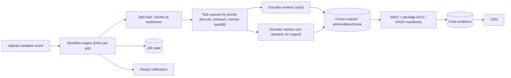
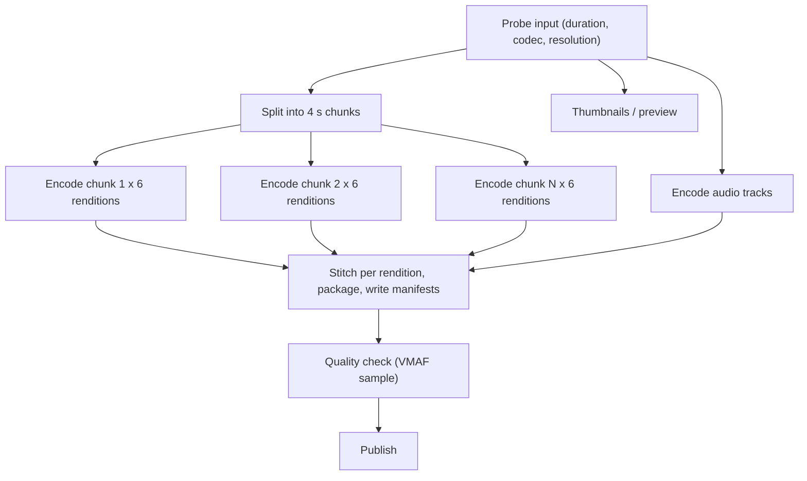

# 83 · Design a Video Transcoding Pipeline

| Category | Difficulty | Key ideas |
|---|---|---|
| Batch compute | Hard | split into GOP-aligned chunks, parallel encode tasks, DAG workflow, idempotent retries, priority queues and fair share, cheap spot capacity with checkpointing |

---

## Summary
An uploaded video is **split into chunks** at keyframe boundaries. A **workflow engine** turns the job into a DAG of tasks: split, encode each chunk for each rendition in parallel, encode audio, generate thumbnails, then **stitch and package** (HLS/DASH). Tasks are **idempotent** (output keyed by job, chunk and rendition), so a retry simply overwrites. A **scheduler** gives priority to small or premium jobs and runs most encoding on **spot instances**, which are cheap but can disappear, so tasks are short and restartable.

---

## Requirements
| Functional | Non-functional |
|---|---|
| Encode uploads into an ABR ladder (240p to 4K) and codecs | Thousands of uploads per minute |
| Thumbnails, previews, packaging | Short videos ready in under a minute |
| Job status and notifications | Fair: one big uploader can't starve others |
| Re-encode the back catalog with new codecs | Cost-efficient |

---

## Architecture

---

## Job as a DAG

---

## Deep dives
- **Why chunks:** a 1-hour video encoded on one machine takes hours; split into 900 chunks it finishes in minutes, and a failure retries only one chunk.
- **Keyframe alignment:** chunks start on keyframes so they decode independently and stitch cleanly.
- **Idempotent tasks:** deterministic output paths; the workflow marks a task done only after the output exists; duplicate executions are harmless.
- **Priorities and fairness:** separate queues and weighted fair scheduling per customer/tenant; small jobs jump ahead so short videos publish fast; backfills use leftover capacity.
- **Spot instances:** tasks of 1-2 minutes lose little work on preemption; the scheduler re-queues interrupted tasks; keep some on-demand capacity for urgent jobs.
- **Fast publish:** encode the lowest rendition first and publish it, then add higher qualities as they finish.
- **Per-title encoding:** pick the bitrate ladder based on content complexity to save bandwidth.
- **Observability:** queue age per priority, task failure rates by input type, cost per encoded minute.

---

## Interview Q&A

**Q: A worker dies halfway through a chunk. What happens?**
A: The task's lease expires, it's re-queued, another worker re-encodes that chunk and overwrites the same output path.

**Q: How do you stop one customer uploading 10,000 videos from delaying everyone?**
A: Per-tenant queues with weighted fair scheduling and quotas, so their jobs share capacity instead of monopolizing it.

**Related:** [YouTube](11-youtube.md) · [Job scheduler](32-distributed-job-scheduler.md) · [Live streaming](40-live-streaming.md)
