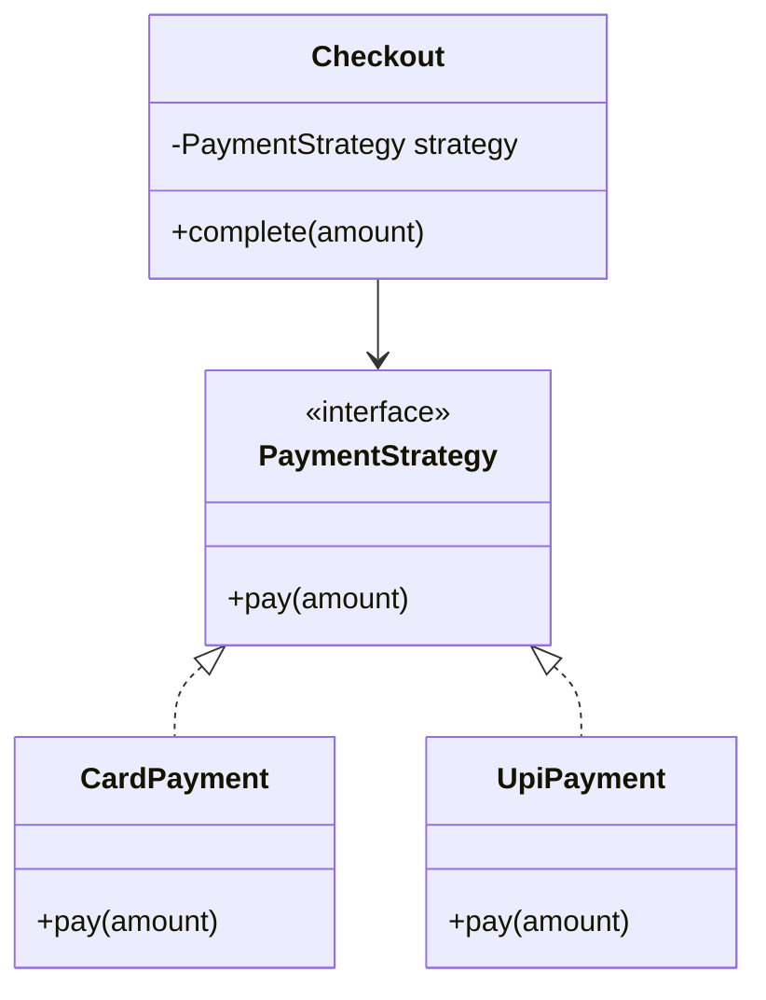

# Low-Level Design Basics: OOP, SOLID and Design Patterns

Low-level design (LLD, also called object-oriented design or machine coding) is a separate interview round from high-level system design. Instead of boxes like "cache" and "queue", you design **classes, interfaces and their interactions** for one component, and often write working code in 45-90 minutes.

---

## How an LLD round usually goes
1. Clarify requirements and scope (what operations, what is out of scope).
2. Identify the **core entities** (nouns) and **behaviours** (verbs).
3. Draw a **class diagram**: classes, attributes, relationships.
4. Define key interfaces and pick design patterns where they genuinely help.
5. Write code for the main flows; handle concurrency and edge cases.
6. Discuss extensibility: "what if we add X?"

---

## OOP building blocks
| Concept | Meaning | Example |
|---|---|---|
| Encapsulation | Hide internal state behind methods | `account.withdraw(100)` instead of editing `balance` |
| Abstraction | Expose what, hide how | `PaymentMethod.pay(amount)` |
| Inheritance | Reuse via "is-a" | `Car` is a `Vehicle` |
| Polymorphism | Same call, different behaviour | `spot.fits(vehicle)` per spot type |
| Composition | "Has-a"; usually preferred over inheritance | `ParkingLot` has `Floor`s |

---

## SOLID
| Principle | In one line | Smell when violated |
|---|---|---|
| **S**ingle responsibility | A class has one reason to change | `OrderService` that also sends emails and formats PDFs |
| **O**pen/closed | Extend behaviour without editing existing code | Long `if type == ...` chains for every new type |
| **L**iskov substitution | Subclasses must work wherever the parent is expected | `Square` breaking `Rectangle.setWidth` assumptions |
| **I**nterface segregation | Many small interfaces beat one fat one | Classes implementing methods they don't need |
| **D**ependency inversion | Depend on abstractions, inject implementations | Business logic creating `MySQLRepository()` directly |

---

## Design patterns that show up most in interviews

| Pattern | Problem it solves | Where you'd use it |
|---|---|---|
| Strategy | Swap algorithms at runtime | Pricing rules, spot allocation, payment methods, elevator scheduling |
| State | Behaviour depends on internal state | Vending machine, order lifecycle, elevator |
| Observer | Notify many listeners of changes | Display boards, notifications, event buses |
| Factory | Centralize object creation | Creating vehicles, payment processors, notifications by type |
| Singleton | Exactly one instance (use sparingly) | Configuration, the parking lot itself |
| Builder | Construct complex objects step by step | HTTP requests, reports |
| Decorator | Add behaviour without subclass explosion | Toppings on a pizza, logging/caching wrappers |
| Command | Encapsulate a request as an object | Undo/redo, job queues, elevator requests |
| Chain of responsibility | Pass a request along handlers | Middleware, approval flows, ATM cash dispensing |
| Adapter | Make incompatible interfaces work together | Wrapping third-party payment SDKs |

---

## Concurrency checklist for LLD code
- Which shared objects are mutated by multiple threads (seats, spots, balances)?
- Protect them with a lock per object (not one global lock) or atomic compare-and-set.
- Keep critical sections small; never call slow I/O while holding a lock.
- Make operations idempotent where retries are possible.

---

## Problems in this section
| Problem | Main patterns |
|---|---|
| [Parking lot](01-parking-lot.md) | Strategy, Factory, Singleton |
| [Elevator system](02-elevator-system.md) | State, Strategy, Command |
| [LRU cache](03-lru-cache.md) | Hash map + doubly linked list, thread safety |
| [Splitwise (expense sharing)](04-splitwise.md) | Strategy, graph simplification |
| [Vending machine](05-vending-machine.md) | State |
| [Movie ticket booking (BookMyShow)](06-movie-ticket-booking.md) | Seat locking, Observer, Strategy |
| [In-memory rate limiter](07-rate-limiter-class.md) | Strategy, thread safety |
