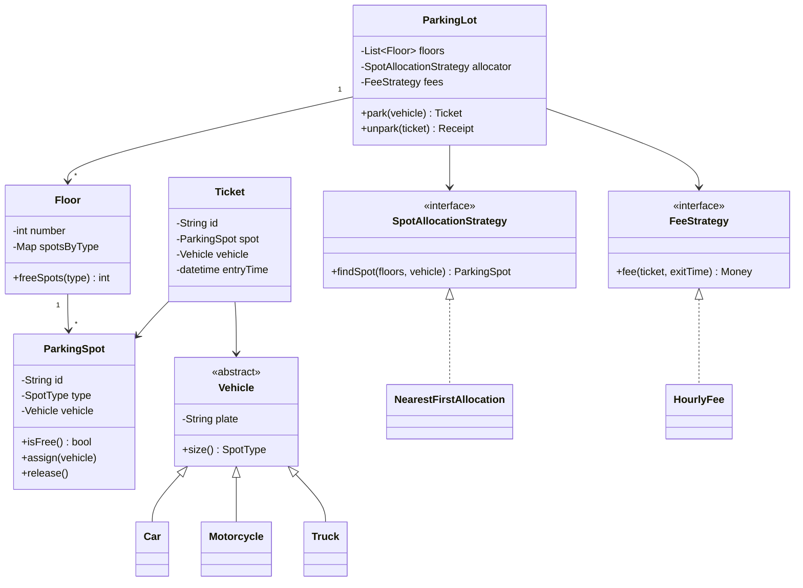

# LLD 01 · Parking Lot

## Requirements
- Multiple floors, each with spots of different sizes: motorcycle, compact, large (and EV charging).
- Vehicles: motorcycle, car, truck. A vehicle can park in a spot of its size or larger.
- Entry issues a ticket; exit computes the fee by duration and vehicle type, accepts payment, frees the spot.
- Show available spots per floor and type.
- Multiple entry/exit gates working concurrently.

## Entities
`ParkingLot`, `Floor`, `ParkingSpot`, `Vehicle`, `Ticket`, `Gate`, `FeeStrategy`, `SpotAllocationStrategy`, `Payment`.

## Class diagram


## Core code (Python)
```python
from enum import IntEnum
from datetime import datetime
import threading, uuid, math

class SpotType(IntEnum):        # ordered by size
    MOTORCYCLE = 1
    COMPACT = 2
    LARGE = 3

class Vehicle:
    def __init__(self, plate, size: SpotType):
        self.plate, self.size = plate, size

class ParkingSpot:
    def __init__(self, spot_id, spot_type: SpotType):
        self.id, self.type, self.vehicle = spot_id, spot_type, None
        self._lock = threading.Lock()

    def try_assign(self, vehicle) -> bool:
        with self._lock:                      # two gates may pick the same spot
            if self.vehicle is None and self.type >= vehicle.size:
                self.vehicle = vehicle
                return True
            return False

    def release(self):
        with self._lock:
            self.vehicle = None

class NearestFirstAllocation:
    def find_and_assign(self, floors, vehicle):
        for floor in floors:                  # lower floors first
            for spot in floor.spots:
                if spot.vehicle is None and spot.type >= vehicle.size and spot.try_assign(vehicle):
                    return spot
        return None

class HourlyFee:
    RATES = {SpotType.MOTORCYCLE: 10, SpotType.COMPACT: 20, SpotType.LARGE: 40}
    def fee(self, ticket, exit_time):
        hours = max(1, math.ceil((exit_time - ticket.entry).total_seconds() / 3600))
        return hours * self.RATES[ticket.vehicle.size]

class Ticket:
    def __init__(self, vehicle, spot):
        self.id, self.vehicle, self.spot = str(uuid.uuid4()), vehicle, spot
        self.entry = datetime.now()

class ParkingLot:
    def __init__(self, floors, allocator, fees):
        self.floors, self.allocator, self.fees = floors, allocator, fees
        self.active = {}                      # ticket_id -> Ticket

    def park(self, vehicle):
        spot = self.allocator.find_and_assign(self.floors, vehicle)
        if spot is None:
            raise RuntimeError("Lot full for this vehicle type")
        ticket = Ticket(vehicle, spot)
        self.active[ticket.id] = ticket
        return ticket

    def unpark(self, ticket_id):
        ticket = self.active.pop(ticket_id)
        amount = self.fees.fee(ticket, datetime.now())
        ticket.spot.release()
        return amount
```

## Design decisions
- **Strategy** for allocation and pricing, so "nearest to elevator", "EV spots first" or weekend pricing are new classes, not edits.
- **Per-spot locks** instead of one global lock, so gates don't block each other.
- Keep availability counters per floor and type for the display board (update on assign/release, or use Observer to push to displays).

## Follow-up questions
- Add EV charging spots with an extra fee? New `SpotType` plus a decorator on the fee strategy.
- Reservations in advance? Add a `Reservation` with a time window and mark spots as reserved.
- Distributed lot with many gates on different machines? Move spot state to a database and use conditional updates, like seat booking.
