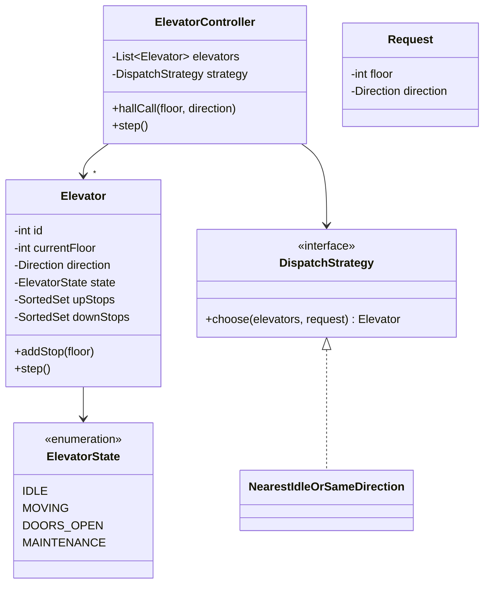
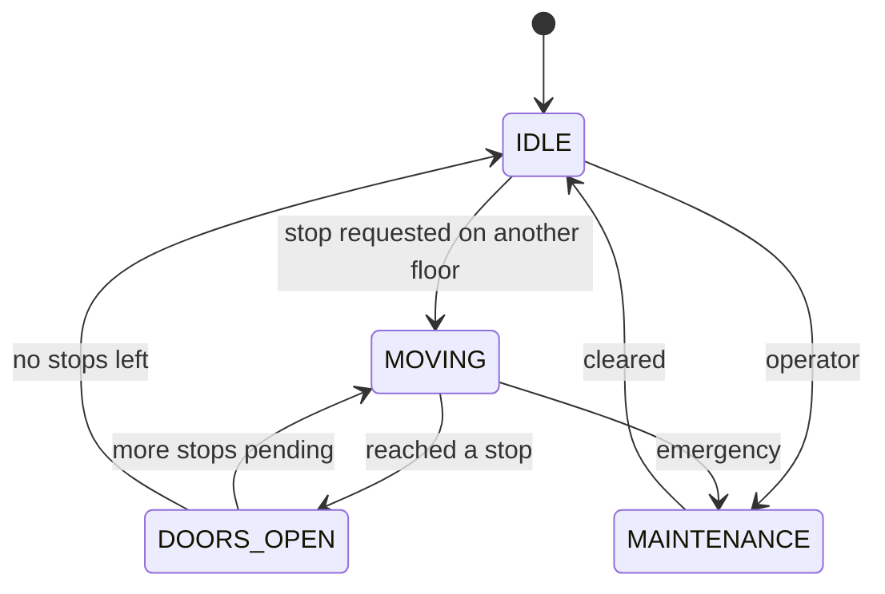

# LLD 02 · Elevator System

## Requirements
- A building with N floors and M elevators.
- Hall calls: a person on a floor presses up or down.
- Car calls: a person inside presses a destination floor.
- The controller assigns hall calls to elevators and each elevator serves requests efficiently.
- Doors, capacity limit, emergency stop / maintenance mode.

## Entities
`ElevatorController`, `Elevator`, `Request` (hall or car), `Direction`, `ElevatorState`, `DispatchStrategy`, `Door`, `Display`.

## Class diagram


## Elevator state machine


## Scheduling: the SCAN / LOOK algorithm
Each elevator keeps two sorted sets of stops. While going up it serves every up-stop above it in order, then reverses and serves down-stops. This avoids starvation and zig-zagging, the same idea as disk-arm scheduling.

## Core code (Python)
```python
from enum import Enum

class Direction(Enum):
    UP = 1
    DOWN = -1
    IDLE = 0

class Elevator:
    def __init__(self, eid, floors):
        self.id, self.floor, self.dir = eid, 0, Direction.IDLE
        self.up, self.down = set(), set()

    def add_stop(self, floor):
        if floor > self.floor: self.up.add(floor)
        elif floor < self.floor: self.down.add(floor)

    def step(self):
        if self.dir in (Direction.UP, Direction.IDLE) and self.up:
            self.dir = Direction.UP
            self.floor += 1
            if self.floor in self.up:
                self.up.discard(self.floor)       # open doors here
        elif self.down:
            self.dir = Direction.DOWN
            self.floor -= 1
            if self.floor in self.down:
                self.down.discard(self.floor)
        else:
            self.dir = Direction.IDLE

    def cost(self, floor, direction):
        # cheap if idle, or moving towards the floor in the same direction
        dist = abs(self.floor - floor)
        if self.dir == Direction.IDLE:
            return dist
        same_way = (self.dir == direction) and ((floor - self.floor) * self.dir.value >= 0)
        return dist if same_way else dist + 2 * len(self.up | self.down)

class Controller:
    def __init__(self, elevators):
        self.elevators = elevators

    def hall_call(self, floor, direction):
        best = min(self.elevators, key=lambda e: e.cost(floor, direction))
        best.add_stop(floor)
        return best.id
```

## Design decisions
- **Strategy** for dispatching: nearest car, least loaded, zoning (some cars only serve high floors), or energy-saving at night.
- **State** pattern (or an enum with a transition table) keeps door and movement rules explicit.
- **Command** objects for requests make it easy to queue, log and cancel them.

## Follow-up questions
- Peak hours (morning rush)? Park idle elevators at the lobby; dedicate cars to express zones.
- Capacity full? Skip hall calls when the load sensor says full, re-dispatch to another car.
- Fire mode? All cars return to the ground floor and ignore hall calls.
