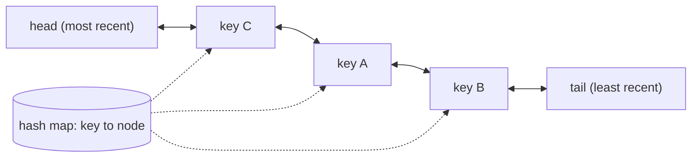
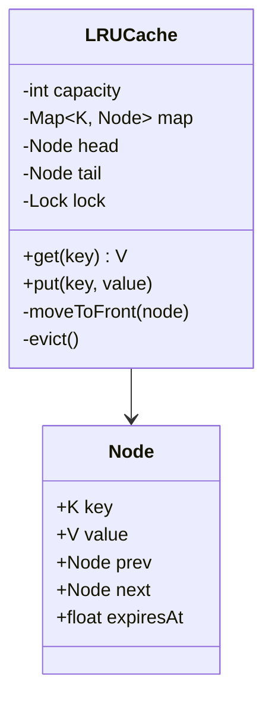

# LLD 03 · LRU Cache

## Requirements
- `get(key)` and `put(key, value)` in O(1).
- Fixed capacity; when full, evict the least recently used entry.
- Optional: TTL per entry, thread safety, eviction listener.

## Data structure
A **hash map** gives O(1) lookup of a node; a **doubly linked list** keeps usage order with O(1) move-to-front and remove-from-tail.



## Class diagram


## Code (Python, thread-safe, optional TTL)
```python
import threading, time

class Node:
    __slots__ = ("key", "value", "prev", "next", "expires_at")
    def __init__(self, key=None, value=None, expires_at=None):
        self.key, self.value, self.expires_at = key, value, expires_at
        self.prev = self.next = None

class LRUCache:
    def __init__(self, capacity, on_evict=None):
        self.capacity, self.map, self.on_evict = capacity, {}, on_evict
        self.head, self.tail = Node(), Node()        # sentinels
        self.head.next, self.tail.prev = self.tail, self.head
        self.lock = threading.Lock()

    def _unlink(self, n):
        n.prev.next, n.next.prev = n.next, n.prev

    def _push_front(self, n):
        n.next, n.prev = self.head.next, self.head
        self.head.next.prev = n
        self.head.next = n

    def get(self, key):
        with self.lock:
            n = self.map.get(key)
            if n is None:
                return None
            if n.expires_at and n.expires_at < time.monotonic():
                self._unlink(n); del self.map[key]
                return None
            self._unlink(n); self._push_front(n)
            return n.value

    def put(self, key, value, ttl=None):
        exp = time.monotonic() + ttl if ttl else None
        with self.lock:
            if key in self.map:
                n = self.map[key]
                n.value, n.expires_at = value, exp
                self._unlink(n); self._push_front(n)
                return
            if len(self.map) >= self.capacity:
                lru = self.tail.prev
                self._unlink(lru); del self.map[lru.key]
                if self.on_evict:
                    self.on_evict(lru.key, lru.value)
            n = Node(key, value, exp)
            self.map[key] = n
            self._push_front(n)
```

## Design decisions
- Sentinel head/tail nodes remove edge cases for empty lists.
- One lock is simple; for high concurrency, shard the cache into N segments each with its own lock (like Java's `ConcurrentHashMap`), or use approximate LRU (sampling, as Redis does).
- TTL is checked lazily on `get`; a background sweeper can remove expired entries proactively.

## Follow-up questions
- LFU instead of LRU? Keep a frequency map to doubly linked lists of keys with that frequency; track the minimum frequency for O(1) eviction.
- Why not Python's `OrderedDict`? It works (`move_to_end`, `popitem(last=False)`), but interviewers usually want to see the underlying structure.
- Distributed version? See [Distributed cache](../03-problems/31-distributed-cache.md).
