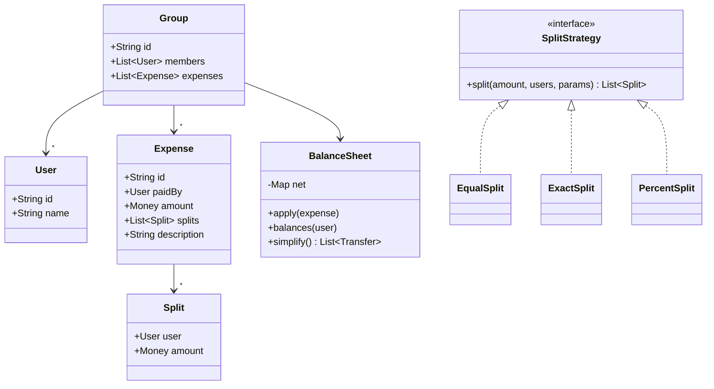

# LLD 04 · Splitwise (Expense Sharing)

## Requirements
- Users and groups.
- Add an expense paid by one user, split among participants: equally, by exact amounts, or by percentage.
- Show balances: who owes whom and how much.
- Settle up; optionally simplify debts within a group (minimum number of transactions).

## Class diagram


## Core code (Python)
```python
from collections import defaultdict
import heapq

class EqualSplit:
    def split(self, amount_cents, users, _=None):
        share, rem = divmod(amount_cents, len(users))
        # give the leftover cents to the first users so the total is exact
        return {u: share + (1 if i < rem else 0) for i, u in enumerate(users)}

class PercentSplit:
    def split(self, amount_cents, users, percents):
        assert sum(percents) == 100
        parts = {u: amount_cents * p // 100 for u, p in zip(users, percents)}
        parts[users[0]] += amount_cents - sum(parts.values())
        return parts

class BalanceSheet:
    def __init__(self):
        self.net = defaultdict(int)          # positive = should receive money

    def add_expense(self, paid_by, amount_cents, users, strategy, params=None):
        for user, owed in strategy.split(amount_cents, users, params).items():
            self.net[user] -= owed
        self.net[paid_by] += amount_cents

    def simplify(self):
        """Greedy: match biggest creditor with biggest debtor."""
        creditors = [(-v, u) for u, v in self.net.items() if v > 0]
        debtors = [(v, u) for u, v in self.net.items() if v < 0]
        heapq.heapify(creditors); heapq.heapify(debtors)
        transfers = []
        while creditors and debtors:
            c_amt, c = heapq.heappop(creditors)
            d_amt, d = heapq.heappop(debtors)
            pay = min(-c_amt, -d_amt)
            transfers.append((d, c, pay))
            if -c_amt > pay: heapq.heappush(creditors, (c_amt + pay, c))
            if -d_amt > pay: heapq.heappush(debtors, (d_amt + pay, d))
        return transfers
```

## Design decisions
- Store money as **integer cents** to avoid floating-point errors; distribute leftover cents deterministically.
- **Strategy** for split types; adding "split by shares" is a new class.
- Keep a **net balance per user** per group; it is enough to compute who owes whom and to simplify debts.
- Keep expenses as immutable records; edits create a reversal plus a new expense, so history is auditable.

## Follow-up questions
- Multiple currencies? Store currency per expense; convert at settlement time with a recorded rate.
- Is greedy simplification optimal? It gives at most N-1 transfers; the true minimum is NP-hard in general, so greedy is the accepted answer.
- Scale to millions of users? Expenses in a database partitioned by group; balances maintained incrementally.
