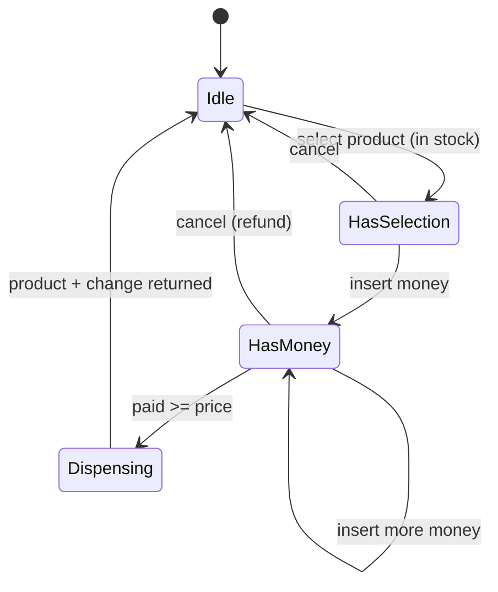
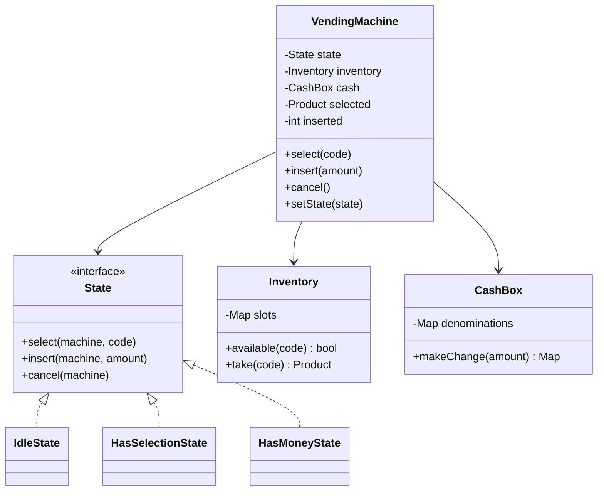

# LLD 05 · Vending Machine

## Requirements
- Products in slots with prices and stock.
- User selects a product, inserts coins/notes, gets the product and change.
- Cancel returns inserted money.
- Admin restocks products and collects cash.
- Handle out-of-stock and "cannot make change".

## State machine


## Class diagram


## Core code (Python, State pattern)
```python
class IdleState:
    def select(self, m, code):
        if not m.inventory.available(code):
            raise ValueError("Out of stock")
        m.selected = m.inventory.product(code)
        m.state = HasSelectionState()
    def insert(self, m, amount): raise ValueError("Select a product first")
    def cancel(self, m): pass

class HasSelectionState:
    def select(self, m, code): IdleState().select(m, code)    # change selection
    def insert(self, m, amount):
        m.inserted += amount
        m.state = HasMoneyState()
        m.state.check(m)
    def cancel(self, m):
        m.selected, m.state = None, IdleState()

class HasMoneyState:
    def select(self, m, code): raise ValueError("Already paying")
    def insert(self, m, amount):
        m.inserted += amount
        self.check(m)
    def check(self, m):
        if m.inserted < m.selected.price:
            return
        change = m.cash.make_change(m.inserted - m.selected.price)   # raises if impossible
        m.inventory.take(m.selected.code)
        m.cash.add(m.inserted)
        m.dispense(m.selected, change)
        m.selected, m.inserted, m.state = None, 0, IdleState()
    def cancel(self, m):
        m.refund(m.inserted)
        m.selected, m.inserted, m.state = None, 0, IdleState()

class CashBox:
    def __init__(self, coins):            # {denomination: count}
        self.coins = coins
    def make_change(self, amount):
        result = {}
        for d in sorted(self.coins, reverse=True):     # greedy works for standard coin sets
            use = min(amount // d, self.coins[d])
            if use:
                result[d] = use
                amount -= use * d
        if amount:
            raise ValueError("Cannot make change, refunding")
        for d, n in result.items():
            self.coins[d] -= n
        return result
```

## Design decisions
- **State** pattern makes illegal actions explicit per state instead of scattered `if` checks.
- Check change availability **before** dispensing; otherwise refund.
- Inventory and cash box are separate classes (single responsibility).

## Follow-up questions
- Card payments? Add a payment strategy; the HasMoney state becomes "PaymentPending" waiting for authorization.
- Remote monitoring? Observer that publishes stock and cash levels to a backend.
