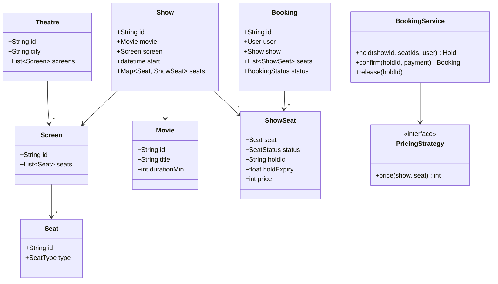
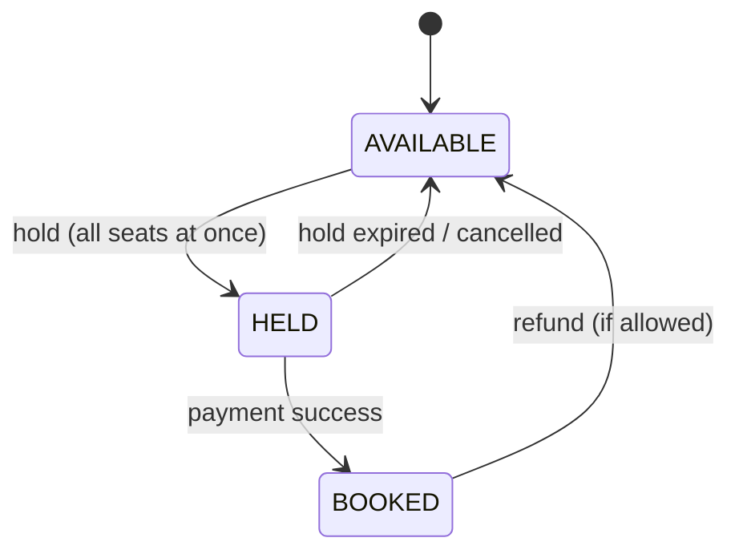

# LLD 06 · Movie Ticket Booking (BookMyShow)

## Requirements
- Cities have theatres; theatres have screens; screens have seats (regular, premium).
- Movies have shows (movie + screen + start time).
- Users search shows, view the seat map, select seats, hold them for a few minutes, pay, and get a booking.
- Two users must never book the same seat for the same show.

## Class diagram


## Seat status flow


## Core code (Python)
```python
import threading, time, uuid

HOLD_SECONDS = 300

class ShowSeat:
    def __init__(self, seat_id, price):
        self.seat_id, self.price = seat_id, price
        self.status, self.hold_id, self.hold_expiry = "AVAILABLE", None, 0.0

class Show:
    def __init__(self, show_id, seats):
        self.id, self.seats = show_id, seats          # {seat_id: ShowSeat}
        self.lock = threading.Lock()                  # one lock per show

class BookingService:
    def __init__(self):
        self.holds = {}                               # hold_id -> (show, seat_ids, user)

    def _free(self, s):
        return s.status == "AVAILABLE" or (s.status == "HELD" and s.hold_expiry < time.time())

    def hold(self, show, seat_ids, user):
        with show.lock:                               # all-or-nothing hold
            seats = [show.seats[i] for i in seat_ids]
            if not all(self._free(s) for s in seats):
                raise ValueError("One or more seats are taken")
            hold_id = str(uuid.uuid4())
            for s in seats:
                s.status, s.hold_id, s.hold_expiry = "HELD", hold_id, time.time() + HOLD_SECONDS
            self.holds[hold_id] = (show, seat_ids, user)
            return hold_id

    def confirm(self, hold_id, pay):
        show, seat_ids, user = self.holds[hold_id]
        with show.lock:
            seats = [show.seats[i] for i in seat_ids]
            if any(s.hold_id != hold_id or s.hold_expiry < time.time() for s in seats):
                raise ValueError("Hold expired")
        pay(sum(s.price for s in seats))              # outside the lock: slow I/O
        with show.lock:
            for s in seats:
                s.status = "BOOKED"
        return {"booking_id": str(uuid.uuid4()), "user": user, "seats": seat_ids}
```

## Design decisions
- Lock per **show**, not global, so different shows never contend.
- Holds expire by timestamp (lazy expiry) so a crashed client never blocks seats forever.
- Payment runs outside the lock; the hold protects the seats meanwhile.
- **Strategy** for pricing (weekday/weekend, premium seats, dynamic pricing); **Observer** to push seat-map updates to clients.

## Follow-up questions
- Multiple servers? Keep seat state in a database and replace the lock with a conditional update (`WHERE status = 'AVAILABLE'`). The full distributed version is [Ticketmaster](../03-problems/29-ticketmaster.md).
- Payment succeeds after the hold expired? Refund automatically, or extend holds while payment is in progress.
