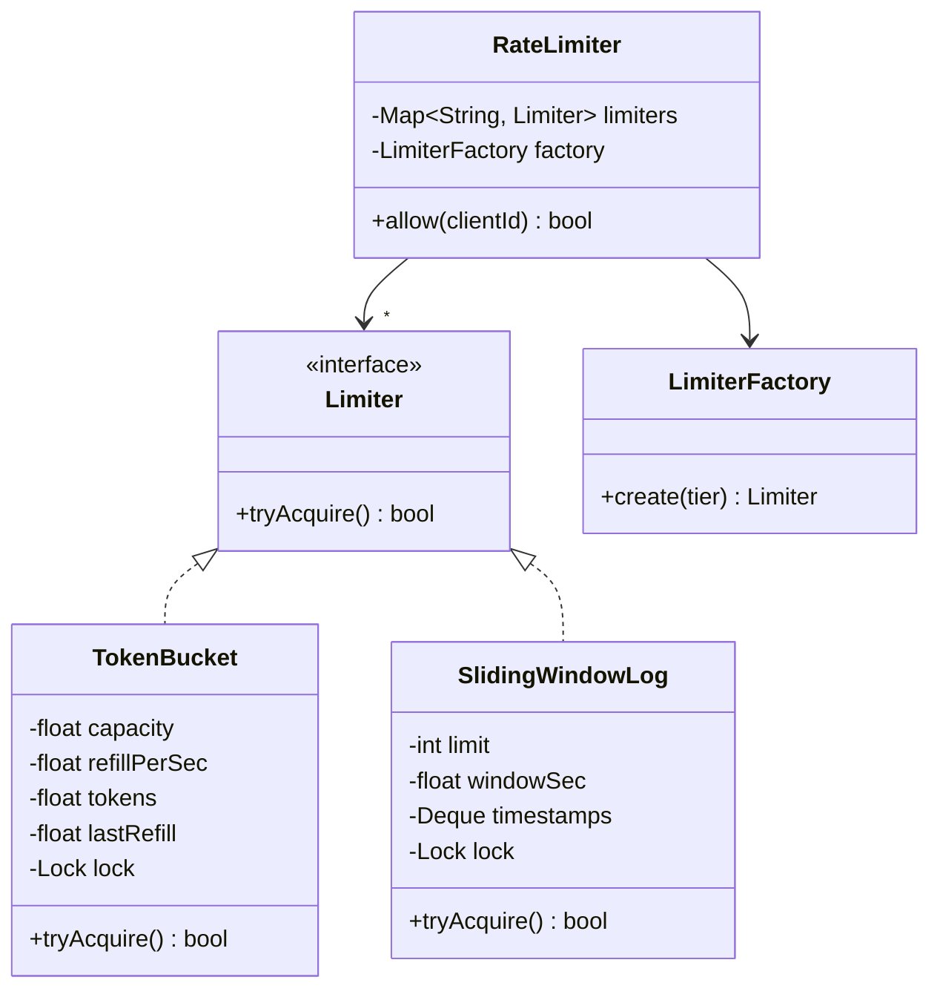

# LLD 07 · In-Memory Rate Limiter (class design)

## Requirements
- `allow(client_id) -> bool` for each incoming request.
- Configurable algorithm per rule: token bucket or sliding window.
- Different limits per client tier (free, pro).
- Thread safe; memory for inactive clients is reclaimed.

## Class diagram


## Code (Python)
```python
import threading, time
from collections import deque

class TokenBucket:
    def __init__(self, capacity, refill_per_sec):
        self.capacity, self.rate = capacity, refill_per_sec
        self.tokens, self.last = capacity, time.monotonic()
        self.lock = threading.Lock()

    def try_acquire(self):
        with self.lock:
            now = time.monotonic()
            self.tokens = min(self.capacity, self.tokens + (now - self.last) * self.rate)
            self.last = now
            if self.tokens >= 1:
                self.tokens -= 1
                return True
            return False

class SlidingWindowLog:
    def __init__(self, limit, window_sec):
        self.limit, self.window = limit, window_sec
        self.times, self.lock = deque(), threading.Lock()

    def try_acquire(self):
        with self.lock:
            now = time.monotonic()
            while self.times and self.times[0] <= now - self.window:
                self.times.popleft()
            if len(self.times) < self.limit:
                self.times.append(now)
                return True
            return False

class LimiterFactory:
    TIERS = {"free": lambda: TokenBucket(10, 1), "pro": lambda: TokenBucket(100, 20)}
    def create(self, tier):
        return self.TIERS[tier]()

class RateLimiter:
    def __init__(self, factory, tier_of):
        self.factory, self.tier_of = factory, tier_of
        self.limiters, self.lock = {}, threading.Lock()

    def allow(self, client_id):
        limiter = self.limiters.get(client_id)
        if limiter is None:
            with self.lock:                                  # create once per client
                limiter = self.limiters.setdefault(
                    client_id, self.factory.create(self.tier_of(client_id)))
        return limiter.try_acquire()
```

## Design decisions
- `Limiter` interface plus a **factory** keeps algorithms swappable per tier (Open/Closed principle).
- Lock per client limiter so different clients never contend; a short global lock only when creating a limiter.
- Use `time.monotonic()` so wall-clock changes don't break the math.
- Reclaim memory by evicting limiters not used for N minutes (an LRU map, see [LRU cache](03-lru-cache.md)).

## Follow-up questions
- Many servers? Move state to Redis with atomic Lua scripts. See the distributed [Rate limiter](../03-problems/01-rate-limiter.md).
- Return when the client can retry? Token bucket can compute `(1 - tokens) / rate` seconds.
