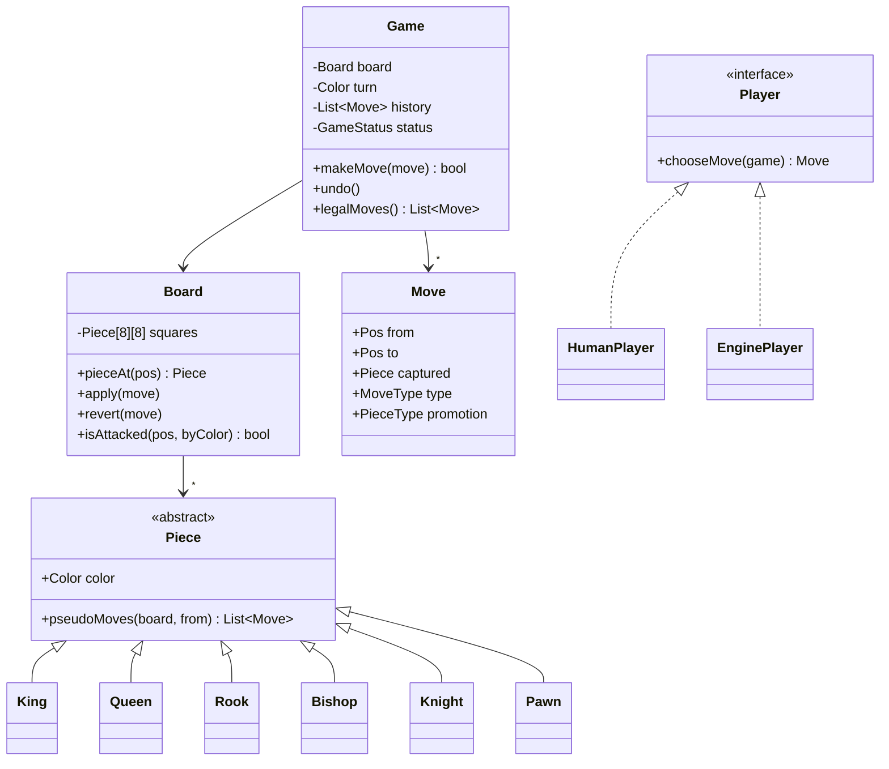

# LLD 08 · Chess Game

## Requirements
- Two players, standard board, all piece moves including castling, en passant and promotion.
- Detect check, checkmate, stalemate and common draws (50-move rule, threefold repetition, insufficient material).
- Keep players and their input (human, AI, network) **outside** the rules engine.
- Undo and move history.

## Class diagram


## Core idea: pseudo-legal moves, then filter
Each piece generates moves by its movement rules (pseudo-legal). A move is **legal** only if, after applying it, your own king is not attacked.

```python
class Game:
    def legal_moves(self):
        moves = []
        for frm, piece in self.board.pieces(self.turn):
            for mv in piece.pseudo_moves(self.board, frm):
                self.board.apply(mv)
                if not self.board.in_check(self.turn):
                    moves.append(mv)
                self.board.revert(mv)
        return moves + self.castling_moves()        # castling has its own conditions

    def make_move(self, mv):
        if mv not in self.legal_moves():
            return False
        self.board.apply(mv)
        self.history.append(mv)
        self.turn = self.turn.opposite()
        self.status = self.evaluate_status()
        return True

    def evaluate_status(self):
        if self.legal_moves():
            return Status.DRAW if self.is_draw() else Status.ACTIVE
        return Status.CHECKMATE if self.board.in_check(self.turn) else Status.STALEMATE
```

## Design decisions
- **Polymorphism** for pieces: each subclass knows how it moves; sliding pieces share a helper that walks in directions until blocked.
- **Move objects** store everything needed to undo (captured piece, previous castling rights, en passant square, halfmove clock), so `revert` is exact; this also gives the **Command** pattern for undo.
- **Players outside the rules:** `Game` never asks for input; a controller loop asks the current `Player` for a move and passes it to `Game.make_move`. The same engine serves local play, network play and AI.
- Special rules (castling rights, en passant) live in `Game`/`Board` state, not scattered in pieces.

## Follow-up questions
- Threefold repetition? Keep a count of position hashes (Zobrist hashing).
- Timed games? A `Clock` object per player, managed by the controller, not the rules engine.
- Online play? See [Online chess platform](../03-problems/73-online-chess.md).
