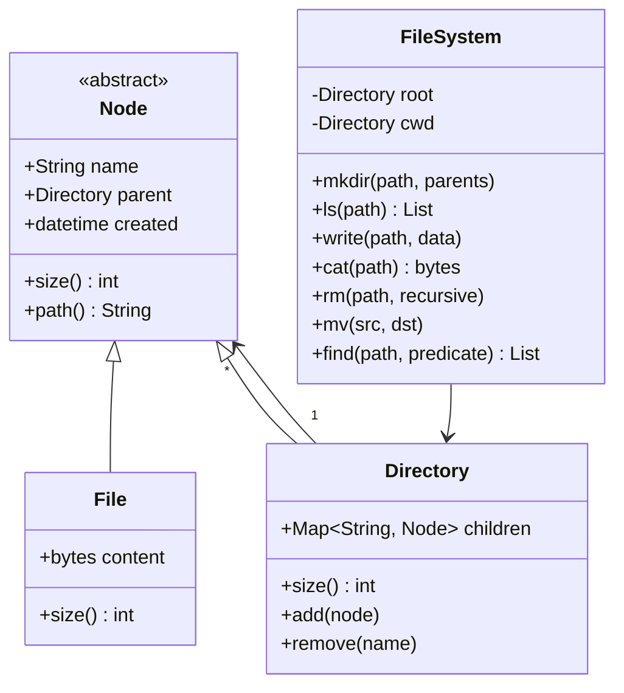

# LLD 09 · In-Memory File System

## Requirements
- Directories and files in a tree with absolute and relative paths.
- Commands: `mkdir -p`, `ls`, `cd`, `touch`, `write`, `cat`, `rm (-r)`, `mv`, `find` by name or size.
- Return clear errors (not found, already exists, not a directory).

## Class diagram (Composite pattern)


## Core code (Python)
```python
class Node:
    def __init__(self, name, parent=None):
        self.name, self.parent = name, parent
    def path(self):
        return "/" if self.parent is None else (self.parent.path().rstrip("/") + "/" + self.name)

class File(Node):
    def __init__(self, name, parent):
        super().__init__(name, parent); self.content = b""
    def size(self): return len(self.content)

class Directory(Node):
    def __init__(self, name, parent=None):
        super().__init__(name, parent); self.children = {}
    def size(self): return sum(c.size() for c in self.children.values())

class FileSystem:
    def __init__(self):
        self.root = Directory(""); self.cwd = self.root

    def _resolve(self, path, create_dirs=False):
        node = self.root if path.startswith("/") else self.cwd
        for part in [p for p in path.split("/") if p and p != "."]:
            if part == "..":
                node = node.parent or node; continue
            if not isinstance(node, Directory):
                raise NotADirectoryError(node.path())
            nxt = node.children.get(part)
            if nxt is None:
                if not create_dirs: raise FileNotFoundError(path)
                nxt = node.children[part] = Directory(part, node)
            node = nxt
        return node

    def mkdir(self, path, parents=False):
        parent_path, _, name = path.rstrip("/").rpartition("/")
        parent = self._resolve(parent_path or ("/" if path.startswith("/") else "."), create_dirs=parents)
        if name in parent.children: raise FileExistsError(path)
        parent.children[name] = Directory(name, parent)

    def write(self, path, data: bytes, append=False):
        parent_path, _, name = path.rpartition("/")
        parent = self._resolve(parent_path or ".")
        f = parent.children.get(name) or parent.children.setdefault(name, File(name, parent))
        if isinstance(f, Directory): raise IsADirectoryError(path)
        f.content = f.content + data if append else data

    def ls(self, path="."):
        node = self._resolve(path)
        return sorted(node.children) if isinstance(node, Directory) else [node.name]

    def find(self, path, predicate):
        out, stack = [], [self._resolve(path)]
        while stack:
            n = stack.pop()
            if predicate(n): out.append(n.path())
            if isinstance(n, Directory): stack.extend(n.children.values())
        return out
```

## Design decisions
- **Composite pattern:** files and directories share `Node`, so size, path and traversal work uniformly.
- Children in a hash map for O(1) lookup by name; `ls` sorts on output.
- `find` takes a **predicate** (Strategy): `lambda n: n.name.endswith(".log") and n.size() > 1_000_000`.
- Path resolution handles `.`, `..`, absolute and relative paths in one place.

## Follow-up questions
- Permissions and owners? Add metadata to `Node`, check in `FileSystem` operations.
- Large files? Store content as a list of fixed-size blocks.
- Concurrency? A read-write lock per directory, or one lock for simplicity in an interview.
