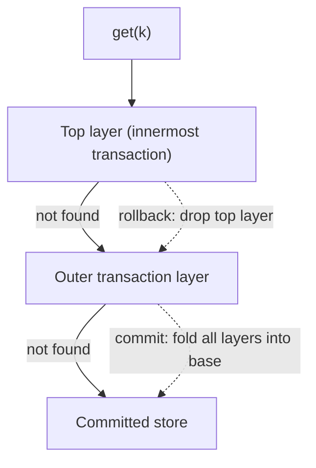

# LLD 10 · In-Memory Key-Value Store with Nested Transactions

A frequent coding-style interview question (OpenAI, Anthropic and others ask variants of it).

## Requirements
- `set(key, value)`, `get(key)`, `delete(key)`.
- Optional TTL: `set(key, value, ttl)` expires keys.
- Transactions: `begin()`, `commit()`, `rollback()`, and they can be **nested**. A rollback undoes only the innermost transaction; commit applies all open transactions.
- Reads inside a transaction see that transaction's uncommitted writes.

## Design: a stack of change layers

Each open transaction is a dictionary of changes (with a special DELETED marker). `get` looks from the top layer down to the base store.

## Code (Python)
```python
import time

_DELETED = object()

class KVStore:
    def __init__(self):
        self.base = {}                 # key -> (value, expires_at or None)
        self.layers = []               # stack of dicts for open transactions

    def _now(self): return time.monotonic()

    def _lookup(self, key):
        for layer in reversed(self.layers):
            if key in layer:
                return layer[key]
        return self.base.get(key)

    def get(self, key):
        entry = self._lookup(key)
        if entry is None or entry is _DELETED:
            return None
        value, exp = entry
        if exp is not None and exp <= self._now():
            return None
        return value

    def set(self, key, value, ttl=None):
        entry = (value, self._now() + ttl if ttl else None)
        if self.layers: self.layers[-1][key] = entry
        else: self.base[key] = entry

    def delete(self, key):
        if self.layers: self.layers[-1][key] = _DELETED
        else: self.base.pop(key, None)

    def begin(self):
        self.layers.append({})

    def rollback(self):
        if not self.layers: raise RuntimeError("NO TRANSACTION")
        self.layers.pop()

    def commit(self):
        if not self.layers: raise RuntimeError("NO TRANSACTION")
        for layer in self.layers:      # oldest to newest
            for k, v in layer.items():
                if v is _DELETED: self.base.pop(k, None)
                else: self.base[k] = v
        self.layers.clear()
```

## Example
```
set a 10
begin
  set a 20
  begin
    delete a
    get a        -> None
  rollback
  get a          -> 20
commit
get a            -> 20   (the outer transaction committed)
```

## Design decisions
- Layers make rollback O(size of that layer) and reads O(depth); depth is small in practice.
- A tombstone object distinguishes "deleted in this transaction" from "not touched".
- TTL is checked lazily on read; a background sweep can purge expired keys from the base.

## Follow-up questions
- `count(value)` (how many keys have this value) in O(1)? Maintain a value-to-count map in the base and per layer deltas.
- Commit only the innermost transaction into its parent (another common variant)? Merge the top layer into the layer below instead of into the base.
- Thread safety? A single lock around operations, or per-client transaction stacks (each client has its own layers, commits apply under a lock).
