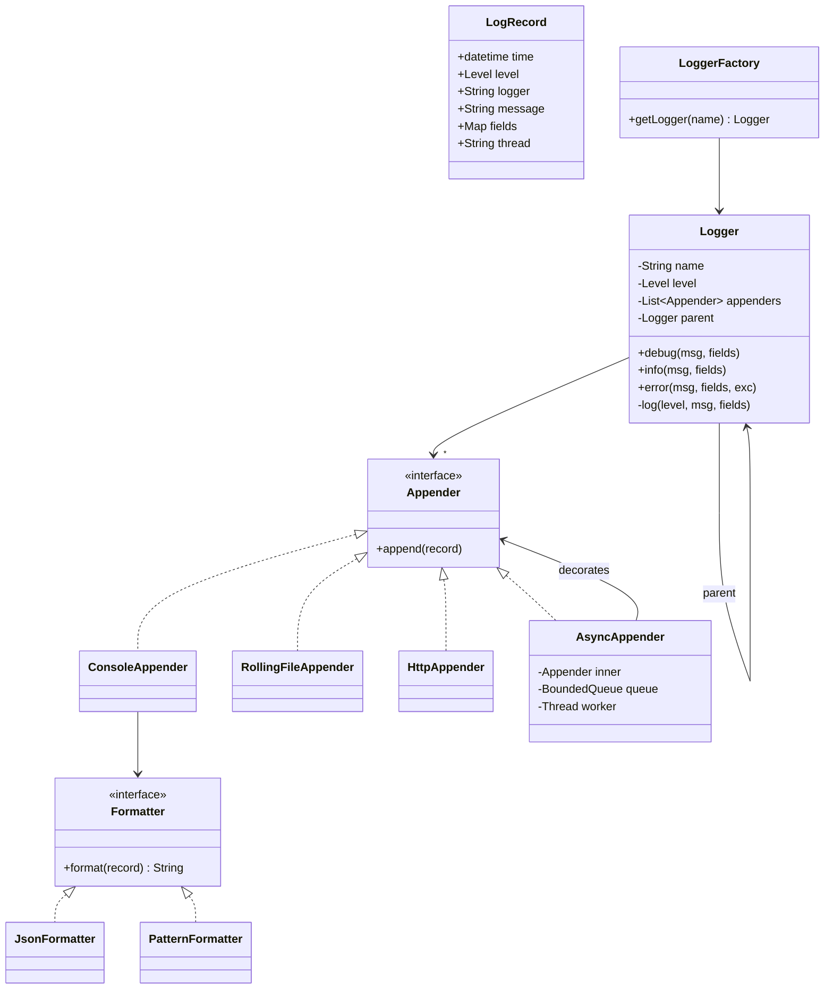

# LLD 11 · Logging Framework

## Requirements
- Log messages at levels (DEBUG, INFO, WARN, ERROR, FATAL) with a minimum level per logger.
- Pluggable **formatters** (plain text, JSON) and **sinks/appenders** (console, file with rotation, remote HTTP).
- Hierarchical loggers (`app.payments` inherits from `app`).
- Logging must never slow down or crash the caller: slow sinks run **asynchronously** with a bounded buffer.

## Class diagram


## Core code (Python)
```python
import threading, queue, json, time, sys
from enum import IntEnum

class Level(IntEnum):
    DEBUG = 10; INFO = 20; WARN = 30; ERROR = 40; FATAL = 50

class JsonFormatter:
    def format(self, r):
        return json.dumps({"ts": r["time"], "level": r["level"].name, "logger": r["logger"],
                           "msg": r["message"], **r["fields"]})

class ConsoleAppender:
    def __init__(self, formatter): self.formatter = formatter
    def append(self, record): sys.stdout.write(self.formatter.format(record) + "\n")

class AsyncAppender:
    """Decorator: moves slow I/O off the caller's thread, drops when the buffer is full."""
    def __init__(self, inner, capacity=10_000):
        self.inner, self.q, self.dropped = inner, queue.Queue(maxsize=capacity), 0
        threading.Thread(target=self._run, daemon=True).start()
    def append(self, record):
        try: self.q.put_nowait(record)
        except queue.Full: self.dropped += 1          # never block the request path
    def _run(self):
        while True:
            rec = self.q.get()
            try: self.inner.append(rec)
            except Exception: pass                    # a broken sink must not kill the worker

class Logger:
    def __init__(self, name, level=Level.INFO, appenders=None, parent=None):
        self.name, self.level, self.appenders, self.parent = name, level, appenders or [], parent
    def _log(self, level, msg, **fields):
        if level < self.level: return                 # cheap check first
        rec = {"time": time.time(), "level": level, "logger": self.name, "message": msg, "fields": fields}
        logger = self
        while logger:                                 # propagate up the hierarchy
            for a in logger.appenders: a.append(rec)
            logger = logger.parent
    def info(self, msg, **f): self._log(Level.INFO, msg, **f)
    def error(self, msg, **f): self._log(Level.ERROR, msg, **f)
```

## Design decisions
- **Strategy** for formatters, **Decorator** for async behaviour, **Factory/registry** for named loggers (one instance per name).
- Check the level **before** building the record, so disabled DEBUG logs cost almost nothing.
- Bounded queue with drop counting: when the disk or network is slow, drop logs rather than block requests or run out of memory (a form of [back-pressure](../01-fundamentals/29-back-pressure.md)).
- Appender errors are contained.

## Follow-up questions
- Never lose ERROR logs? Separate queue for errors, or block briefly for ERROR only.
- File rotation? `RollingFileAppender` checks size or date and renames files.
- Context like request IDs? Thread-local or context-variable fields merged into every record.
