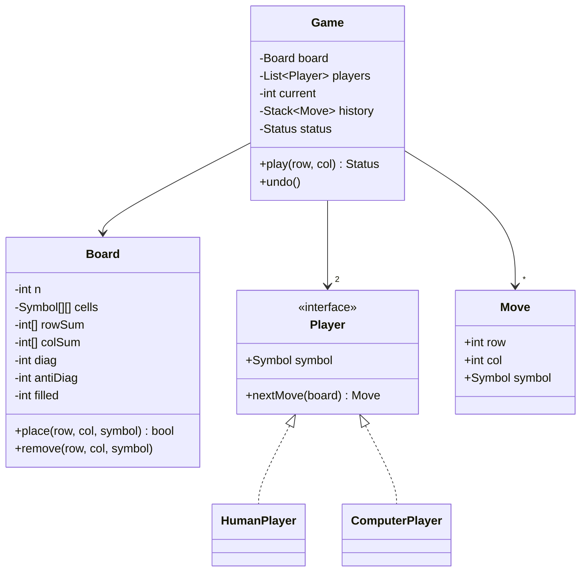

# LLD 12 · Tic-Tac-Toe (N x N)

## Requirements
- N x N board, two players (X and O), win by completing a row, column or diagonal.
- Detect win and draw in **O(1)** per move.
- Undo moves.
- Players can be human or computer.

## Class diagram


## O(1) win detection
Give X the value +1 and O the value -1. Keep running sums per row, per column and for the two diagonals. After placing at (r, c), a sum of +N or -N in that row, column or diagonal means someone just won.

```python
class Board:
    def __init__(self, n):
        self.n, self.cells = n, [[None] * n for _ in range(n)]
        self.rows, self.cols = [0] * n, [0] * n
        self.diag = self.anti = self.filled = 0

    def place(self, r, c, symbol):
        if self.cells[r][c] is not None:
            raise ValueError("Cell taken")
        v = 1 if symbol == "X" else -1
        self.cells[r][c] = symbol
        self._add(r, c, v)
        self.filled += 1
        n = self.n
        return n in (abs(self.rows[r]), abs(self.cols[c]),
                     abs(self.diag) if r == c else 0,
                     abs(self.anti) if r + c == n - 1 else 0)

    def remove(self, r, c):                      # for undo
        v = 1 if self.cells[r][c] == "X" else -1
        self.cells[r][c] = None
        self._add(r, c, -v)
        self.filled -= 1

    def _add(self, r, c, v):
        self.rows[r] += v; self.cols[c] += v
        if r == c: self.diag += v
        if r + c == self.n - 1: self.anti += v

    def full(self): return self.filled == self.n * self.n

class Game:
    def __init__(self, n, players):
        self.board, self.players, self.turn, self.history = Board(n), players, 0, []
        self.status = "IN_PROGRESS"

    def play(self, r, c):
        if self.status != "IN_PROGRESS": raise RuntimeError("Game over")
        sym = self.players[self.turn].symbol
        won = self.board.place(r, c, sym)
        self.history.append((r, c))
        self.status = f"{sym}_WINS" if won else ("DRAW" if self.board.full() else "IN_PROGRESS")
        self.turn ^= 1
        return self.status

    def undo(self):
        r, c = self.history.pop()
        self.board.remove(r, c)
        self.turn ^= 1
        self.status = "IN_PROGRESS"
```

## Design decisions
- Counters make every move O(1) instead of scanning the board (O(N)).
- `Player` interface separates input (keyboard, network, AI) from rules.
- Undo is a stack of moves; reversing updates the same counters.

## Follow-up questions
- Win with K in a row on an N x N board (K < N)? Counters no longer work; check the 4 directions around the last move, O(K).
- Computer player? Minimax with alpha-beta for 3x3; heuristics for larger boards.
- More than two players? Use one counter array per player instead of the +1/-1 trick.
